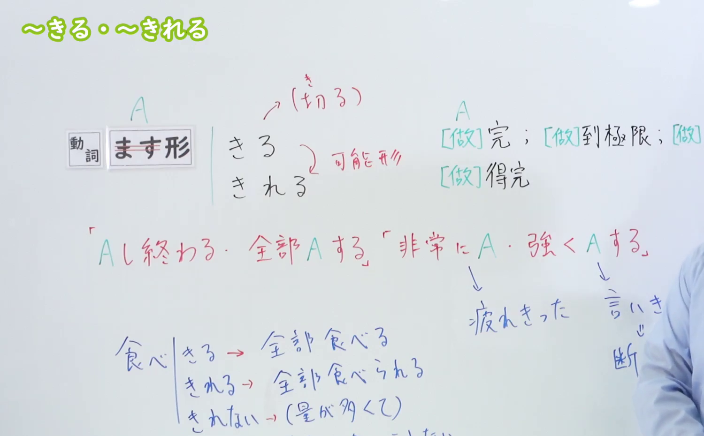
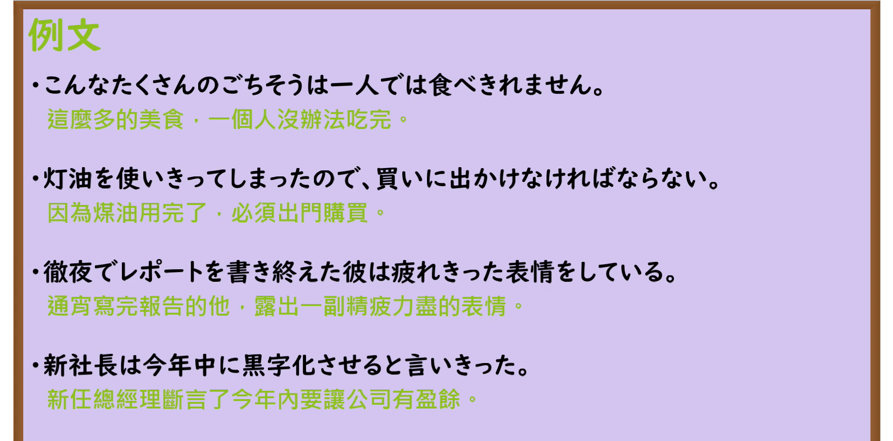

---
{
  "id": "N3-G-0012",
  "kind": "grammar",
  "level": "N3",
  "title": "〜きる／〜きれる／〜きれない（彻底做完／完全……／无法完全……）",
  "card_revision": 1,
  "schema_version": 1,
  "source": {
    "lesson": "N3 第12个语法",
    "material": "出口日語原视频板书、日语自动字幕与Hagoromo文型检索正文",
    "video": "https://www.youtube.com/watch?v=o0s4Wy88bVg",
    "screenshot": "assets/grammar/n3/N3-G-0012-connection.png",
    "screenshot_seconds": 260,
    "screenshot_crop": {
      "x": 0,
      "y": 0,
      "width": 1500,
      "height": 930
    }
  },
  "tags": [
    "きる",
    "きれる",
    "きれない",
    "切る",
    "N3"
  ],
  "confusions": [
    "おわる",
    "つくす"
  ]
}
---

# N3 第12个语法：〜きる／〜きれる／〜きれない

# 视频学习资料整理

本课讲解 N3 语法形式「〜きる／〜きれる／〜きれない（〜切る／〜切れる／〜切れない）」。

## 接续图（板书与讲解）

- 视频链接：[出口日語 N3 第12个语法](https://www.youtube.com/watch?v=o0s4Wy88bVg)
- 真实时间：04:20（260.00秒）
- 原图尺寸：1920×1080
- 裁切说明：选用 04:20 画面，此时板书已完整书写接续规则「動詞ます形（去掉ます）＋きる／きれる／きれない」，并清晰总结两大核心语义：①動作を最後までやり終える（最後まで全部～する）、②限界に達する（これ以上できない、非常に～だ），以及可能态「きれる」与否定态「きれない」的推导规则。固定左上角（0, 0），裁切区域为宽 1500、高 930，去除右侧人像与底部空白，完整保留全部板书。
- 图片：

## 例句图（视频例句）

- 视频链接：[出口日語 N3 第12个语法](https://www.youtube.com/watch?v=o0s4Wy88bVg)
- 真实时间：04:29（269.30秒）
- 原图尺寸：1920×1080
- 裁切说明：提取自视频 04:29 处的例句黑板页面。固定左上角（0, 0），裁切区域为宽 1920、高 950，裁去底部多余边框与杂物，完整保留四条例句及中文翻译。
- 图片：

# 核心

## 功能一：表示动作彻底做到最后、完全结束或达到极限（全部做完／完全……）

**最上位意味カテゴリー：**

- **Vきる：** 場所・時間（场所与时间）

**中位意味カテゴリー：**

- **Vきる：** 起点・終点（起点与终点）

**意味：**

- **Vきる：** 終了（结束、完成）

**くわしい意味記述：**

- **Vきる：** 「全部する」「最後までする」という意味を表す。（表示“全部做完”、“坚持做到最后”。其可能形式「〜きれる」表示能够全部完成，否定形式「〜きれない」表示动作过于庞大或繁重而无法彻底完成。）

**派生語：** Vきれる、Vきれない

### 例句

1. 電池を使い切る。

   （把电池的电量彻底用完。）

2. 家にある紅茶を、そろそろ全部飲みきりたい。

   （差不多想把家里存的红茶全部喝完了。）

3. 頼まれたら断り切れない性格なので、引き受けてしまった。

   （因为性格上一旦被拜托就难以彻底拒绝，所以还是答应了下来。）

4. 入りきらなかった荷物は別のバッグに入れる。

   （装不下的行李放到另一个包里。）

# 来源

- [出口日語原视频](https://www.youtube.com/watch?v=o0s4Wy88bVg)
- [Hagoromo 文型検索「Vきる」](https://hagoromo-text.work/lookup?vid=457)（查询日期：2026-09-25）
