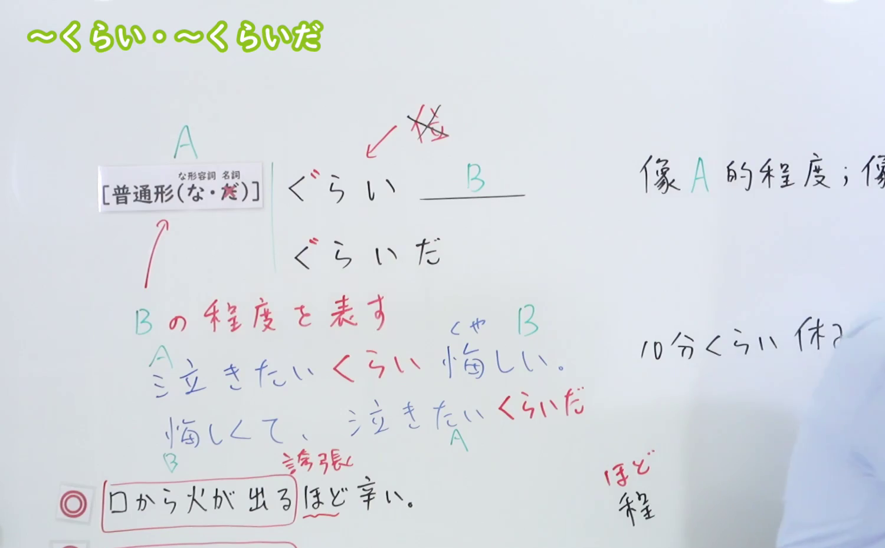
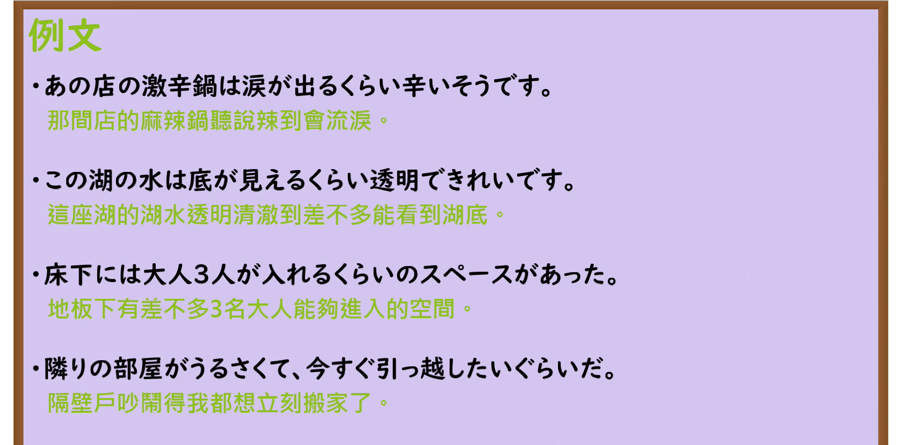

---
{
  "id": "N3-G-0013",
  "kind": "grammar",
  "level": "N3",
  "title": "〜くらい／〜ぐらい／〜くらいだ／〜ぐらいだ（达到……的程度／简直……）",
  "card_revision": 1,
  "schema_version": 1,
  "source": {
    "lesson": "N3 第13个语法",
    "material": "出口日語原视频板书、日语自动字幕与Hagoromo文型检索正文",
    "video": "https://www.youtube.com/watch?v=4fclthCjNsI",
    "screenshot": "assets/grammar/n3/N3-G-0013-connection.png",
    "screenshot_seconds": 310,
    "screenshot_crop": {
      "x": 0,
      "y": 0,
      "width": 1500,
      "height": 930
    }
  },
  "tags": [
    "くらい",
    "ぐらい",
    "くらいだ",
    "ぐらいだ",
    "N3"
  ],
  "confusions": [
    "ほど",
    "ばかり"
  ]
}
---

# N3 第13个语法：〜くらい／〜ぐらい／〜くらいだ／〜ぐらいだ

# 视频学习资料整理

本课讲解 N3 语法形式「〜くらい／〜ぐらい／〜くらいだ／〜ぐらいだ」。

## 接续图（板书与讲解）

- 视频链接：[出口日語 N3 第13个语法](https://www.youtube.com/watch?v=4fclthCjNsI)
- 真实时间：05:10（310.00秒）
- 原图尺寸：1920×1080
- 裁切说明：选用 05:10 画面，此时板书已完整书写普通形接续规则「普通形（なAな・N直接接）＋くらい／ぐらい／くらいだ／ぐらいだ」，并清晰归纳本课核心：①程度を表す（ある事態が他と同じ程度である）、②軽視・最低限を表す（これくらいのことはできる）、以及举例比喻的典型表现。固定左上角（0, 0），裁切区域为宽 1500、高 930，去除右侧人像与底部空白，完整保留全部板书。
- 图片：

## 例句图（视频例句）

- 视频链接：[出口日語 N3 第13个语法](https://www.youtube.com/watch?v=4fclthCjNsI)
- 真实时间：05:44（344.50秒）
- 原图尺寸：1920×1080
- 裁切说明：提取自视频 05:44 处的例句黑板页面。固定左上角（0, 0），裁切区域为宽 1920、高 950，裁去底部多余边框与杂物，完整保留四条例句及中文翻译。
- 图片：

# 核心

## 功能一：举出具体事例或比喻，表示状态或事态达到的程度（达到……的程度／简直……）

**最上位意味カテゴリー：**

- **くらいだ：** ものごとの様子（事物的状态样貌）

**中位意味カテゴリー：**

- **くらいだ：** 程度（程度）

**意味：**

- **くらいだ：** 程度（程度）

**くわしい意味記述：**

- **くらいだ：** ある出来事や状態が他のXと同じ程度であることを表す。「ぐらいだ」という言い方もある。（用于表达某种事件或状态达到了与举出的X同等夸张或显著的程度。多带有说话人的主观感叹色彩，常用于比喻。）

### 例句

1. 情けなくて、泣きたいくらいだ。

   （委屈窝囊得简直想要哭出来。）

2. 写真を白黒にしたいくらいだった。

   （颜色反差强烈得简直想把照片调成黑白的程度。）

3. 味覚の多様化、料理の多様化は、じつにオーブンと煮こみ鍋に支えられたといってもよいくらいである。

   （口味的多样化、料理的多样化，说是由烤箱与炖锅支撑起来的也不为过。）

4. 子供たちの婚礼でさえ出席したくなかったくらいだ。

   （心灰意冷到了甚至连孩子们自己的婚礼都不想出席的严重程度。）

# 来源

- [出口日語原视频](https://www.youtube.com/watch?v=4fclthCjNsI)
- [Hagoromo 文型検索「くらいだ」](https://hagoromo-text.work/lookup?vid=473)（查询日期：2026-09-25）
