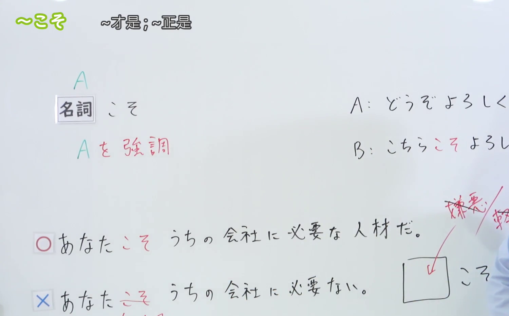
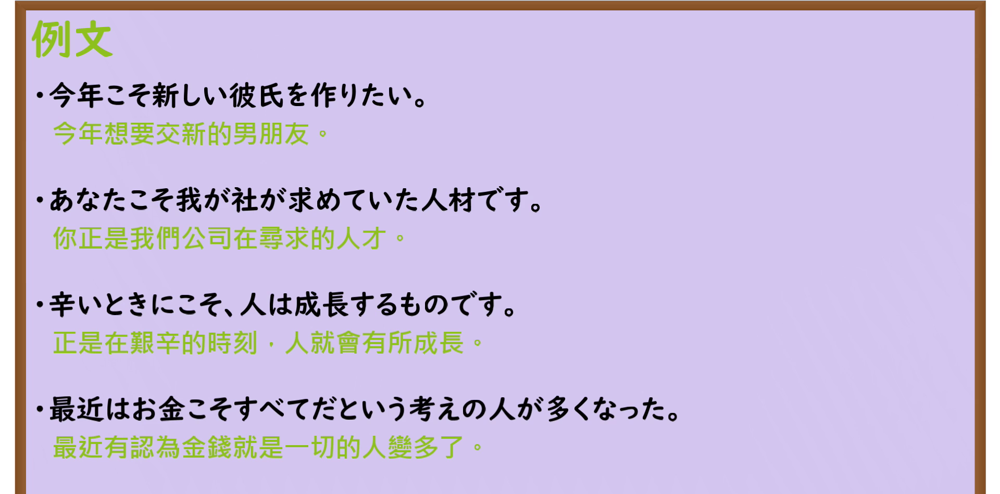

---
{
  "id": "N3-G-0014",
  "kind": "grammar",
  "level": "N3",
  "title": "〜こそ（正是……／唯有……才……）",
  "card_revision": 1,
  "schema_version": 1,
  "source": {
    "lesson": "N3 第14个语法",
    "material": "出口日語原视频板书、日语自动字幕与Hagoromo文型检索正文",
    "video": "https://www.youtube.com/watch?v=JHzM1doYlkQ",
    "screenshot": "assets/grammar/n3/N3-G-0014-connection.png",
    "screenshot_seconds": 180,
    "screenshot_crop": {
      "x": 0,
      "y": 0,
      "width": 1500,
      "height": 930
    }
  },
  "tags": [
    "こそ",
    "からこそ",
    "ばこそ",
    "N3"
  ],
  "confusions": [
    "さえ",
    "でも"
  ]
}
---

# N3 第14个语法：〜こそ

# 视频学习资料整理

本课讲解 N3 语法形式「〜こそ」。

## 接续图（板书与讲解）

- 视频链接：[出口日語 N3 第14个语法](https://www.youtube.com/watch?v=JHzM1doYlkQ)
- 真实时间：03:00（180.00秒）
- 原图尺寸：1920×1080
- 裁切说明：选用 03:00 画面，此时板书已完整书写接续规则「名詞（＋助詞）＋こそ」以及核心语义「強調：他のものではなく、これが大事である・まさにこれだ」，并列出「こちらこそよろしく」「今年こそ」「親だからこそ」等典型派生句型。固定左上角（0, 0），裁切区域为宽 1500、高 930，去除右侧人像与底部空白，完整保留全部板书。
- 图片：

## 例句图（视频例句）

- 视频链接：[出口日語 N3 第14个语法](https://www.youtube.com/watch?v=JHzM1doYlkQ)
- 真实时间：03:27（207.63秒）
- 原图尺寸：1920×1080
- 裁切说明：提取自视频 03:27 处的例句黑板页面。固定左上角（0, 0），裁切区域为宽 1920、高 950，裁去底部多余边框与杂物，完整保留四条例句及中文翻译。
- 图片：

# 核心

## 功能一：排他性强烈强调，突出非它莫属、正是如此（正是……／唯有……才……）

**最上位意味カテゴリー：**

- **こそ：** 考え・感情（思想与情感）

**中位意味カテゴリー：**

- **こそ：** 軽重の強調（轻重的强调）

**意味：**

- **こそ：** 程度の強調（程度与焦点强调）

**くわしい意味記述：**

- **こそ：** 前のものごとについて，「他のものではなく，これが大事である」という意味を加える表現。（针对前接的事物，赋予“不是其他别的，偏偏唯有这个才最重要/正是这个”的强烈肯定与排他性强调语义。）

### 例句

1. 今年こそ合格だ。

   （唯独今年一定要考上合格。）

2. こちらこそ、よろしくお願いいたします。

   （我这边才更需要请您多多关照。）

3. 筋トレこそ、1時間限度だよ。

   （正因为是肌肉力量训练，1小时才算是极限。）

4. そしてこの要素こそが、集団における個人の位置づけを決定する重要な要因となっている。

   （而这一要素，恰恰正是决定个人在集体中所处地位的关键因素。）

# 来源

- [出口日語原视频](https://www.youtube.com/watch?v=JHzM1doYlkQ)
- [Hagoromo 文型検索「こそ」](https://hagoromo-text.work/lookup?vid=500)（查询日期：2026-09-25）
