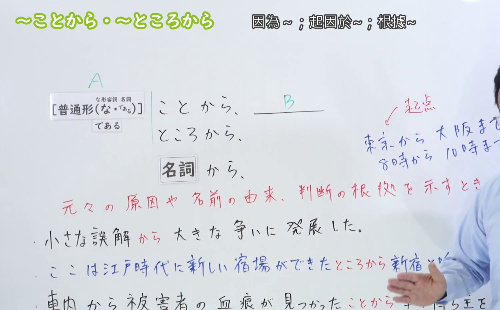
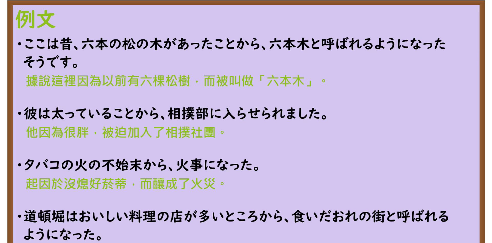

---
{
  "id": "N3-G-0015",
  "kind": "grammar",
  "level": "N3",
  "title": "〜ことから／〜ところから（由于……／从……由来）",
  "card_revision": 1,
  "schema_version": 1,
  "source": {
    "lesson": "N3 第15个语法",
    "material": "出口日語原视频板书、日语自动字幕与Hagoromo文型检索正文",
    "video": "https://www.youtube.com/watch?v=Z3ojJlz0yRw",
    "screenshot": "assets/grammar/n3/N3-G-0015-connection.png",
    "screenshot_seconds": 220,
    "screenshot_crop": {
      "x": 0,
      "y": 0,
      "width": 1500,
      "height": 930
    }
  },
  "tags": [
    "ことから",
    "ところから",
    "から",
    "N3"
  ],
  "confusions": [
    "からといって",
    "からには"
  ]
}
---

# N3 第15个语法：〜ことから／〜ところから

# 视频学习资料整理

本课讲解 N3 语法形式「〜ことから／〜ところから」。

## 接续图（板书与讲解）

- 视频链接：[出口日語 N3 第15个语法](https://www.youtube.com/watch?v=Z3ojJlz0yRw)
- 真实时间：03:40（220.00秒）
- 原图尺寸：1920×1080
- 裁切说明：选用 03:40 画面，此时板书已完整书写接续规则「普通形（なAな/である・Nである）＋ことから／ところから（或名词直接接から）」，以及三大核心用法：①名前の由来（名付けられた理由）、②判断の根拠（～から判断する）、③きっかけ（ある事実がきっかけで変化が生じる）。固定左上角（0, 0），裁切区域为宽 1500、高 930，去除右侧人像与底部空白，完整保留全部板书。
- 图片：

## 例句图（视频例句）

- 视频链接：[出口日語 N3 第15个语法](https://www.youtube.com/watch?v=Z3ojJlz0yRw)
- 真实时间：04:14（254.95秒）
- 原图尺寸：1920×1080
- 裁切说明：提取自视频 04:14 处的例句黑板页面。固定左上角（0, 0），裁切区域为宽 1920、高 950，裁去底部多余边框与杂物，完整保留四条例句及中文翻译。
- 图片：

# 核心

## 功能一：表示名称的由来、判断的依据或引发变化的契机（由于……／从……由来）

**最上位意味カテゴリー：**

- **ことから：** ものごとの関係（事物的关系）

**中位意味カテゴリー：**

- **ことから：** 原因・理由（原因与理由）

**意味：**

- **ことから：** 原因・理由（原因与理由、依据由来）

**くわしい意味記述：**

- **ことから：** Xが理由で。Xという由来から。物や地域がある名前で呼ばれるようになった理由や，何かを判断した理由・根拠について述べる時の表現。「Xという根拠・理由から，Yになった・Yと判断されている」という意味を表す。（用于说明事物或地区得名的由头、推断某种事态的客观依据，或是引发某种变化的直接契机。）

### 例句

1. この辺りは、野鳥が多いことから、環境保護地域になっている。

   （由于这一带野生鸟类众多，因而被划定为环境保护区。）

2. 技術がおくれているということから、つい他の部分も日本のほうがすぐれているのだと単純に思いやすい。

   （仅凭技术相对落后这一点，人们往往容易单纯地认为其他方面也是日本更优越。）

3. 以上のようなことから、日本では素材がひじょうに重視される。

   （基于上述客观理由，在日本料理中食材的新鲜本味自然受到极大的重视。）

4. 子供を守るという保護動作までも逆になっていることから推すと、物の考え方の根本が異なっているのではないか。

   （从连保护孩子的守护动作都完全相反这一事实推断，或许思考方式的根底原本就有所不同吧。）

# 来源

- [出口日語原视频](https://www.youtube.com/watch?v=Z3ojJlz0yRw)
- [Hagoromo 文型検索「ことから」](https://hagoromo-text.work/lookup?vid=508)（查询日期：2026-09-25）
