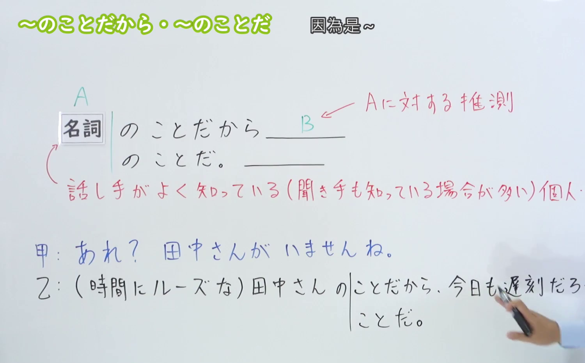
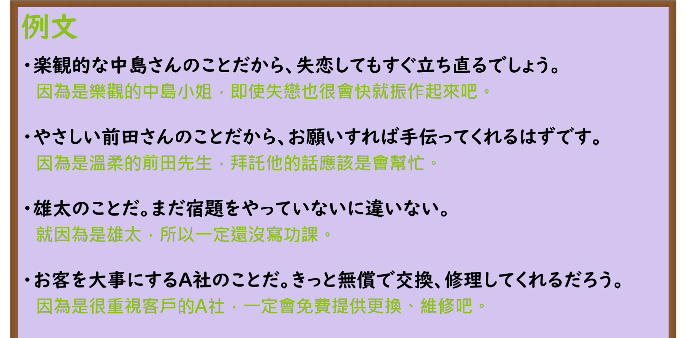

---
{
  "id": "N3-G-0016",
  "kind": "grammar",
  "level": "N3",
  "title": "〜ことだから／〜のことだから（正因为是……／凭……的为人性格推测必然……）",
  "card_revision": 1,
  "schema_version": 1,
  "source": {
    "lesson": "N3 第16个语法",
    "material": "出口日語原视频板书、日语自动字幕与Hagoromo文型检索正文",
    "video": "https://www.youtube.com/watch?v=VD7dMBQwc5M",
    "screenshot": "assets/grammar/n3/N3-G-0016-connection.png",
    "screenshot_seconds": 125,
    "screenshot_crop": {
      "x": 0,
      "y": 0,
      "width": 1500,
      "height": 930
    }
  },
  "tags": [
    "ことだから",
    "のことだから",
    "N3"
  ],
  "confusions": [
    "ことから",
    "ばかりに"
  ]
}
---

# N3 第16个语法：〜ことだから／〜のことだから

# 视频学习资料整理

本课讲解 N3 语法形式「〜ことだから／〜のことだから」。

## 接续图（板书与讲解）

- 视频链接：[出口日語 N3 第16个语法](https://www.youtube.com/watch?v=VD7dMBQwc5M)
- 真实时间：02:05（125.00秒）
- 原图尺寸：1920×1080
- 裁切说明：选用 02:05 画面，此时板书已完整书写接续规则「名詞（A：人や組織）＋のことだから」以及核心语义「Aに対する評価（性格・特徴）からB（推測・判断）を導く」，并强调说话人和听话人都熟知的对象才能用于此处。固定左上角（0, 0），裁切区域为宽 1500、高 930，去除右侧人像与底部空白，完整保留全部板书。
- 图片：

## 例句图（视频例句）

- 视频链接：[出口日語 N3 第16个语法](https://www.youtube.com/watch?v=VD7dMBQwc5M)
- 真实时间：02:55（175.13秒）
- 原图尺寸：1920×1080
- 裁切说明：提取自视频 02:55 处的例句黑板页面。固定左上角（0, 0），裁切区域为宽 1920、高 950，裁去底部多余边框与杂物，完整保留四条例句及中文翻译。
- 图片：

# 核心

## 功能一：以熟知人物或团体的性格特质为依据，推测其必然做出某种行为（正因为是……／凭……的为人性格推测必然……）

**最上位意味カテゴリー：**

- **ことだから：** ものごとの関係（事物的关系）

**中位意味カテゴリー：**

- **ことだから：** 原因・理由（原因与理由）

**意味：**

- **ことだから：** 原因・理由（依据人品特质推断理由）

**くわしい意味記述：**

- **ことだから：** ①話し手も聞き手もよく知っている人やものの名前を「Xのことだから」と例を挙げて，その人の特徴や性格から考えて，Yだろう・Yかもしれない・Yに違いないと判断するときに使う表現。（列举说话人和听话人都深为了解的人物或团体，根据其平时一贯的性格、作风与特点推断，后项通常接「〜だろう」「〜に違いない」等推测判断表达。）

### 例句

1. 朝寝坊のあの人のことだから、今日もきっと遅刻してくるにちがいない。

   （就凭那人爱睡懒觉的习惯，今天肯定又会迟到。）

2. 律儀な四ノ宮さんのことだから、料理を習い始めると本職なみの努力で「修業」を始めてしまうのではないかと思う。

   （依照四之宫先生一贯古板认真的为人，一旦开始学做料理，恐怕会以专业水准的劲头开始闭关“修行”吧。）

3. 真面目な彼のことだから、約束を破るはずがない。

   （凭他那么认真负责的人品，是绝不可能违背诺言的。）

4. 親切な彼女のことだから、困っている人を見たら放っておけないだろう。

   （正因为是热心肠的她，看到有困难的人想必是绝不会坐视不管的吧。）

# 来源

- [出口日語原视频](https://www.youtube.com/watch?v=VD7dMBQwc5M)
- [Hagoromo 文型検索「ことだから」](https://hagoromo-text.work/lookup?vid=514)（查询日期：2026-09-25）
