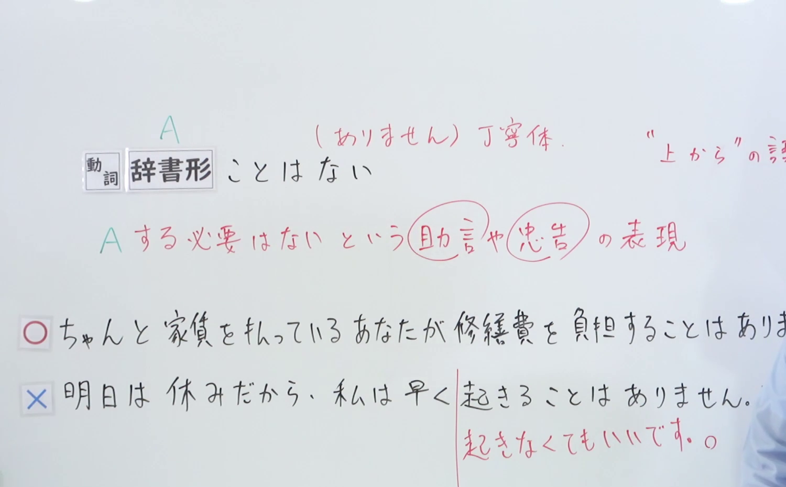
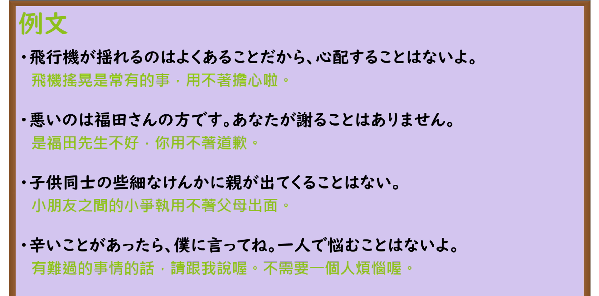

---
{
  "id": "N3-G-0017",
  "kind": "grammar",
  "level": "N3",
  "title": "〜ことはない（用不着……／没必要……）",
  "card_revision": 1,
  "schema_version": 1,
  "source": {
    "lesson": "N3 第17个语法",
    "material": "出口日語原视频板书、日语自动字幕与Hagoromo文型检索正文",
    "video": "https://www.youtube.com/watch?v=a3HFygHO3XU",
    "screenshot": "assets/grammar/n3/N3-G-0017-connection.png",
    "screenshot_seconds": 200,
    "screenshot_crop": {
      "x": 0,
      "y": 0,
      "width": 1500,
      "height": 930
    }
  },
  "tags": [
    "ことはない",
    "こともない",
    "N3"
  ],
  "confusions": [
    "ないことはない",
    "わけではない"
  ]
}
---

# N3 第17个语法：〜ことはない

# 视频学习资料整理

本课讲解 N3 语法形式「〜ことはない」。

## 接续图（板书与讲解）

- 视频链接：[出口日語 N3 第17个语法](https://www.youtube.com/watch?v=a3HFygHO3XU)
- 真实时间：03:20（200.00秒）
- 原图尺寸：1920×1080
- 裁切说明：选用 03:20 画面，此时板书已完整书写接续规则「動詞辞書形＋ことはない」以及核心语义「〜する必要はない（助言・忠告の表現）」；出口老师在此特别提醒学习者：该句型多用于向对方提供建议、劝慰或忠告，语气上带有说话人向对方表述“用不着如此多虑或白费力气”的从容感。固定左上角（0, 0），裁切区域为宽 1500、高 930，去除右侧人像与底部空白，完整保留全部板书。
- 图片：

## 例句图（视频例句）

- 视频链接：[出口日語 N3 第17个语法](https://www.youtube.com/watch?v=a3HFygHO3XU)
- 真实时间：03:37（217.45秒）
- 原图尺寸：1920×1080
- 裁切说明：提取自视频 03:37 处的例句黑板页面。固定左上角（0, 0），裁切区域为宽 1920、高 950，裁去底部多余边框与杂物，完整保留四条例句及中文翻译。
- 图片：

# 核心

## 功能一：向对方提出劝告或开导，表示没有必要做某事（用不着……／没必要……）

**最上位意味カテゴリー：**

- **ことはない：** 考え・感情（思想与情感）

**中位意味カテゴリー：**

- **ことはない：** 助言・忠告（建议与劝告）

**意味：**

- **ことはない：** 主張（主张、劝告）

**くわしい意味記述：**

- **ことはない：** 何かを心配している人に対して，心配しなくていいことを伝える表現。「〜する必要はない」という意味を表す。（用于安慰或建议正感到不安、焦虑或犹豫的人，传达“完全没有必要特意去做/不必为此操心”的意思。）

### 例句

1. 君が行くことはない。僕が代わりに行ってくるよ。

   （你用不着亲自跑一趟，我替你去就行了。）

2. 代表だけが出席すれば十分だ。部下がみんな出席することもない。

   （只要代表出席就足够了，部下完全没有全员出席的必要。）

3. 別に、そんなに心配することはないわ。

   （并没有什么大不了的，用不着那么提心吊胆啦。）

4. 時間がまだ十分にあるから、そんなに急ぐことはない。

   （时间还非常充裕，用不着这么急急忙忙的。）

# 来源

- [出口日語原视频](https://www.youtube.com/watch?v=a3HFygHO3XU)
- [Hagoromo 文型検索「ことはない」](https://hagoromo-text.work/lookup?vid=531)（查询日期：2026-09-25）
