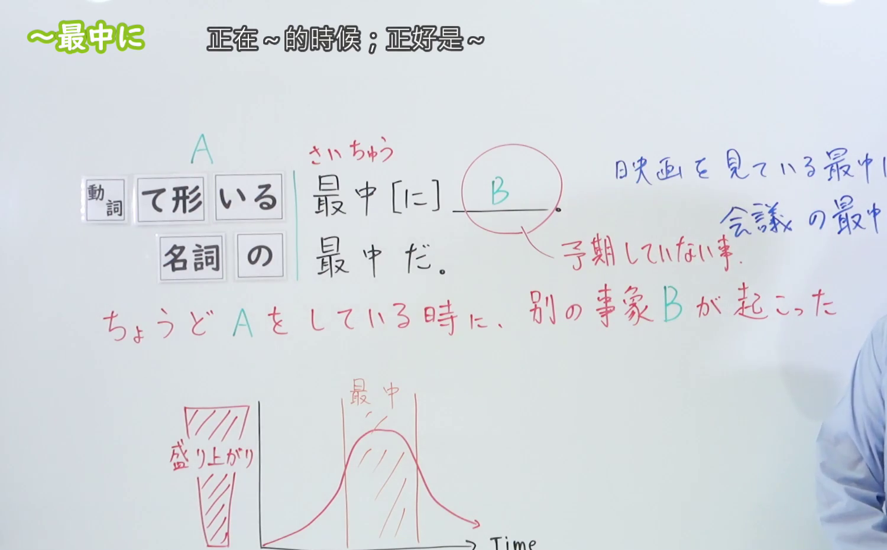
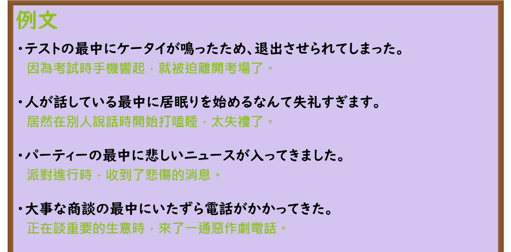

---
{
  "id": "N3-G-0018",
  "kind": "grammar",
  "level": "N3",
  "title": "〜さいちゅうに／〜最中に（正当……的时候／偏偏在……顶峰时刻）",
  "card_revision": 1,
  "schema_version": 1,
  "source": {
    "lesson": "N3 第18个语法",
    "material": "出口日語原视频板书、日语自动字幕与Hagoromo文型检索正文",
    "video": "https://www.youtube.com/watch?v=kJyfoMwPGgc",
    "screenshot": "assets/grammar/n3/N3-G-0018-connection.png",
    "screenshot_seconds": 195,
    "screenshot_crop": {
      "x": 0,
      "y": 0,
      "width": 1500,
      "height": 930
    }
  },
  "tags": [
    "さいちゅうに",
    "最中に",
    "最中だ",
    "N3"
  ],
  "confusions": [
    "うちに",
    "あいだに"
  ]
}
---

# N3 第18个语法：〜さいちゅうに／〜最中に

# 视频学习资料整理

本课讲解 N3 语法形式「〜さいちゅうに／〜最中に（〜最中だ）」。

## 接续图（板书与讲解）

- 视频链接：[出口日語 N3 第18个语法](https://www.youtube.com/watch?v=kJyfoMwPGgc)
- 真实时间：03:15（195.00秒）
- 原图尺寸：1920×1080
- 裁切说明：选用 03:15 画面，此时板书已完整书写接续规则「動詞ている形＋最中に／名詞の＋最中に」，并深刻剖析其核心语义：不仅表示某个持续性动作正在进行，更特指在动作进行得最起劲、最不可打扰的“峰值时刻”，突然发生了打扰或阻碍前项动作的意外事件（後件には予想外・邪魔になる事態が起こる）。固定左上角（0, 0），裁切区域为宽 1500、高 930，去除右侧人像与底部空白，完整保留全部板书。
- 图片：

## 例句图（视频例句）

- 视频链接：[出口日語 N3 第18个语法](https://www.youtube.com/watch?v=kJyfoMwPGgc)
- 真实时间：03:28（208.73秒）
- 原图尺寸：1920×1080
- 裁切说明：提取自视频 03:28 处的例句黑板页面。固定左上角（0, 0），裁切区域为宽 1920、高 950，裁去底部多余边框与杂物，完整保留四条例句及中文翻译。
- 图片：

# 核心

## 功能一：表示正处于动作行为的核心高潮时刻，偏偏遭遇意外事件打扰（正当……的时候／偏偏在……顶峰时刻）

**最上位意味カテゴリー：**

- **さいちゅうだ：** 場所・時間（场所与时间）

**中位意味カテゴリー：**

- **さいちゅうだ：** 時点・場面（时间点与场面）

**意味：**

- **さいちゅうだ：** 範囲（期间、正在……最起劲时）

**くわしい意味記述：**

- **さいちゅうだ：** ある動作が継続しているときを表す。（表示某项动作正在持续热烈进行的最核心阶段。后项接续「〜に」时，多表示偏偏在此时发生了出乎预料、造成妨碍或干扰的偶发事态。）

### 例句

1. 今検討している最中だ。

   （目前正在紧锣密鼓地研讨当中。）

2. 部長の発言の最中に、彼は突然立ち上がった。

   （正当部长发言讲到关键处时，他突然站了起来。）

3. 建設している最中の大事故で、建設計画そのものが中止になった。

   （正在施工如火如荼之际发生了一起重大事故，导致整个建设计划被迫终止。）

4. 大切な書類を探している最中に、電話がかかってきた。

   （偏偏在焦头烂额翻找重要文件的时候，电话响了起来。）

# 来源

- [出口日語原视频](https://www.youtube.com/watch?v=kJyfoMwPGgc)
- [Hagoromo 文型検索「さいちゅうだ」](https://hagoromo-text.work/lookup?vid=546)（查询日期：2026-09-25）
