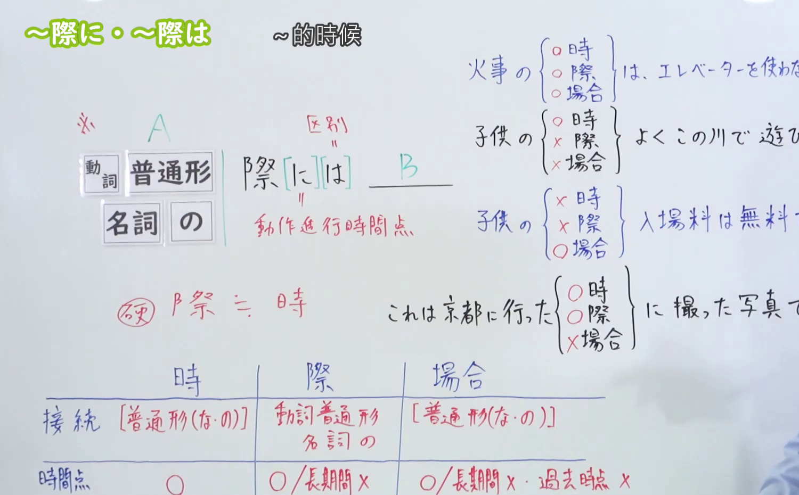
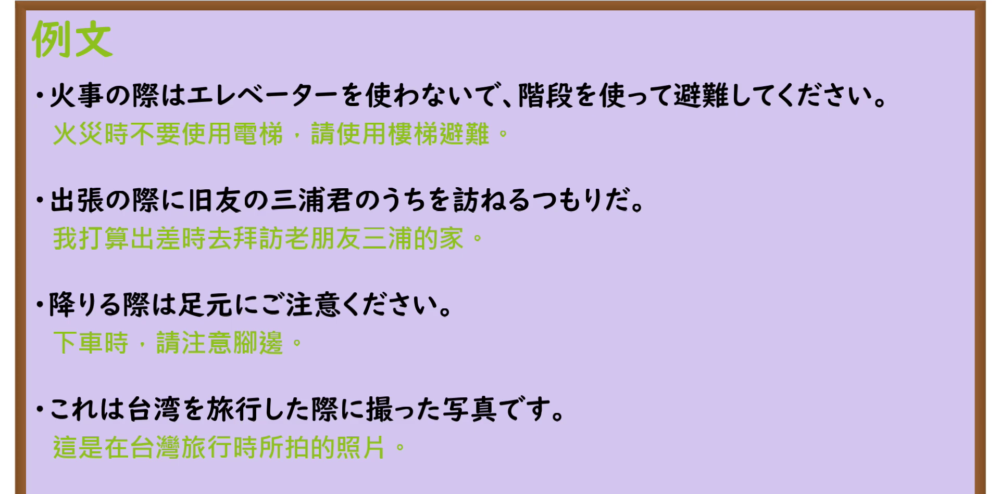

---
{
  "id": "N3-G-0019",
  "kind": "grammar",
  "level": "N3",
  "title": "〜さいに／〜際に（在……之际／当……的时候）",
  "card_revision": 1,
  "schema_version": 1,
  "source": {
    "lesson": "N3 第19个语法",
    "material": "出口日語原视频板书、日语自动字幕与Hagoromo文型检索正文",
    "video": "https://www.youtube.com/watch?v=K_ZT2Nsrbys",
    "screenshot": "assets/grammar/n3/N3-G-0019-connection.png",
    "screenshot_seconds": 495,
    "screenshot_crop": {
      "x": 0,
      "y": 0,
      "width": 1500,
      "height": 930
    }
  },
  "tags": [
    "さいに",
    "際に",
    "際",
    "際は",
    "N3"
  ],
  "confusions": [
    "ときに",
    "にあたって"
  ]
}
---

# N3 第19个语法：〜さいに／〜際に

# 视频学习资料整理

本课讲解 N3 语法形式「〜さいに／〜際に（〜際／〜際は）」。

## 接续图（板书与讲解）

- 视频链接：[出口日語 N3 第19个语法](https://www.youtube.com/watch?v=K_ZT2Nsrbys)
- 真实时间：08:15（495.00秒）
- 原图尺寸：1920×1080
- 裁切说明：选用 08:15 画面，此时板书已完整书写接续规则「動詞辞書形／動詞た形／名詞の＋際（に／は）」以及核心语义「〜の時（フォーマルな場面で使う硬い表現）」；出口老师在此特别对比了日常口语「〜とき」与书面郑重场合「〜際（に）」的语域区别，并详细说明了「際は」（提示焦点或条件假定）与「際に」（提示特定时间点场合）的用法细微差别。固定左上角（0, 0），裁切区域为宽 1500、高 930，去除右侧人像与底部空白，完整保留全部板书。
- 图片：

## 例句图（视频例句）

- 视频链接：[出口日語 N3 第19个语法](https://www.youtube.com/watch?v=K_ZT2Nsrbys)
- 真实时间：08:41（521.75秒）
- 原图尺寸：1920×1080
- 裁切说明：提取自视频 08:41 处的例句黑板页面。固定左上角（0, 0），裁切区域为宽 1920、高 950，裁去底部多余边框与杂物，完整保留四条例句及中文翻译。
- 图片：

# 核心

## 功能一：在正式或郑重场合表示“在……的时候、在……之际”（在……之际／当……的时候）

**最上位意味カテゴリー：**

- **さい（に）：** 場所・時間（场所与时间）

**中位意味カテゴリー：**

- **さい（に）：** 時点・場面（时间点与场面）

**意味：**

- **さい（に）：** 場面・場合（场面与场合）

**くわしい意味記述：**

- **さい（に）：** 「〜とき」と同じ意味。「とき」よりやや硬い表現。（与口语表达「〜とき」意思相同，多用于业务通知、礼仪公文、演讲或正式商务谈话等郑重语域中，表示在特定场合或时机采取相应行动。）

**派生語：** さい，さいに，さいは

### 例句

1. 首相はヨーロッパを訪問する際に、各国で会談を行う。

   （首相在访问欧洲之际，将与各国首脑举行会谈。）

2. お近くにお出掛けの際は、ぜひお立ち寄りください。

   （外出到附近来的时候，请务必顺道过来坐坐。）

3. お帰りの際にこちらの札をレジまでお持ちください。

   （离开时请将此卡牌带至收银台结账。）

4. 小説を手にする際には、いくぶん気をつけて読んできた。

   （每当翻阅拿起小说来读的时候，我都有意识地留意字里行间的细致描写。）

# 来源

- [出口日語原视频](https://www.youtube.com/watch?v=K_ZT2Nsrbys)
- [Hagoromo 文型検索「さい（に）」](https://hagoromo-text.work/lookup?vid=548)（查询日期：2026-09-25）
