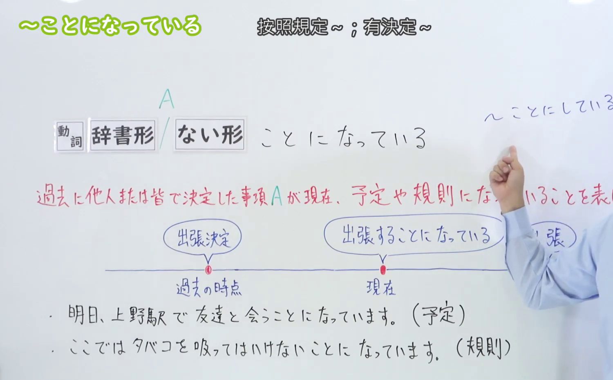
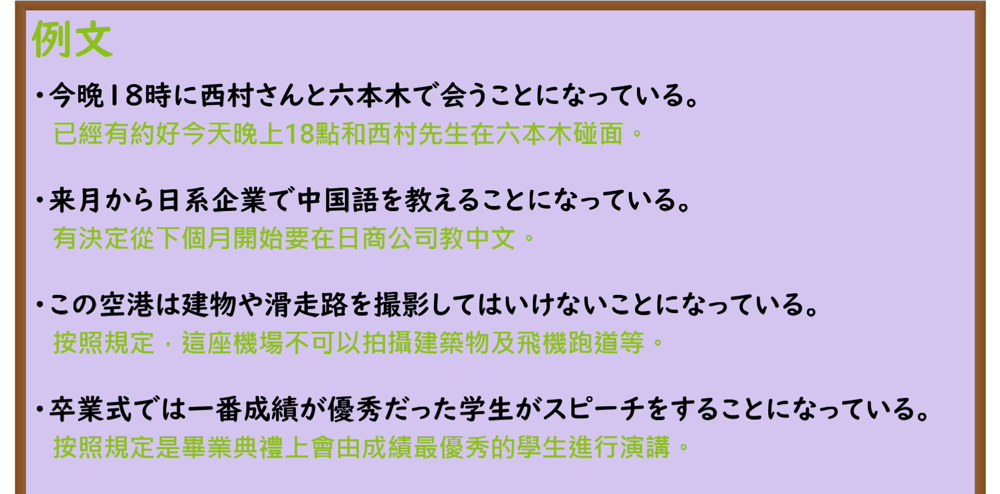

---
{
  "id": "N3-G-0020",
  "kind": "grammar",
  "level": "N3",
  "title": "〜ことになっている（规定为……／预定……）",
  "card_revision": 1,
  "schema_version": 1,
  "source": {
    "lesson": "N3 第20个语法",
    "material": "出口日語原视频板书、日语自动字幕与Hagoromo文型检索正文",
    "video": "https://www.youtube.com/watch?v=2UJIC9WSPjQ",
    "screenshot": "assets/grammar/n3/N3-G-0020-connection.png",
    "screenshot_seconds": 180,
    "screenshot_crop": {
      "x": 0,
      "y": 0,
      "width": 1500,
      "height": 930
    }
  },
  "tags": [
    "ことになっている",
    "ことになってる",
    "N3"
  ],
  "confusions": [
    "ことにしている",
    "ことになった"
  ]
}
---

# N3 第20个语法：〜ことになっている

# 视频学习资料整理

本课讲解 N3 语法形式「〜ことになっている」。

## 接续图（板书与讲解）

- 视频链接：[出口日語 N3 第20个语法](https://www.youtube.com/watch?v=2UJIC9WSPjQ)
- 真实时间：03:00（180.00秒）
- 原图尺寸：1920×1080
- 裁切说明：选用 03:00 画面，此时板书已完整书写接续规则「動詞辞書形／動詞ない形＋ことになっている」，并清晰剖析核心语义「過去に他人または皆で決定した事項が、現在予定や規則・習慣になっていることを表す」；出口老师在此特别强调：与表示个人主观决定的「〜ことにしている」不同，本句型侧重客观既定的社会规则、法律团体规章或他人安排好的日程约定。固定左上角（0, 0），裁切区域为宽 1500、高 930，去除右侧人像与底部空白，完整保留全部板书。
- 图片：

## 例句图（视频例句）

- 视频链接：[出口日語 N3 第20个语法](https://www.youtube.com/watch?v=2UJIC9WSPjQ)
- 真实时间：03:27（207.90秒）
- 原图尺寸：1920×1080
- 裁切说明：提取自视频 03:27 处的例句黑板页面。固定左上角（0, 0），裁切区域为宽 1920、高 950，裁去底部多余边框与杂物，完整保留四条例句及中文翻译。
- 图片：

# 核心

## 功能一：表示团体规章、法律制度、客观约定或固定习惯（规定为……／预定……）

**最上位意味カテゴリー：**

- **ことになっている：** モダリティ（情态与语气）

**中位意味カテゴリー：**

- **ことになっている：** 状況可能（情势与境况）

**意味：**

- **ことになっている：** 結末（既定规约、制度规定）

**くわしい意味記述：**

- **ことになっている：** 「何らかの規則や決まりで〜になっている」の意味。過去に他人またはみんなで決定した事項が，現在予定や規則になっていることを表す。（表示过去由集体、组织、他人商定或由法律习俗制定下的事项，在当前作为既定的日程安排、规则规范或惯例在持续发挥效力。）

### 例句

1. 授業は４月７日から始めることになっている。

   （按学校日程规定，新学期的课程预定于4月7日正式开始。）

2. 法律では、20歳未満の飲酒や喫煙は禁止されることになっている。

   （按法律明文规定，未满20岁者严禁饮酒与吸烟。）

3. 今日あんたに会うことになっているんだけど、どうしても自分じゃいけないから。

   （本来按计划今天是要和你见面的，但我这边无论如何实在脱不开身。）

4. 憲法第九六条では、国民の承認が得られたときは、天皇は国民の名で公布することになっている。

   （宪法第96条规定，在获得国民承认之时，天皇当以国民的名义予以公布。）

# 来源

- [出口日語原视频](https://www.youtube.com/watch?v=2UJIC9WSPjQ)
- [Hagoromo 文型検索「ことになっている」](https://hagoromo-text.work/lookup?vid=527)（查询日期：2026-09-25）
