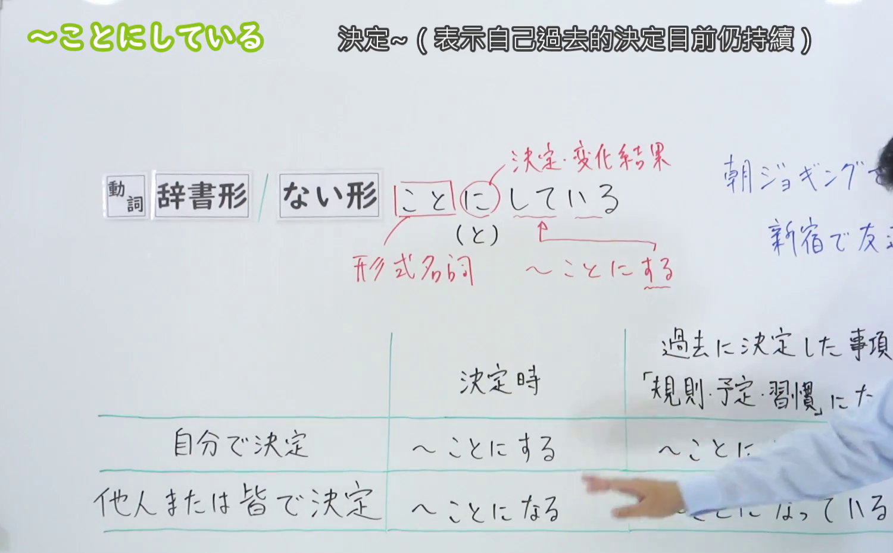
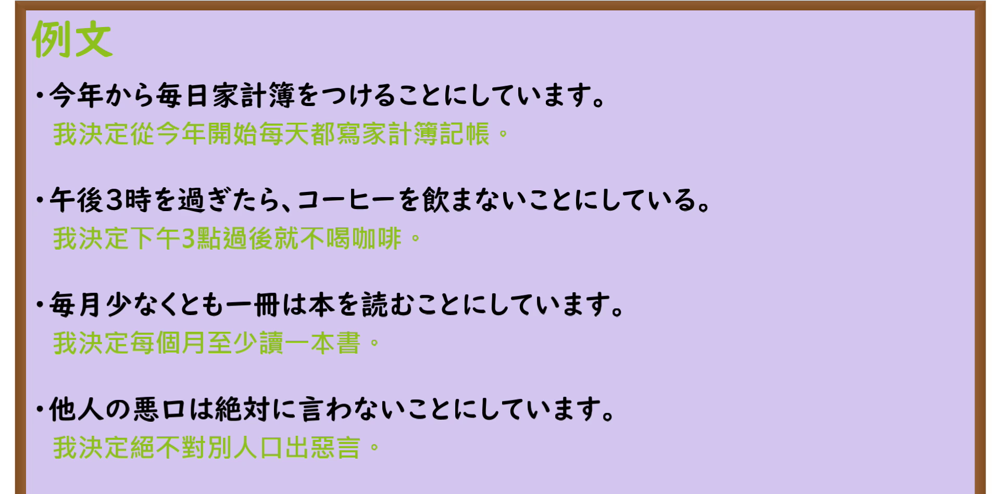

---
{
  "id": "N3-G-0021",
  "kind": "grammar",
  "level": "N3",
  "title": "〜ことにしている（坚持……／一直保持……的习惯）",
  "card_revision": 1,
  "schema_version": 1,
  "source": {
    "lesson": "N3 第21个语法",
    "material": "出口日語原视频板书、日语自动字幕与Hagoromo文型检索正文",
    "video": "https://www.youtube.com/watch?v=D7X3CChxptY",
    "screenshot": "assets/grammar/n3/N3-G-0021-connection.png",
    "screenshot_seconds": 265,
    "screenshot_crop": {
      "x": 0,
      "y": 0,
      "width": 1500,
      "height": 930
    }
  },
  "tags": [
    "ことにしている",
    "ことにしてる",
    "N3"
  ],
  "confusions": [
    "ことになっている",
    "ことにした"
  ]
}
---

# N3 第21个语法：〜ことにしている

# 视频学习资料整理

本课讲解 N3 语法形式「〜ことにしている」。

## 接续图（板书与讲解）

- 视频链接：[出口日語 N3 第21个语法](https://www.youtube.com/watch?v=D7X3CChxptY)
- 真实时间：04:25（265.00秒）
- 原图尺寸：1920×1080
- 裁切说明：选用 04:25 画面，此时板书已完整书写接续规则「動詞辞書形／動詞ない形＋ことにしている」以及核心语义「自分で決めたルールや習慣を今まで継続している」；出口老师在板书中特别强调形式名词「こと」搭配格助词「に」与进行态「している」，突出这是出自本人主动意志的坚持，并与第20课由外界规章决定的「〜ことになっている」形成明确对比。固定左上角（0, 0），裁切区域为宽 1500、高 930，去除右侧人像与底部空白，完整保留全部板书。
- 图片：

## 例句图（视频例句）

- 视频链接：[出口日語 N3 第21个语法](https://www.youtube.com/watch?v=D7X3CChxptY)
- 真实时间：04:41（281.02秒）
- 原图尺寸：1920×1080
- 裁切说明：提取自视频 04:41 处的例句黑板页面。固定左上角（0, 0），裁切区域为宽 1920、高 950，裁去底部多余边框与杂物，完整保留四条例句及中文翻译。
- 图片：

# 核心

## 功能一：表示个人出于自身意志做出的决定并一直自觉坚持践行的日常习惯（坚持……／一直保持……的习惯）

**最上位意味カテゴリー：**

- **ことにしている：** 考え・感情（思想与情感）

**中位意味カテゴリー：**

- **ことにしている：** 主張・断定的評価（主张与决意评价）

**意味：**

- **ことにしている：** 決定（自主决定并坚持的习惯）

**くわしい意味記述：**

- **ことにしている：** 「〜する習慣がある」という意味。過去に，「〜する」と決めて，今までその習慣を継続しているという意味。（表示过去由自己主动下定决心，并将该决定作为个人行动准则或日常习惯持续坚持至今。）

### 例句

1. 毎日必ず日記を付けることにしている。

   （我一直坚持每天必定写日记的习惯。）

2. 健康のために、毎朝ジョギングをすることにしている。

   （为了保持健康，我一直坚持每天早晨慢跑。）

3. もし箸が使えなかったらフォークを出して上げることにしている。

   （如果客人不会用筷子，我通常都会主动为他们拿叉子。）

4. 外国人学生にいい意味でも決して差別しないような指導をすることにしている。

   （在指导学生时，我一贯坚持无论在何种意义上都绝不对外国留学生施加差别对待。）

# 来源

- [出口日語原视频](https://www.youtube.com/watch?v=D7X3CChxptY)
- [Hagoromo 文型検索「ことにしている」](https://hagoromo-text.work/lookup?vid=524)（查询日期：2026-09-25）
