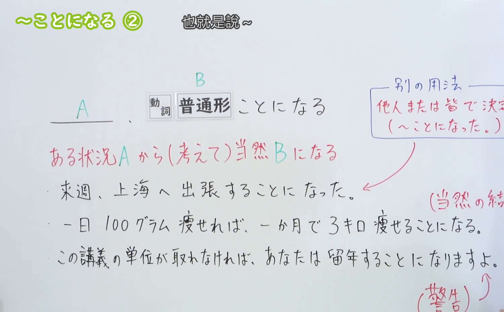
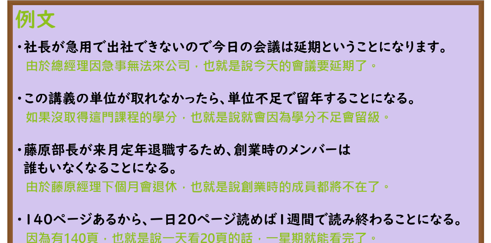

---
{
  "id": "N3-G-0022",
  "kind": "grammar",
  "level": "N3",
  "title": "〜ことになる（结果变成……／就等于……）",
  "card_revision": 1,
  "schema_version": 1,
  "source": {
    "lesson": "N3 第22个语法",
    "material": "出口日語原视频板书、日语自动字幕与Hagoromo文型检索正文",
    "video": "https://www.youtube.com/watch?v=m3udfvJsYWY",
    "screenshot": "assets/grammar/n3/N3-G-0022-connection.png",
    "screenshot_seconds": 200,
    "screenshot_crop": {
      "x": 0,
      "y": 0,
      "width": 1500,
      "height": 930
    }
  },
  "tags": [
    "ことになる",
    "ことになった",
    "N3"
  ],
  "confusions": [
    "ことにする",
    "ことになっている"
  ]
}
---

# N3 第22个语法：〜ことになる

# 视频学习资料整理

本课讲解 N3 语法形式「〜ことになる」。

## 接续图（板书与讲解）

- 视频链接：[出口日語 N3 第22个语法](https://www.youtube.com/watch?v=m3udfvJsYWY)
- 真实时间：03:20（200.00秒）
- 原图尺寸：1920×1080
- 裁切说明：选用 03:20 画面，此时板书已完整书写接续规则「動詞辞書形／動詞ない形＋ことになる」以及核心语义「論理的帰結・結果の必然性（Aという事情から考えると、当然Bという結果に至る／～というわけだ）」；出口老师在此特别强调：除了初级学过的表示客观决定（ことになった）之外，本课核心聚焦于从既定事实或前提出发，顺理成章地推导出的逻辑必然结果。固定左上角（0, 0），裁切区域为宽 1500、高 930，去除右侧人像与底部空白，完整保留全部板书。
- 图片：

## 例句图（视频例句）

- 视频链接：[出口日語 N3 第22个语法](https://www.youtube.com/watch?v=m3udfvJsYWY)
- 真实时间：03:49（229.60秒）
- 原图尺寸：1920×1080
- 裁切说明：提取自视频 03:49 处的例句黑板页面。固定左上角（0, 0），裁切区域为宽 1920、高 950，裁去底部多余边框与杂物，完整保留四条例句及中文翻译。
- 图片：

# 核心

## 功能一：表示基于某种前因或逻辑推导，必然导向某种结局或结论（结果变成……／就等于……）

**最上位意味カテゴリー：**

- **ことになる：** ものごとの関係（事物的关系）

**中位意味カテゴリー：**

- **ことになる：** 経過・結末（过程与结局）

**意味：**

- **ことになる：** 結末（逻辑结论、事态结局）

**くわしい意味記述：**

- **ことになる：** 「何らかの事情で，そうなる」あるいは「論理的に考えると，そうなる」ということを表す。（表示出于某种不可抗拒的客观事态自然演变至此，或按常理逻辑推算、分析前提出发，最终必然归结为该结果，相当于“其结果便意味着……/等于说是……”。）

### 例句

1. シンデレラは王子様と結婚することになりました。

   （历经种种波折，灰姑娘最终与王子结为了夫妻。）

2. その結果、巣の中にいる雷鳥の雛は助かり、もう一羽の親鳥が養うことになる。

   （这样一来，巢中幼鸟得以保全性命，转而由另一只亲鸟承担起抚育的责任。）

3. 論理的に考えると、彼が最終的な責任を取るということになる。

   （按照逻辑推断，最终必然是由他来承担全部责任。）

4. 今回の契約が成立しなければ、計画全体を白紙に戻すことになる。

   （如果这次的合同无法达成，就等于必须将整个计划推倒重来。）

# 来源

- [出口日語原视频](https://www.youtube.com/watch?v=m3udfvJsYWY)
- [Hagoromo 文型検索「ことになる」](https://hagoromo-text.work/lookup?vid=528)（查询日期：2026-09-25）
