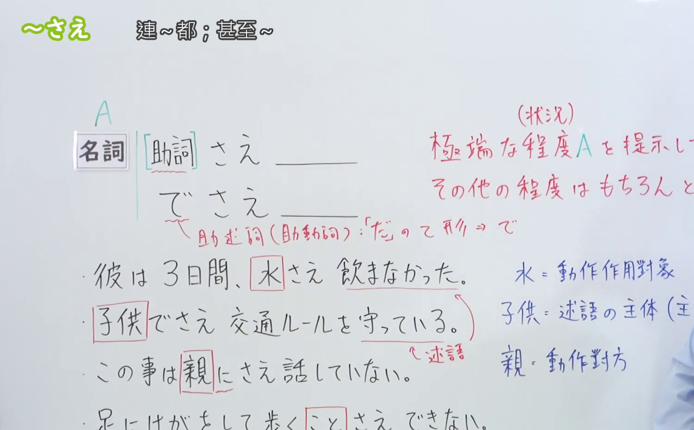
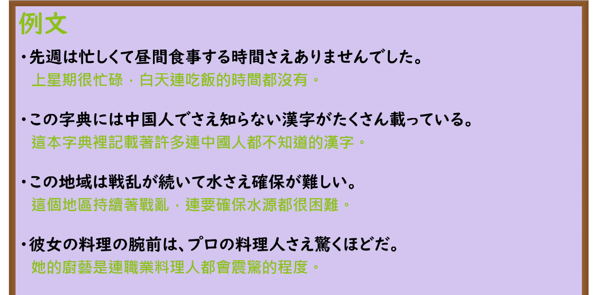

---
{
  "id": "N3-G-0023",
  "kind": "grammar",
  "level": "N3",
  "title": "〜さえ／〜でさえ（连……都……／甚至连……也……）",
  "card_revision": 1,
  "schema_version": 1,
  "source": {
    "lesson": "N3 第23个语法",
    "material": "出口日語原视频板书、日语自动字幕与Hagoromo文型检索正文",
    "video": "https://www.youtube.com/watch?v=Wh8IhNdgk5o",
    "screenshot": "assets/grammar/n3/N3-G-0023-connection.png",
    "screenshot_seconds": 425,
    "screenshot_crop": {
      "x": 0,
      "y": 0,
      "width": 1500,
      "height": 930
    }
  },
  "tags": [
    "さえ",
    "でさえ",
    "N3"
  ],
  "confusions": [
    "すら",
    "まで"
  ]
}
---

# N3 第23个语法：〜さえ／〜でさえ

# 视频学习资料整理

本课讲解 N3 语法形式「〜さえ／〜でさえ」。

## 接续图（板书与讲解）

- 视频链接：[出口日語 N3 第23个语法](https://www.youtube.com/watch?v=Wh8IhNdgk5o)
- 真实时间：07:05（425.00秒）
- 原图尺寸：1920×1080
- 裁切说明：选用 07:05 画面，此时板书已完整书写接续规则「名詞（＋助詞）＋さえ／でさえ」（并详细罗列「でさえ」「にさえ」「とさえ」等助词重叠搭配与「が」「を」的脱落规律），并清晰剖析核心语义「極端な例を取り上げ、他は言うまでもなくそれもそうだという程度を強調する」；出口老师在板书中特别提醒学习者：该句型多用于意外、吃惊或感叹的语境中。固定左上角（0, 0），裁切区域为宽 1500、高 930，去除右侧人像与底部空白，完整保留全部板书。
- 图片：

## 例句图（视频例句）

- 视频链接：[出口日語 N3 第23个语法](https://www.youtube.com/watch?v=Wh8IhNdgk5o)
- 真实时间：07:23（443.68秒）
- 原图尺寸：1920×1080
- 裁切说明：提取自视频 07:23 处的例句黑板页面。固定左上角（0, 0），裁切区域为宽 1920、高 950，裁去底部多余边框与杂物，完整保留四条例句及中文翻译。
- 图片：

# 核心

## 功能一：举出极端浅显或极端的典型事例，类推其他自然更不用说（连……都……／甚至连……也……）

**最上位意味カテゴリー：**

- **さえ：** 考え・感情（思想与情感）

**中位意味カテゴリー：**

- **さえ：** 軽重の強調（轻重的强调）

**意味：**

- **さえ：** 程度の強調（程度与极值强调）

**くわしい意味記述：**

- **さえ：** 極端な例をあげ，他のものはもちろん，その極端なものに対して，後ろのことがあてはまる，という意味を表す。（举出一个极端的下限或上限例子，暗示其他通常情况自不必说同样如此，多带有强烈的惊讶、意外或感叹色彩。）

### 例句

1. 彼はひらがなさえ書けない。

   （他甚至连最基本的平假名都不会写。）

2. 忙しすぎて、昼ご飯を食べる時間さえない。

   （忙得不可开交，甚至连吃午饭的时间都没有。）

3. そんな簡単なこと、子供でさえ知っている。

   （那么简单常识的事情，连小孩子都心知肚明。）

4. 眼鏡がどこにあるかさえ見つけられないくらい、目が疲れている。

   （眼睛疲倦到了甚至连眼镜放在哪里都找不着的程度。）

# 来源

- [出口日語原视频](https://www.youtube.com/watch?v=Wh8IhNdgk5o)
- [Hagoromo 文型検索「さえ」](https://hagoromo-text.work/lookup?vid=550)（查询日期：2026-09-25）
