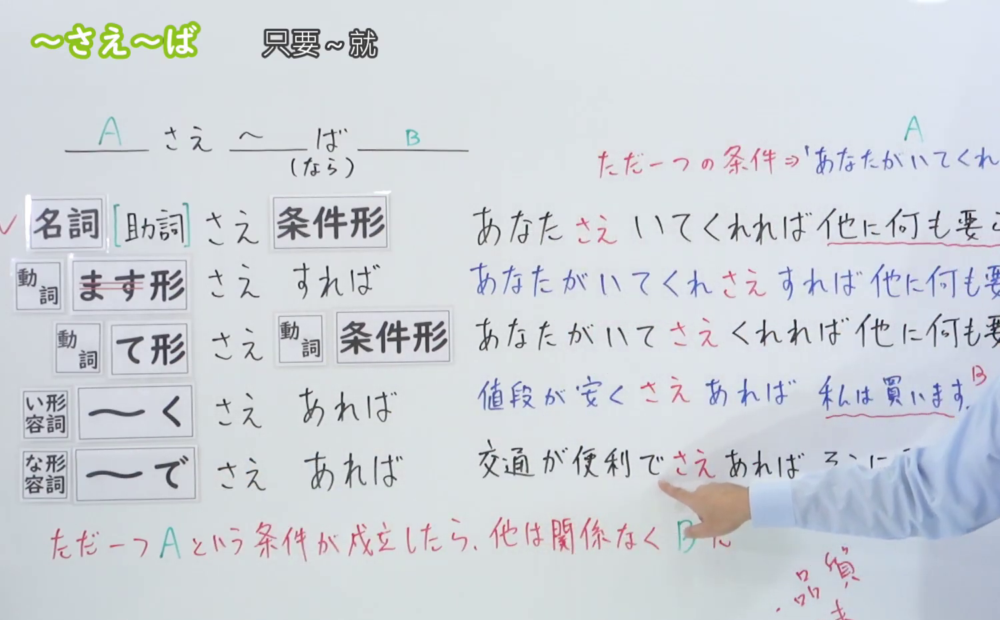
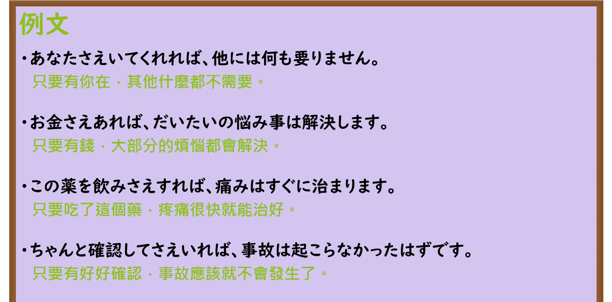

---
{
  "id": "N3-G-0024",
  "kind": "grammar",
  "level": "N3",
  "title": "〜さえ〜ば（只要……就……／唯有满足……即成立）",
  "card_revision": 1,
  "schema_version": 1,
  "source": {
    "lesson": "N3 第24个语法",
    "material": "出口日語原视频板书、日语自动字幕与Hagoromo文型检索正文",
    "video": "https://www.youtube.com/watch?v=_-HDuUcHm3k",
    "screenshot": "assets/grammar/n3/N3-G-0024-connection.png",
    "screenshot_seconds": 260,
    "screenshot_crop": {
      "x": 0,
      "y": 0,
      "width": 1500,
      "height": 930
    }
  },
  "tags": [
    "さえ〜ば",
    "さえ",
    "N3"
  ],
  "confusions": [
    "さえ",
    "かぎり"
  ]
}
---

# N3 第24个语法：〜さえ〜ば

# 视频学习资料整理

本课讲解 N3 语法形式「〜さえ〜ば」。

## 接续图（板书与讲解）

- 视频链接：[出口日語 N3 第24个语法](https://www.youtube.com/watch?v=_-HDuUcHm3k)
- 真实时间：04:20（260.00秒）
- 原图尺寸：1920×1080
- 裁切说明：选用 04:20 画面，此时板书已完整书写接续规则「名詞＋さえ＋動詞ば形／動詞ます形（去ます）＋さえすれば／イ形容詞く・ナ形容詞で＋さえあれば」以及核心语义「必要最低限の条件（ただ一つの条件さえ満たせば、後は問題なく成立する）」；出口老师在板书中特别强调与第23课极端举例「さえ」的区别，本课与条件假定形呼应，表示唯一的排他性必要充分条件。固定左上角（0, 0），裁切区域为宽 1500、高 930，去除右侧人像与底部空白，完整保留全部板书。
- 图片：

## 例句图（视频例句）

- 视频链接：[出口日語 N3 第24个语法](https://www.youtube.com/watch?v=_-HDuUcHm3k)
- 真实时间：05:42（342.18秒）
- 原图尺寸：1920×1080
- 裁切说明：提取自视频 05:42 处的例句黑板页面。固定左上角（0, 0），裁切区域为宽 1920、高 950，裁去底部多余边框与杂物，完整保留四条例句及中文翻译。
- 图片：

# 核心

## 功能一：表示只要满足该唯一的最起码条件，后项即可顺理成章实现（只要……就……／唯有满足……即成立）

**最上位意味カテゴリー：**

- **さえ〜ば：** ものごとの関係（事物的关系）

**中位意味カテゴリー：**

- **さえ〜ば：** 条件（假定与必要条件）

**意味：**

- **さえ〜ば：** 必要最低条件（最低必要条件）

**くわしい意味記述：**

- **さえ〜ば：** ただ１つの条件だけが必要であることを表す。（表示只要具备该单一的最低限度条件，其他顾虑皆可迎刃而解，后项事态必定能够顺利成立。）

### 例句

1. 息子は暇さえあればゲームをしている。

   （我儿子只要一有空闲时间，就必定在打游戏。）

2. 薬を飲みさえすれば、風邪は治るだろう。

   （只要把药按时吃下去，感冒大概就能痊愈了。）

3. 車さえあれば、どこへでも自由に出掛けられる。

   （只要有私家车在手，去哪里都能自由自在地出行。）

4. 良い大学に入りさえすれば、将来は安泰だと思い込んでいた。

   （过去曾一味深信：只要考进好大学，未来就必定高枕无忧。）

# 来源

- [出口日語原视频](https://www.youtube.com/watch?v=_-HDuUcHm3k)
- [Hagoromo 文型検索「さえ〜ば」](https://hagoromo-text.work/lookup?vid=551)（查询日期：2026-09-25）
