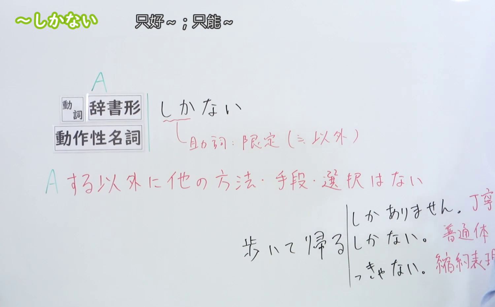
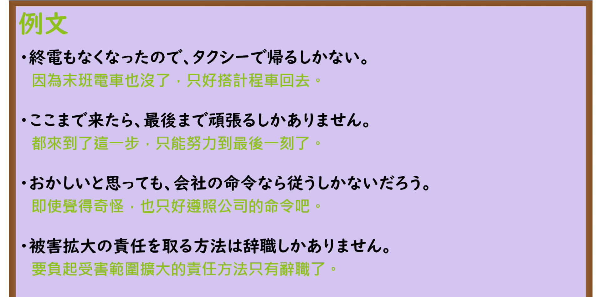

---
{
  "id": "N3-G-0025",
  "kind": "grammar",
  "level": "N3",
  "title": "〜しかない（只能……／别无他法）",
  "card_revision": 1,
  "schema_version": 1,
  "source": {
    "lesson": "N3 第25个语法",
    "material": "出口日語原视频板书、日语自动字幕与Hagoromo文型检索正文",
    "video": "https://www.youtube.com/watch?v=vTvTG8y9lH4",
    "screenshot": "assets/grammar/n3/N3-G-0025-connection.png",
    "screenshot_seconds": 182,
    "screenshot_crop": {
      "x": 0,
      "y": 0,
      "width": 1500,
      "height": 930
    }
  },
  "tags": [
    "しかない",
    "ほかない",
    "よりほかない",
    "N3"
  ],
  "confusions": [
    "ほかない",
    "にすぎない"
  ]
}
---

# N3 第25个语法：〜しかない

# 视频学习资料整理

本课讲解 N3 语法形式「〜しかない」。

## 接续图（板书与讲解）

- 视频链接：[出口日語 N3 第25个语法](https://www.youtube.com/watch?v=vTvTG8y9lH4)
- 真实时间：03:02（182.00秒）
- 原图尺寸：1920×1080
- 裁切说明：选用 03:02 画面，此时画面左上方语法标题与中文释义「〜しかない 只好～；只能～」清晰无渐隐，板书已完整书写接续规则「動詞辞書形／動作性名詞＋しかない」以及核心语义「ほかに方法や選択肢がない（〜するより他に方法がない・〜せざるを得ない）」；出口老师在板书中特别强调形式助词「しか」后项必须呼应否定形「ない」，带有说话人在别无选择、走投无路时的无奈接受或破釜沉舟的决断语气。固定左上角（0, 0），裁切区域为宽 1500、高 930，去除右侧人像与底部空白，完整保留全部板书与顶部标题。
- 图片：

## 例句图（视频例句）

- 视频链接：[出口日語 N3 第25个语法](https://www.youtube.com/watch?v=vTvTG8y9lH4)
- 真实时间：03:30（210.97秒）
- 原图尺寸：1920×1080
- 裁切说明：提取自视频 03:30 处的例句黑板页面。固定左上角（0, 0），裁切区域为宽 1920、高 950，裁去底部多余边框与杂物，完整保留四条例句及中文翻译。
- 图片：

# 核心

## 功能一：表示除此之外不存在其他手段或选择，不得不如此（只能……／别无他法）

**最上位意味カテゴリー：**

- **しかない：** 考え・感情（思想与情感）

**中位意味カテゴリー：**

- **しかない：** 主張・断定的評価（主张与断定评价）

**意味：**

- **しかない：** 評価（排他性评价与无奈决断）

**くわしい意味記述：**

- **しかない：** 「〜するより他に方法がない」「〜するしかしかたがない」という意味。（表示在面临特定困境或事实情境时，除此做法之外再无其他替代方案或解决途径，只能硬着头皮如此行事。）

### 例句

1. こうなったらやるしかない。

   （事已至此，唯有一鼓作气干到底了。）

2. 終電に乗り遅れてしまったので、歩いて帰るしかない。

   （错过了末班电车，除了徒步走回家之外别无他法。）

3. 交通機関がないから、車で迎えに来てもらうしかない。

   （因为周围没有任何公共交通工具，只能拜托别人开车来接了。）

4. 誰にも頼めない以上、自分で修論を書くしかない。

   （既然无法依赖任何人，就唯有靠自己把毕业论文硬啃下来了。）

# 来源

- [出口日語原视频](https://www.youtube.com/watch?v=vTvTG8y9lH4)
- [Hagoromo 文型検索「しかない」](https://hagoromo-text.work/lookup?vid=579)（查询日期：2026-09-25）
