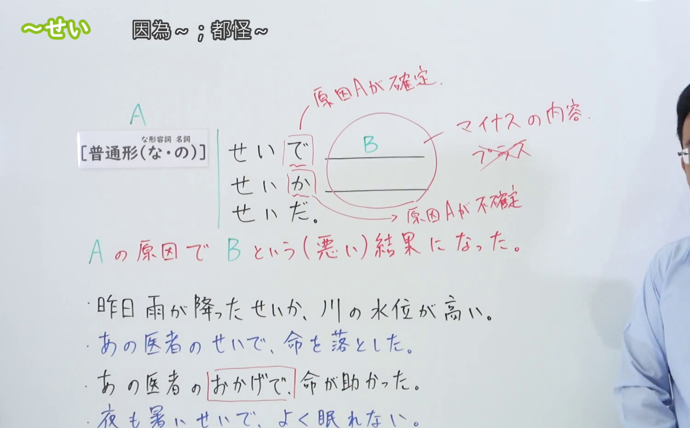
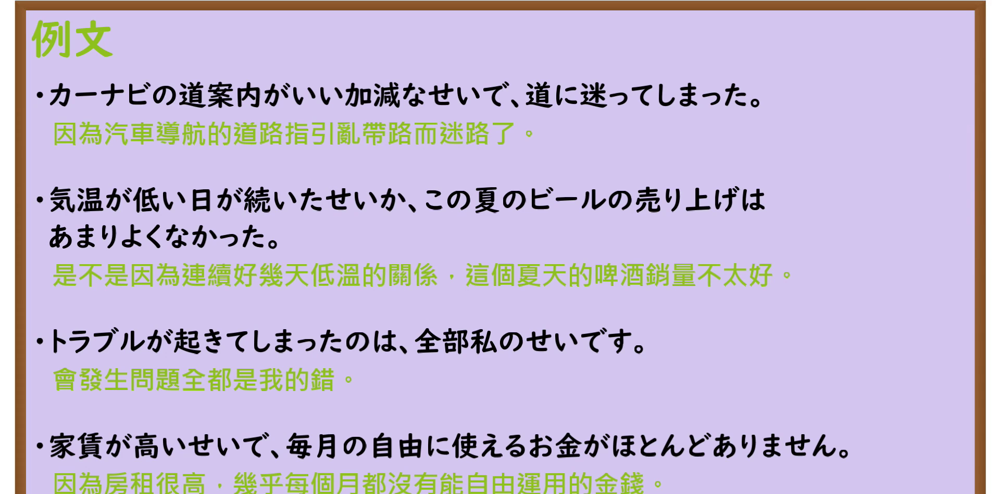

---
{
  "id": "N3-G-0026",
  "kind": "grammar",
  "level": "N3",
  "title": "〜せいだ／〜せいで／〜せいか（全怪……／都因为……导致负面结果）",
  "card_revision": 1,
  "schema_version": 1,
  "source": {
    "lesson": "N3 第26个语法",
    "material": "出口日語原视频板书、日语自动字幕与Hagoromo文型检索正文",
    "video": "https://www.youtube.com/watch?v=eAkY9mYXq2E",
    "screenshot": "assets/grammar/n3/N3-G-0026-connection.png",
    "screenshot_seconds": 338,
    "screenshot_crop": {
      "x": 0,
      "y": 0,
      "width": 1500,
      "height": 930
    }
  },
  "tags": [
    "せいだ",
    "せいで",
    "せいか",
    "せい",
    "N3"
  ],
  "confusions": [
    "おかげで",
    "ために"
  ]
}
---

# N3 第26个语法：〜せいだ／〜せいで／〜せいか

# 视频学习资料整理

本课讲解 N3 语法形式「〜せいだ／〜せいで／〜せいか」。

## 接续图（板书与讲解）

- 视频链接：[出口日語 N3 第26个语法](https://www.youtube.com/watch?v=eAkY9mYXq2E)
- 真实时间：05:38（338.00秒）
- 原图尺寸：1920×1080
- 裁切说明：选用 05:38 画面，此时板书已完整书写接续规则「普通形（なAな/である・Nの/である）＋せいだ／せいで／せいか」以及核心语义「好ましくない結果の原因・理由（責任を他に帰する表現）」；出口老师在板书中特别对比了第4课表示恩惠积极结果的「〜おかげで」，指出「〜せい」专用于引出消极负面事态，并详细讲解了「〜せいか」（也许是因为……导致负面结果，表不确定缘由）的派生用法。固定左上角（0, 0），裁切区域为宽 1500、高 930，去除右侧人像与底部空白，完整保留全部板书。
- 图片：

## 例句图（视频例句）

- 视频链接：[出口日語 N3 第26个语法](https://www.youtube.com/watch?v=eAkY9mYXq2E)
- 真实时间：05:47（347.05秒）
- 原图尺寸：1920×1080
- 裁切说明：提取自视频 05:47 处的例句黑板页面。固定左上角（0, 0），裁切区域为宽 1920、高 950，裁去底部多余边框与杂物，完整保留四条例句及中文翻译。
- 图片：

# 核心

## 功能一：表示招致消极恶果的直接归咎原因，带有埋怨、非难或归咎色彩（全怪……／都因为……导致负面结果）

**最上位意味カテゴリー：**

- **せいだ：** ものごとの関係（事物的关系）

**中位意味カテゴリー：**

- **せいだ：** 原因・理由（原因与理由）

**意味：**

- **せいだ：** 理由・非難（归咎非难与负面缘由）

**くわしい意味記述：**

- **せいだ：** Xということが起こったのは，Yが原因・理由だ。「せいだ」を用いると，悪い結果が起きたことを表すことが多い。「X（な）のは，Y（の）せいだ」という文型で現れる。（用于说明导致消极、糟糕或不如意恶果的始作俑者，常带有说话人的抱怨、指责、推卸责任或懊悔情绪；搭配「〜か」变为「〜せいか」时表示不确切推测的负面原因。）

**派生語：** せいで，せいか，せいに帰する

### 例句

1. 事故を起こしたのは、機械の使い方を知らなかったせいだ。

   （之所以酿成事故，全怪没有掌握机器的正确使用方法。）

2. 大雨のせいで、テニス大会は中止になった。

   （都怪下大雨，导致网球比赛被迫取消了。）

3. 薬をいろいろ飲んだせいで、副作用が出てしまった。

   （因为乱吃了不少药，反而惹出了药物副作用。）

4. 寝不足のせいか、朝からずっと頭が痛い。

   （或许是因为昨晚没睡够，从早晨开始脑袋就一直隐隐作痛。）

# 来源

- [出口日語原视频](https://www.youtube.com/watch?v=eAkY9mYXq2E)
- [Hagoromo 文型検索「せいだ」](https://hagoromo-text.work/lookup?vid=611)（查询日期：2026-09-25）
