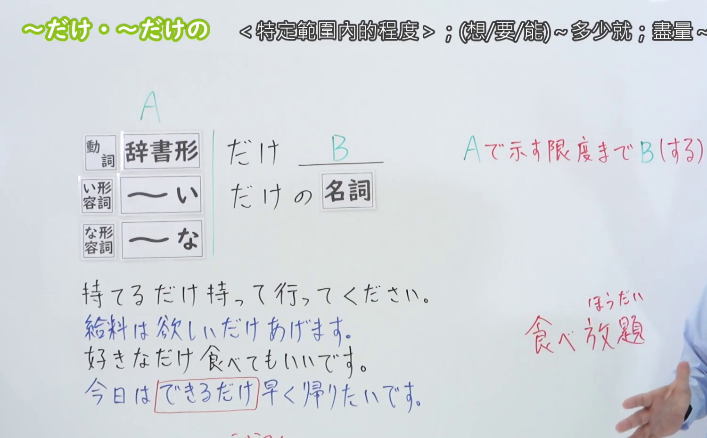
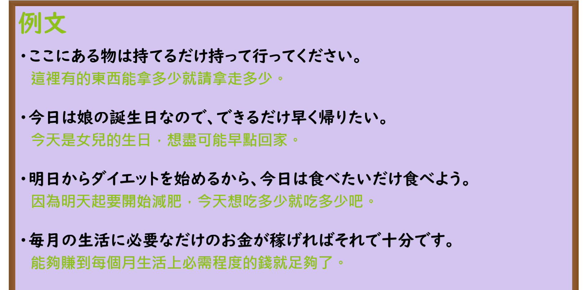

---
{
  "id": "N3-G-0027",
  "kind": "grammar",
  "level": "N3",
  "title": "〜だけ／〜だけの（尽量……／尽情……／达到……限度）",
  "card_revision": 1,
  "schema_version": 1,
  "source": {
    "lesson": "N3 第27个语法",
    "material": "出口日語原视频板书、日语自动字幕与Hagoromo文型检索正文",
    "video": "https://www.youtube.com/watch?v=VSho5rvFGWw",
    "screenshot": "assets/grammar/n3/N3-G-0027-connection.png",
    "screenshot_seconds": 210,
    "screenshot_crop": {
      "x": 0,
      "y": 0,
      "width": 1500,
      "height": 930
    }
  },
  "tags": [
    "だけ",
    "だけの",
    "できるだけ",
    "好きなだけ",
    "N3"
  ],
  "confusions": [
    "ばかり",
    "ほど"
  ]
}
---

# N3 第27个语法：〜だけ／〜だけの

# 视频学习资料整理

本课讲解 N3 语法形式「〜だけ／〜だけの」。

## 接续图（板书与讲解）

- 视频链接：[出口日語 N3 第27个语法](https://www.youtube.com/watch?v=VSho5rvFGWw)
- 真实时间：03:30（210.00秒）
- 原图尺寸：1920×1080
- 裁切说明：选用 03:30 画面，此时板书已完整书写接续规则「動詞辞書形／動詞可能形／イ形容詞・ナ形容詞＋だけ／だけの」以及核心语义「可能な限度・範囲のすべて（〜の限度まで、これ以上はない程度まで）」；出口老师在此特别对比了初级仅表示单一排他限定的「〜だけ」（只有），指出本课聚焦于程度与范围的极限量（如「できるだけ」「好きなだけ」「食べたいだけ」）以及「やるだけのことはやった」（尽人事待天命）等高频表达。固定左上角（0, 0），裁切区域为宽 1500、高 930，去除右侧人像与底部空白，完整保留全部板书。
- 图片：

## 例句图（视频例句）

- 视频链接：[出口日語 N3 第27个语法](https://www.youtube.com/watch?v=VSho5rvFGWw)
- 真实时间：04:06（246.55秒）
- 原图尺寸：1920×1080
- 裁切说明：提取自视频 04:06 处的例句黑板页面。固定左上角（0, 0），裁切区域为宽 1920、高 950，裁去底部多余边框与杂物，完整保留四条例句及中文翻译。
- 图片：

# 核心

## 功能一：表示达到某种能力、愿望或可能性的最大许可限度（尽量……／尽情……／达到……限度）

**最上位意味カテゴリー：**

- **だけ：** ものごとの関係（事物的关系）

**中位意味カテゴリー：**

- **だけ：** 限定（限度与限定）

**意味：**

- **だけ：** 限定（极限量、最大程度限定）

**くわしい意味記述：**

- **だけ：** 「これ以上はない」という程度まで何かをすることを表す。「できるだけ」「ほしいだけ」「好きなだけ」として用いられることが多い。（表示将动作或事态推至主客观允许的最高极限或全部范围，相当于“能做到何种程度就尽量做到极致/想要多少就尽情索取多少”。）

### 例句

1. 新しい作品をできるだけ多くの人に見てもらいたい。

   （希望能让尽可能多的人欣赏到我的全新作品。）

2. ほしいだけ持って行っていいですよ。

   （只要是你想要的，拿走多少都没问题。）

3. 食べられるだけ食べてください。

   （只要还能吃得下，就请尽情多吃一些。）

4. やるだけのことはやったのだから、あとは静かに結果を待つのみだ。

   （能尽的努力既然都已经全力以赴了，接下来就唯有静候结果了。）

# 来源

- [出口日語原视频](https://www.youtube.com/watch?v=VSho5rvFGWw)
- [Hagoromo 文型検索「だけ」](https://hagoromo-text.work/lookup?vid=684)（查询日期：2026-09-25）
