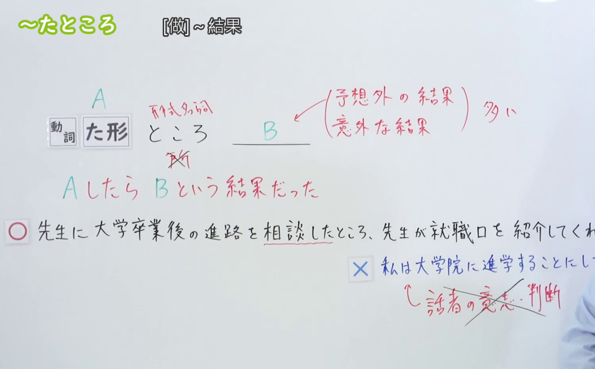
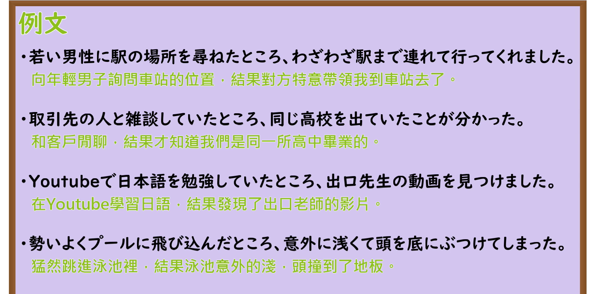

---
{
  "id": "N3-G-0028",
  "kind": "grammar",
  "level": "N3",
  "title": "〜たところ（一试着做……结果发现……／做完……之后）",
  "card_revision": 1,
  "schema_version": 1,
  "source": {
    "lesson": "N3 第28个语法",
    "material": "出口日語原视频板书、日语自动字幕与Hagoromo文型检索正文",
    "video": "https://www.youtube.com/watch?v=Lr3D1K1ewzA",
    "screenshot": "assets/grammar/n3/N3-G-0028-connection.png",
    "screenshot_seconds": 210,
    "screenshot_crop": {
      "x": 0,
      "y": 0,
      "width": 1500,
      "height": 930
    }
  },
  "tags": [
    "たところ",
    "ところ",
    "N3"
  ],
  "confusions": [
    "たら",
    "たばかり"
  ]
}
---

# N3 第28个语法：〜たところ

# 视频学习资料整理

本课讲解 N3 语法形式「〜たところ」。

## 接续图（板书与讲解）

- 视频链接：[出口日語 N3 第28个语法](https://www.youtube.com/watch?v=Lr3D1K1ewzA)
- 真实时间：03:30（210.00秒）
- 原图尺寸：1920×1080
- 裁切说明：选用 03:30 画面，此时画面左上方语法标题「〜たところ ……」清晰无渐隐，板书已完整书写接续规则「動詞た形＋ところ」以及核心语义「ある行為をしてみたら、その結果がこうだった（きっかけとその結果・新発見を表す）」；出口老师在板书中特别提醒学习者：后项句尾绝不能使用说话人的意志、命令、请求或劝诱表达（意志表現は来ない），必须是客观显现的事实结果或意料之外的发现。固定左上角（0, 0），裁切区域为宽 1500、高 930，去除右侧人像与底部空白，完整保留全部板书与顶部标题。
- 图片：

## 例句图（视频例句）

- 视频链接：[出口日語 N3 第28个语法](https://www.youtube.com/watch?v=Lr3D1K1ewzA)
- 真实时间：03:59（239.12秒）
- 原图尺寸：1920×1080
- 裁切说明：提取自视频 03:59 处的例句黑板页面。固定左上角（0, 0），裁切区域为宽 1920、高 950，裁去底部多余边框与杂物，完整保留四条例句及中文翻译。
- 图片：

# 核心

## 功能一：表示采取某行动尝试之后，获得了某种客观结果或意外发现（一试着做……结果发现……／做完……之后）

**最上位意味カテゴリー：**

- **Vたところ：** 場所・時間（场所与时间）

**中位意味カテゴリー：**

- **Vたところ：** 起点・終点（起点与终点）

**意味：**

- **Vたところ：** 終了（动作告一段落引出的新事态）

**くわしい意味記述：**

- **Vたところ：** 「あることをしたら，こんな結果になった」ということを表す。後の文に話し手の意志を表す文はこない。（表示进行了前项的动作或查探之后，紧接着获悉或查明了后项的客观情况；后项只陈述客观既成事实或新察觉的现象，不接祈使、意志动词。）

### 例句

1. 実験をやってみたところ、思いの外うまくいった。

   （试着做了一下实验，结果出乎意料地非常顺利。）

2. 制服を新しくすることについて聞いたところ、賛成の人は４５％であった。

   （就更换新校服一事向大家征询了意见，结果赞成者占45%。）

3. 病院で検査を受けたところ、幸い異常は見つからなかった。

   （在医院做了全面检查，所幸并没有发现任何异常。）

4. お見受けしたところ、お元気そうで安心いたしました。

   （从外表气色来看，您身体硬朗精神饱满，我也就放心了。）

# 来源

- [出口日語原视频](https://www.youtube.com/watch?v=Lr3D1K1ewzA)
- [Hagoromo 文型検索「Vたところ」](https://hagoromo-text.work/lookup?vid=709)（查询日期：2026-09-25）
