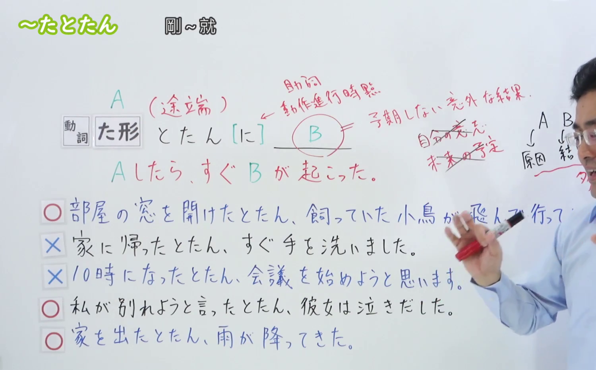
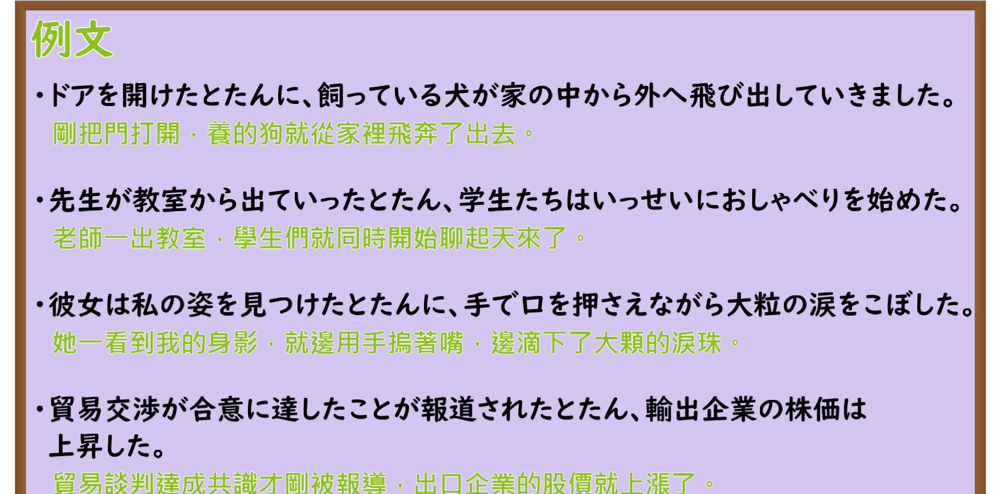

---
{
  "id": "N3-G-0029",
  "kind": "grammar",
  "level": "N3",
  "title": "〜たとたん／〜たとたんに（刚一……就立刻……／正当……瞬间）",
  "card_revision": 1,
  "schema_version": 1,
  "source": {
    "lesson": "N3 第29个语法",
    "material": "出口日語原视频板书、日语自动字幕与Hagoromo文型检索正文",
    "video": "https://www.youtube.com/watch?v=4xMjB1qda54",
    "screenshot": "assets/grammar/n3/N3-G-0029-connection.png",
    "screenshot_seconds": 330,
    "screenshot_crop": {
      "x": 0,
      "y": 0,
      "width": 1500,
      "height": 930
    }
  },
  "tags": [
    "たとたん",
    "たとたんに",
    "途端",
    "N3"
  ],
  "confusions": [
    "たところ",
    "しだい"
  ]
}
---

# N3 第29个语法：〜たとたん／〜たとたんに

# 视频学习资料整理

本课讲解 N3 语法形式「〜たとたん／〜たとたんに（〜途端／〜途端に）」。

## 接续图（板书与讲解）

- 视频链接：[出口日語 N3 第29个语法](https://www.youtube.com/watch?v=4xMjB1qda54)
- 真实时间：05:30（330.00秒）
- 原图尺寸：1920×1080
- 裁切说明：选用 05:30 画面，此时板书已完整书写接续规则「動詞た形＋とたん／とたんに」以及核心语义「Aをしたら、その瞬間に予想外のBが起こる（同時・直後の急激な変化）」；出口老师在板书中特别强调形式名词「途端」兼具汉字与假名书写，其语法本质侧重前项动作完成的刹那间发生毫无思想准备的突发意外事件，后项绝不可接续说话人的计划、意志或请求劝诱表达。固定左上角（0, 0），裁切区域为宽 1500、高 930，去除右侧人像与底部空白，完整保留全部板书。
- 图片：

## 例句图（视频例句）

- 视频链接：[出口日語 N3 第29个语法](https://www.youtube.com/watch?v=4xMjB1qda54)
- 真实时间：06:18（378.52秒）
- 原图尺寸：1920×1080
- 裁切说明：提取自视频 06:18 处的例句黑板页面。固定左上角（0, 0），裁切区域为宽 1920、高 950，裁去底部多余边框与杂物，完整保留四条例句及中文翻译。
- 图片：

# 核心

## 功能一：表示前项动作刚刚发生的瞬间，紧接着突发某种出乎预料的变化（刚一……就立刻……／正当……瞬间）

**最上位意味カテゴリー：**

- **Vたとたん（に）：** 場所・時間（场所与时间）

**中位意味カテゴリー：**

- **Vたとたん（に）：** 時間的前後（时间先后与继起）

**意味：**

- **Vたとたん（に）：** 継起（後）（紧随继起）

**くわしい意味記述：**

- **Vたとたん（に）：** あることをすると同時に別のことが起こることを表す。（表示前项动作发生的那一刹那，仿佛受到触发一般，立刻紧接着发生了意料之外的某种突变或意外情况；后项为客观突发事态，不可接命令、意志或希望表达。）

**派生語：** たとたん，たとたんに

### 例句

1. 窓を開けたとたん、猫が勢いよく飛び出していった。

   （刚一打开窗户，猫就嗖的一下猛蹿了出去。）

2. 角を曲がったとたんに、向こうから走ってきた自転車とぶつかった。

   （刚一拐过街角，就迎面撞上了对面疾驰而来的自行车。）

3. 担任になったとたん、びっくりするほど優しくなった。

   （刚一当上班主任，态度竟然变得出奇温柔，令人大吃一惊。）

4. スープを一口飲んだとたん、あまりの辛さに激しくむせてしまった。

   （刚喝了一小口汤，就立刻因为过度的辛辣而剧烈呛咳起来。）

# 来源

- [出口日語原视频](https://www.youtube.com/watch?v=4xMjB1qda54)
- [Hagoromo 文型検索「Vたとたん（に）」](https://hagoromo-text.work/lookup?vid=716)（查询日期：2026-09-25）
