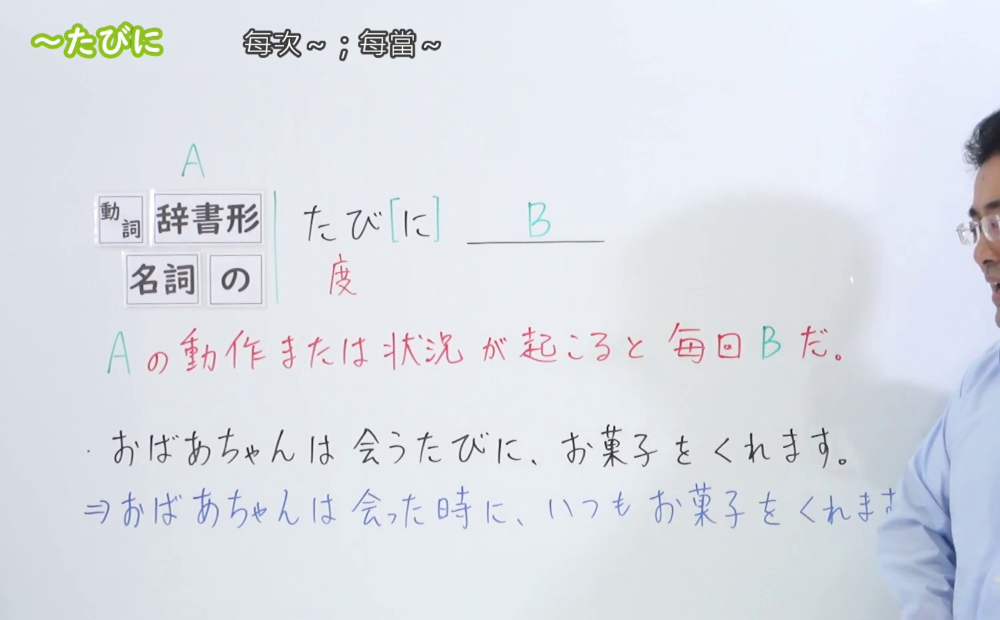
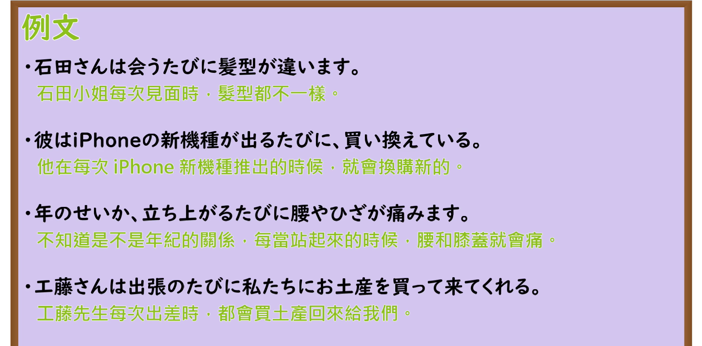

---
{
  "id": "N3-G-0030",
  "kind": "grammar",
  "level": "N3",
  "title": "〜たびに／〜度に（每当……就……／每次……总是……）",
  "card_revision": 1,
  "schema_version": 1,
  "source": {
    "lesson": "N3 第30个语法",
    "material": "出口日語原视频板书、日语自动字幕与Hagoromo文型检索正文",
    "video": "https://www.youtube.com/watch?v=T36BcdYpTEU",
    "screenshot": "assets/grammar/n3/N3-G-0030-connection.png",
    "screenshot_seconds": 108,
    "screenshot_crop": {
      "x": 0,
      "y": 0,
      "width": 1500,
      "height": 930
    }
  },
  "tags": [
    "たびに",
    "度に",
    "たび",
    "N3"
  ],
  "confusions": [
    "ごとに",
    "ついでに"
  ]
}
---

# N3 第30个语法：〜たびに／〜度に

# 视频学习资料整理

本课讲解 N3 语法形式「〜たびに／〜度に」。

## 接续图（板书与讲解）

- 视频链接：[出口日語 N3 第30个语法](https://www.youtube.com/watch?v=T36BcdYpTEU)
- 真实时间：01:48（108.00秒）
- 原图尺寸：1920×1080
- 裁切说明：选用 01:48 画面，此时板书已完整书写接续规则「動詞辞書形＋たびに／名詞＋の＋たびに」以及核心语义「その時にはいつも同じことが起こる（Xの時は毎回、例外なくいつもYになる）」；出口老师在板书中特别提醒学习者形式名词「たび」既可写汉字「度」亦常写平假名，用于表示某种重复性契机带来的必然规律或恒常心理反应，但日常生活中理所当然的反复动作（如每天刷牙、吃饭等日常常规）通常不用本句型。固定左上角（0, 0），裁切区域为宽 1500、高 930，去除右侧人像与底部空白，完整保留全部板书。
- 图片：

## 例句图（视频例句）

- 视频链接：[出口日語 N3 第30个语法](https://www.youtube.com/watch?v=T36BcdYpTEU)
- 真实时间：02:15（135.00秒）
- 原图尺寸：1920×1080
- 裁切说明：提取自视频 02:15 处的例句黑板页面。固定左上角（0, 0），裁切区域为宽 1920、高 950，裁去底部多余边框与杂物，完整保留四条例句及中文翻译。
- 图片：

# 核心

## 功能一：表示每逢前项事情发生，必定无一例外地伴随某种相同的行为或情感反应（每当……就……／每次……总是……）

**最上位意味カテゴリー：**

- **たび（に）：** 場所・時間（场所与时间）

**中位意味カテゴリー：**

- **たび（に）：** 時点・場面（时间点与场面）

**意味：**

- **たび（に）：** 関連（相伴发生、无一例外的连带关连）

**くわしい意味記述：**

- **たび（に）：** Xの時は毎回。「Xの時はいつも誰かが（何かが）Yをする／Yという状態だ／だんだんYになっている」という意味を表す。（表示只要出现前项的契机或时机，后项必然屡屡随之出现同样的行为、事态变化或心理感慨，突出无一例外的反复发生性。）

**派生語：** たび，たびに，そのたびに

### 例句

1. 新宿へ行くたび、町の風景が変わっている。

   （每次去新宿，那里的城市街景总是在发生崭新的变化。）

2. 優しいお心遣いを思い出すたびに、今でも胸が温まる気がします。

   （每当回想起您体贴入微的关照，至今心中仍感到一阵暖意。）

3. 祝い事があるたびに、親戚で集まってパーティーを開く。

   （每逢家里有值得庆贺的喜事，亲戚们总是聚在一起举办宴会。）

4. この写真を見るたびに、楽しかった学生時代を懐かしく思い出す。

   （每当我翻看这张照片，总会无限怀念地回想起那段快乐的学生时代。）

# 来源

- [出口日語原视频](https://www.youtube.com/watch?v=T36BcdYpTEU)
- [Hagoromo 文型検索「たび（に）」](https://hagoromo-text.work/lookup?vid=722)（查询日期：2026-09-25）
