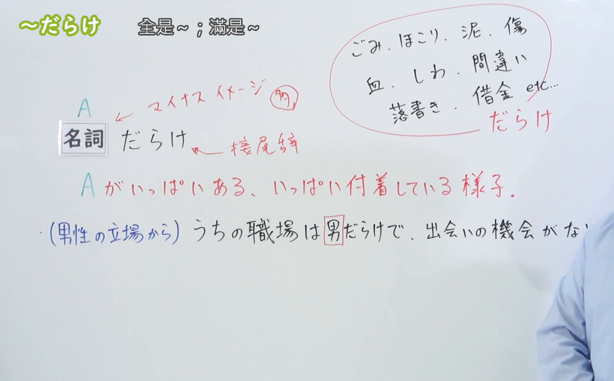
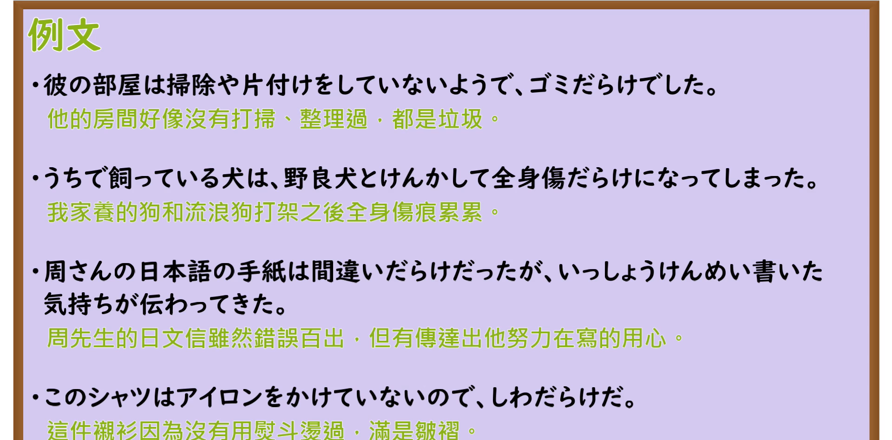

---
{
  "id": "N3-G-0031",
  "kind": "grammar",
  "level": "N3",
  "title": "〜だらけ（全是……／满是……）",
  "card_revision": 1,
  "schema_version": 1,
  "source": {
    "lesson": "N3 第31个语法",
    "material": "出口日語原视频板书、日语自动字幕与Hagoromo文型检索正文",
    "video": "https://www.youtube.com/watch?v=XA_CEir1-3s",
    "screenshot": "assets/grammar/n3/N3-G-0031-connection.png",
    "screenshot_seconds": 170,
    "screenshot_crop": {
      "x": 0,
      "y": 0,
      "width": 1500,
      "height": 930
    }
  },
  "tags": [
    "だらけ",
    "N3"
  ],
  "confusions": [
    "まみれ",
    "ずくめ"
  ]
}
---

# N3 第31个语法：〜だらけ

# 视频学习资料整理

本课讲解 N3 语法形式「〜だらけ」。

## 接续图（板书与讲解）

- 视频链接：[出口日語 N3 第31个语法](https://www.youtube.com/watch?v=XA_CEir1-3s)
- 真实时间：02:50（170.00秒）
- 原图尺寸：1920×1080
- 裁切说明：选用 02:50 画面，此时画面左上方语法标题与中文释义「〜だらけ 全是〜；滿是〜」清晰无渐隐，板书已完整书写接续规则「名詞＋だらけ（接尾辞）」以及核心语义「Aがいっぱいある、いっぱい付着している様子」；出口老师在板书中特别强调形式「だらけ」通常用于消极负面评价（マイナスイメージ），列举了「ごみ、ほこり、泥、傷、血、しわ、間違い、借金」等典型搭配。固定左上角（0, 0），裁切区域为宽 1500、高 930，去除右侧人像与底部空白，完整保留全部板书与顶部标题。
- 图片：

## 例句图（视频例句）

- 视频链接：[出口日語 N3 第31个语法](https://www.youtube.com/watch?v=XA_CEir1-3s)
- 真实时间：03:20（200.00秒）
- 原图尺寸：1920×1080
- 裁切说明：提取自视频 03:20 处的例句黑板页面。固定左上角（0, 0），裁切区域为宽 1920、高 950，裁去底部多余边框与杂物，完整保留四条例句及中文翻译。
- 图片：

# 核心

## 功能一：表示遍地都是或表面附着大量的消极负面事物（全是……／满是……）

**最上位意味カテゴリー：**

- **〜だらけ：** ものごとの様子（事物的状态与样貌）

**中位意味カテゴリー：**

- **〜だらけ：** 様子・状態（样貌与状态）

**意味：**

- **〜だらけ：** 状態（充满消极不洁事物的客观状态）

**くわしい意味記述：**

- **〜だらけ：** 良くないものがあまりにも多い状態になっているという意味を表す。傷，血，泥，しわといった名詞とともに使われる。（表示放眼望去充斥着大量令人不快、杂乱、污秽或不良的事物；常与表示伤痕、血迹、泥巴、褶皱、错误、债务等消极含义的名词连用。）

### 例句

1. 彼の部屋は掃除や片付けをしていないようで、ゴミだらけでした。

   （他的房间似乎没怎么打扫整理，到处都是垃圾。）

2. うちで飼っている犬は、野良犬とけんかして全身傷だらけになってしまった。

   （我家养的狗跟野狗打架，结果浑身伤痕累累。）

3. 周さんの日本語の手紙は間違いだらけだったが、いっしょうけんめい書いた気持ちが伝わってきた。

   （周先生的日文信虽然错漏百出，但能真切感受到他认真用心的态度。）

4. このシャツはアイロンをかけていないので、しわだらけだ。

   （这件衬衫没有烫过，满是褶皱。）

# 来源

- [出口日語原视频](https://www.youtube.com/watch?v=XA_CEir1-3s)
- [Hagoromo 文型検索「だらけ」](https://hagoromo-text.work/lookup?vid=739)（查询日期：2026-09-25）
