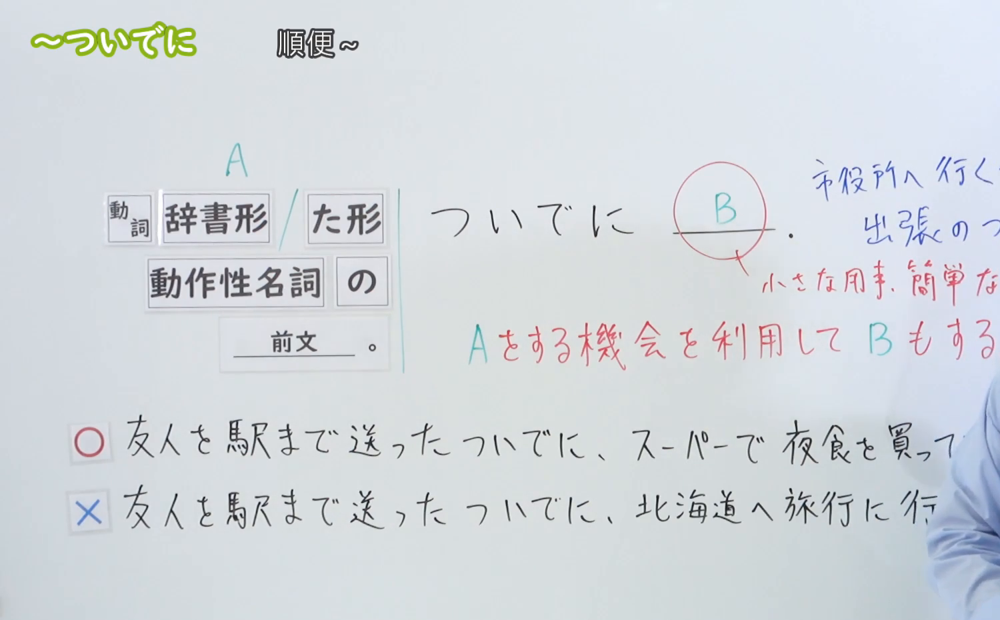
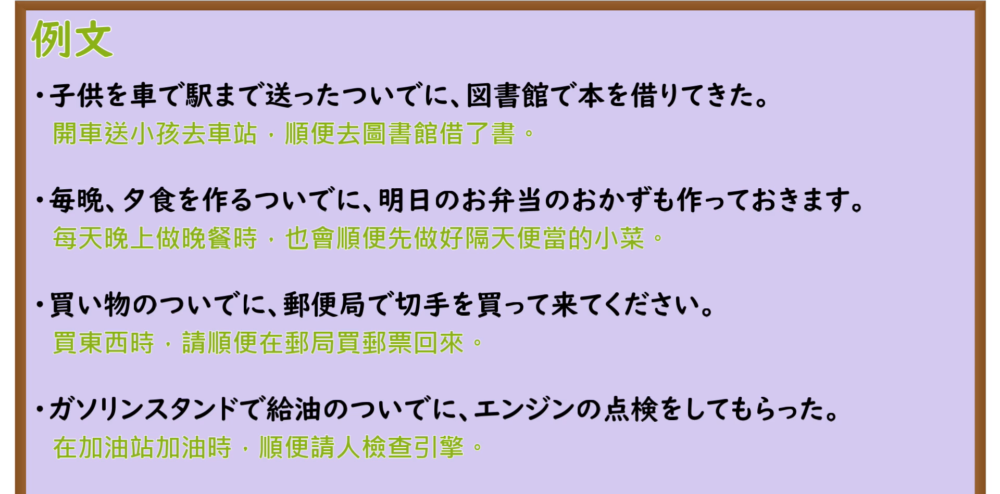

---
{
  "id": "N3-G-0032",
  "kind": "grammar",
  "level": "N3",
  "title": "〜ついでに（顺便……／借……之机）",
  "card_revision": 1,
  "schema_version": 1,
  "source": {
    "lesson": "N3 第32个语法",
    "material": "出口日語原视频板书、日语自动字幕与Hagoromo文型检索正文",
    "video": "https://www.youtube.com/watch?v=smV9kXG8T8o",
    "screenshot": "assets/grammar/n3/N3-G-0032-connection.png",
    "screenshot_seconds": 244,
    "screenshot_crop": {
      "x": 0,
      "y": 0,
      "width": 1500,
      "height": 930
    }
  },
  "tags": [
    "ついでに",
    "ついで",
    "N3"
  ],
  "confusions": [
    "がてら",
    "かたがた"
  ]
}
---

# N3 第32个语法：〜ついでに

# 视频学习资料整理

本课讲解 N3 语法形式「〜ついでに」。

## 接续图（板书与讲解）

- 视频链接：[出口日語 N3 第32个语法](https://www.youtube.com/watch?v=smV9kXG8T8o)
- 真实时间：04:04（244.00秒）
- 原图尺寸：1920×1080
- 裁切说明：选用 04:04 画面，此时画面左上方语法标题与中文释义「〜ついでに 順便〜」清晰无渐隐，板书已完整书写接续规则「動詞辞書形／た形／動作性名詞＋の＋ついでに」以及核心语义「Aをする機会を利用してBもする」；出口老师在板书中特别提醒学习者：后项B必须是顺带完成的简单事项或顺手小事（小さな用事、簡単な用事），绝不能将主次颠倒（如去送朋友不能顺便去北海道旅行）。固定左上角（0, 0），裁切区域为宽 1500、高 930，去除右侧人像与底部空白，完整保留全部板书与顶部标题。
- 图片：

## 例句图（视频例句）

- 视频链接：[出口日語 N3 第32个语法](https://www.youtube.com/watch?v=smV9kXG8T8o)
- 真实时间：04:35（275.00秒）
- 原图尺寸：1920×1080
- 裁切说明：提取自视频 04:35 处的例句黑板页面。固定左上角（0, 0），裁切区域为宽 1920、高 950，裁去底部多余边框与杂物，完整保留四条例句及中文翻译。
- 图片：

# 核心

## 功能一：利用做前项主要动作或外出的机会，顺便兼顾完成另一项顺手小事（顺便……／借……之便）

**最上位意味カテゴリー：**

- **〜ついでに：** ものごとの関係（事物的关系）

**中位意味カテゴリー：**

- **〜ついでに：** 付加（附带与附加）

**意味：**

- **〜ついでに：** 付加（附带完成的次要动作）

**くわしい意味記述：**

- **〜ついでに：** あることを行った際に，それに付属してもう一つ別のことを行うこと。「おまけに」「Xを行ったことに関連して，Yも」という意味を表す。（表示进行前项主动作X之际，借此机会附带、顺带进行另一件简便动作Y；常接于外出、出行或顺带行为的表达之后。）

### 例句

1. 散歩のついでに、ポストに手紙を投函してきた。

   （散步的时候顺便把信投进了邮筒。）

2. 図書館へ本を返しに行くついでに、駅前のスーパーで買い物をした。

   （去图书馆还书顺便在车站前的超市买了东西。）

3. 出張で東京へ行ったついでに、昔の大学時代の友人に会ってきた。

   （出差去东京顺便见了一位大学时代的昔日老友。）

4. 部屋の掃除をするついでに、机の引き出しの整理もすませた。

   （打扫房间时顺带把书桌抽屉也整理干净了。）

# 来源

- [出口日語原视频](https://www.youtube.com/watch?v=smV9kXG8T8o)
- [Hagoromo 文型検索「ついでに」](https://hagoromo-text.work/lookup?vid=766)（查询日期：2026-09-25）
