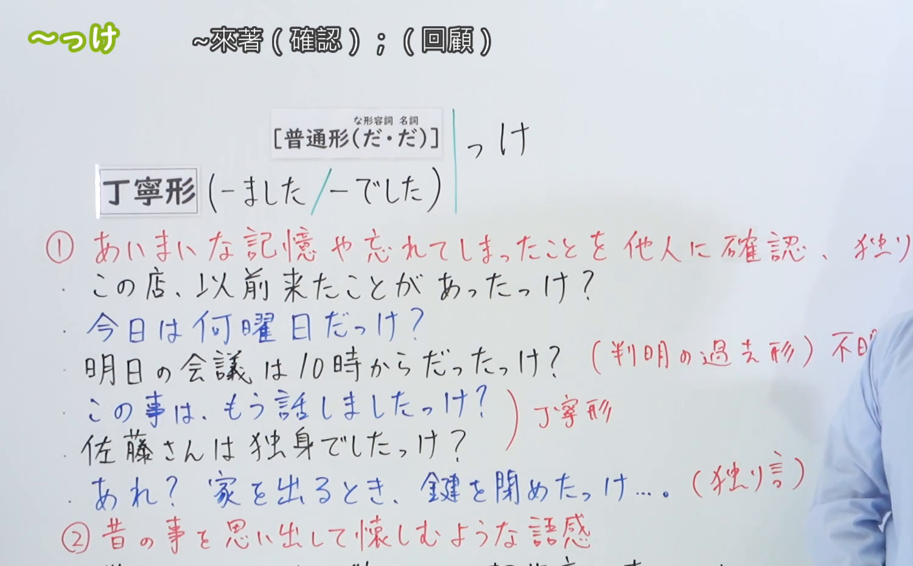
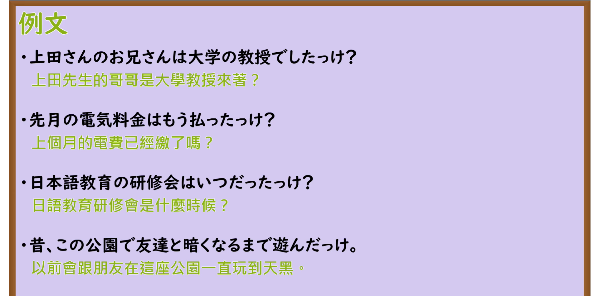

---
{
  "id": "N3-G-0033",
  "kind": "grammar",
  "level": "N3",
  "title": "〜っけ（……来着／回忆过去）",
  "card_revision": 1,
  "schema_version": 1,
  "source": {
    "lesson": "N3 第33个语法",
    "material": "出口日語原视频板书、日语自动字幕与Hagoromo文型检索正文",
    "video": "https://www.youtube.com/watch?v=1cKMQnOY1Gw",
    "screenshot": "assets/grammar/n3/N3-G-0033-connection.png",
    "screenshot_seconds": 390,
    "screenshot_crop": {
      "x": 0,
      "y": 0,
      "width": 1500,
      "height": 930
    }
  },
  "tags": [
    "っけ",
    "N3"
  ],
  "confusions": [
    "っけ",
    "け",
    "か"
  ]
}
---

# N3 第33个语法：〜っけ

# 视频学习资料整理

本课讲解 N3 语法形式「〜っけ」。

## 接续图（板书与讲解）

- 视频链接：[出口日語 N3 第33个语法](https://www.youtube.com/watch?v=1cKMQnOY1Gw)
- 真实时间：06:30（390.00秒）
- 原图尺寸：1920×1080
- 裁切说明：选用 06:30 画面，此时画面左上方语法标题与中文释义「〜っけ 〜來著（確認）；（回顧）」清晰无渐隐，板书已完整书写接续规则「普通形（な形容詞・名詞［だ・だ］）＋っけ」「丁寧形（〜ました／〜でした＋っけ）」以及两项核心语义「①あいまいな記憶や忘れてしまったことを他人に確認・独り言」「②昔の事を思い出して懐かしむような語感」；板书亦注明了判明过去形与独白自语用法。固定左上角（0, 0），裁切区域为宽 1500、高 930，去除右侧人像与底部空白，完整保留全部板书与顶部标题。
- 图片：

## 例句图（视频例句）

- 视频链接：[出口日語 N3 第33个语法](https://www.youtube.com/watch?v=1cKMQnOY1Gw)
- 真实时间：07:00（420.00秒）
- 原图尺寸：1920×1080
- 裁切说明：提取自视频 07:00 处的例句黑板页面。固定左上角（0, 0），裁切区域为宽 1920、高 950，裁去底部多余边框与杂物，完整保留四条例句及中文翻译。
- 图片：

# 核心

## 功能一：对模糊不清或一时遗忘的事实向对方确认，或在自言自语中自问核实（……来着）

**最上位意味カテゴリー：**

- **〜っけ：** 人との関係（人际关系与交际）

**中位意味カテゴリー：**

- **〜っけ：** 問いかけ（询问与求证）

**意味：**

- **〜っけ：** 確認（记忆模糊时的询问确认）

**くわしい意味記述：**

- **〜っけ：** はっきり分からないことを相手に確認する時に使う。（用于自己记忆不确定、或原本知晓但一时想不起来的事实，向对方求证核对；也可用于自言自语确认自身行为。）

### 例句

1. 明日の会議は何時から始まるんだったっけ。

   （明天的会议是几点开始来着？）

2. この店、以前みんなで一緒に来たことがあったっけ？

   （这家店，以前大家一起有来过吗？）

3. あれ？家を出るときに、玄関の鍵を閉めたっけ。

   （咦？出门的时候，我到底锁门了没有来着？）

4. 佐藤さんは独身でしたっけ、それとも結婚していましたっけ。

   （佐藤先生是单身来着，还是已经结婚了来着？）

## 功能二：追忆遥远过去的经历或昔日旧事，带有怀旧或感慨的语气（……过呢／那时候……呢）

**最上位意味カテゴリー：**

- **〜っけ：** 考え・感情（思想与情感）

**中位意味カテゴリー：**

- **〜っけ：** 主張・断定的評価（主张与回顾断定）

**意味：**

- **〜っけ：** 主張（旧事怀想与追忆回想）

**くわしい意味記述：**

- **〜っけ：** 過去の出来事，思い出を回想する時に使う。（用于回顾过去的难忘经历或童年旧事，带有沉浸在回忆中的怀念与感慨语气。）

### 例句

1. 子供の頃は、夏休みになると毎日川で泳いだっけ。

   （小时候一到暑假，每天都在河里游泳呢。）

2. そういえば、去年の秋に京都を旅行した時も、こんなきれいな紅葉を見たっけ。

   （说起来，去年秋天去京都旅行时，也曾见过这般美丽的红叶呢。）

3. 学生時代はよく夜遅くまで友達と将来について語り合ったっけなあ。

   （学生时代经常跟朋友畅聊将来畅聊到深夜呢。）

# 来源

- [出口日語原视频](https://www.youtube.com/watch?v=1cKMQnOY1Gw)
- [Hagoromo 文型検索「っけ（確認）」](https://hagoromo-text.work/lookup?vid=773)（查询日期：2026-09-25）
- [Hagoromo 文型検索「っけ（回想）」](https://hagoromo-text.work/lookup?vid=774)（查询日期：2026-09-25）
