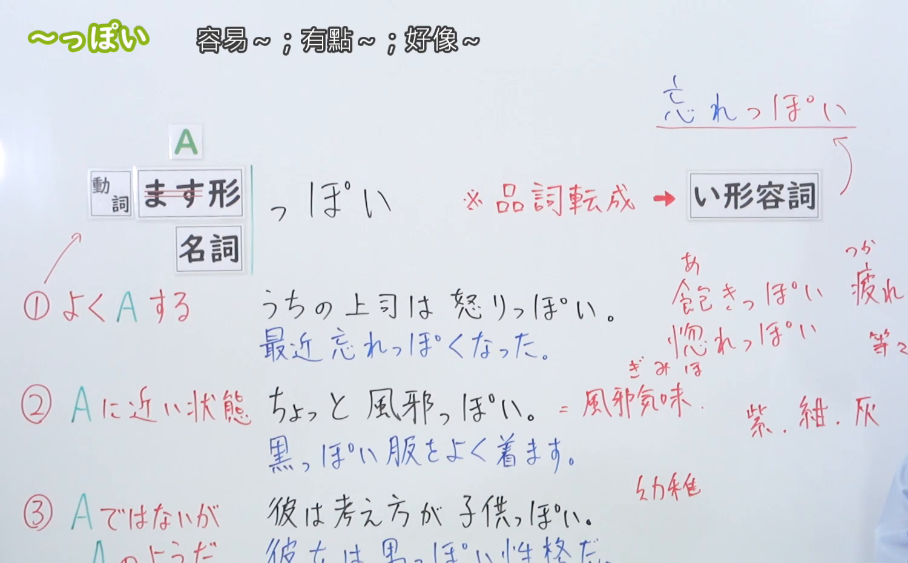
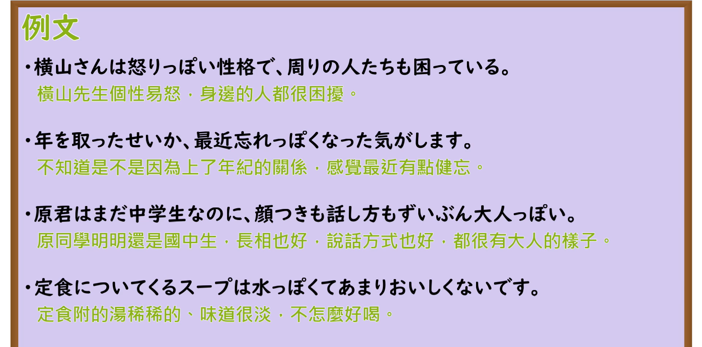

---
{
  "id": "N3-G-0034",
  "kind": "grammar",
  "level": "N3",
  "title": "〜っぽい（容易……／有点……／像……似的）",
  "card_revision": 1,
  "schema_version": 1,
  "source": {
    "lesson": "N3 第34个语法",
    "material": "出口日語原视频板书、日语自动字幕与Hagoromo文型检索正文",
    "video": "https://www.youtube.com/watch?v=q9hzJsLMqbk",
    "screenshot": "assets/grammar/n3/N3-G-0034-connection.png",
    "screenshot_seconds": 356,
    "screenshot_crop": {
      "x": 0,
      "y": 0,
      "width": 1500,
      "height": 930
    }
  },
  "tags": [
    "っぽい",
    "N3"
  ],
  "confusions": [
    "がち",
    "気味",
    "らしい"
  ]
}
---

# N3 第34个语法：〜っぽい

# 视频学习资料整理

本课讲解 N3 语法形式「〜っぽい」。

## 接续图（板书与讲解）

- 视频链接：[出口日語 N3 第34个语法](https://www.youtube.com/watch?v=q9hzJsLMqbk)
- 真实时间：05:56（356.00秒）
- 原图尺寸：1920×1080
- 裁切说明：选用 05:56 画面，此时画面左上方语法标题与中文释义「〜っぽい 容易〜；有點〜；好像〜」清晰无渐隐，板书已完整书写接续规则「動詞ます形（stem）／名詞＋っぽい（品詞転成⇒い形容詞）」以及核心三大倾向「①よくAする（怒りっぽい、忘れっぽい、飽きっぽい）」「②Aに近い状態（風邪っぽい、黒っぽい）」「③AではないがAのようだ（子供っぽい、男っぽい）」；出口老师在板书中特别提醒品词转变为一类形容词后的活用形式。固定左上角（0, 0），裁切区域为宽 1500、高 930，去除右侧人像与底部空白，完整保留全部板书与顶部标题。
- 图片：

## 例句图（视频例句）

- 视频链接：[出口日語 N3 第34个语法](https://www.youtube.com/watch?v=q9hzJsLMqbk)
- 真实时间：06:40（400.00秒）
- 原图尺寸：1920×1080
- 裁切说明：提取自视频 06:40 处的例句黑板页面。固定左上角（0, 0），裁切区域为宽 1920、高 950，裁去底部多余边框与杂物，完整保留四条例句及中文翻译。
- 图片：

# 核心

## 功能一：表示具备某种性质倾向、呈现某种感觉或极易频繁出现某行为（容易……／有点……／像……似的）

**最上位意味カテゴリー：**

- **〜っぽい：** ものごとの様子（事物的状态与样貌）

**中位意味カテゴリー：**

- **〜っぽい：** 傾向（倾向与样态）

**意味：**

- **〜っぽい：** 様態・傾向（性状倾向与外部特征）

**くわしい意味記述：**

- **〜っぽい：** Nっぽいの場合は「〜のような感じがする」の意味で，Nの典型的な性質を持っていることを表す。Vっぽいは「すぐに〜する性質である」という意味だが，パターンは限られている。（接名词时表示带有某种明显的特征、颜色倾向或让人有该种感觉；接动词连用形时表示动辄如此、容易产生该行为的性格与倾向。）

### 例句

1. 祖父は最近年をとったせいか、少し忘れっぽくなってきた。

   （祖父近来大概是因为上了年纪，变得有些容易忘事。）

2. 今日は朝から体がだるくて、少し熱っぽい。

   （今天从早起就觉得浑身乏力，有点发烧的感觉。）

3. もう大学生なのだから、そんな子どもっぽい話し方はやめなさい。

   （既然已经是大学生了，就别再用那种小孩子气的幼稚腔调说话了。）

4. このジャケットは値段の割に安っぽく見えなくて、着心地もいい。

   （这件夹克衫虽然便宜却不显廉价，穿起来也很舒服。）

# 来源

- [出口日語原视频](https://www.youtube.com/watch?v=q9hzJsLMqbk)
- [Hagoromo 文型検索「Nっぽい」](https://hagoromo-text.work/lookup?vid=106)（查询日期：2026-09-25）
