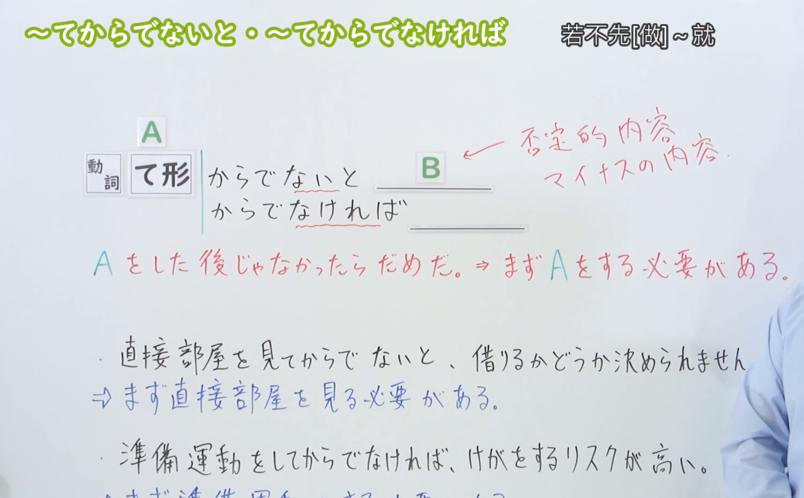
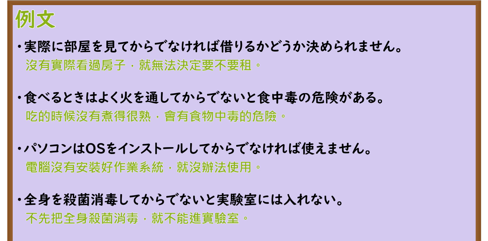

---
{
  "id": "N3-G-0035",
  "kind": "grammar",
  "level": "N3",
  "title": "〜てからでないと／〜てからでなければ（若不先……就不能……）",
  "card_revision": 1,
  "schema_version": 1,
  "source": {
    "lesson": "N3 第35个语法",
    "material": "出口日語原视频板书、日语自动字幕与Hagoromo文型检索正文",
    "video": "https://www.youtube.com/watch?v=BNr2aS7Xra0",
    "screenshot": "assets/grammar/n3/N3-G-0035-connection.png",
    "screenshot_seconds": 177,
    "screenshot_crop": {
      "x": 0,
      "y": 0,
      "width": 1500,
      "height": 930
    }
  },
  "tags": [
    "てからでないと",
    "てからでなければ",
    "からでないと",
    "からでなければ",
    "N3"
  ],
  "confusions": [
    "てから",
    "ないことには"
  ]
}
---

# N3 第35个语法：〜てからでないと／〜てからでなければ

# 视频学习资料整理

本课讲解 N3 语法形式「〜てからでないと／〜てからでなければ」。

## 接续图（板书与讲解）

- 视频链接：[出口日語 N3 第35个语法](https://www.youtube.com/watch?v=BNr2aS7Xra0)
- 真实时间：02:57（177.00秒）
- 原图尺寸：1920×1080
- 裁切说明：选用 02:57 画面，此时画面左上方语法标题与中文释义「〜てからでないと・〜てからでなければ 若不先[做]〜就」清晰无渐隐，板书已完整书写接续规则「動詞て形＋からでないと／からでなければ」以及核心语义「Aをした後じゃなかったらだめだ。⇒まずAをする必要がある」；出口老师在板书中特别强调后项B必须是否定内容或消极结果（否定的な内容／マイナスの内容），表达若前置条件不满足则后项决不可行。固定左上角（0, 0），裁切区域为宽 1500、高 930，去除右侧人像与底部空白，完整保留全部板书与顶部标题。
- 图片：

## 例句图（视频例句）

- 视频链接：[出口日語 N3 第35个语法](https://www.youtube.com/watch?v=BNr2aS7Xra0)
- 真实时间：03:25（205.00秒）
- 原图尺寸：1920×1080
- 裁切说明：提取自视频 03:25 处的例句黑板页面。固定左上角（0, 0），裁切区域为宽 1920、高 950，裁去底部多余边框与杂物，完整保留四条例句及中文翻译。
- 图片：

# 核心

## 功能一：表示必须在先完成某动作的前提下才能进行后项，否则后项无法实现或产生不良后果（若不先……就不能……）

**最上位意味カテゴリー：**

- **〜てからでないと／〜てからでなければ：** 場所・時間（场所与时间）

**中位意味カテゴリー：**

- **〜てからでないと／〜てからでなければ：** 時間的前後（时间先后顺序与前提条件）

**意味：**

- **〜てからでないと／〜てからでなければ：** 後（先行动作作为不可或缺的前提）

**くわしい意味記述：**

- **〜てからでないと／〜てからでなければ：** 「あることをした後でないとだめだから，別のことをする」という意味を表す。後には不可能や困難を表す文がくる。（表示若不先将某事完成便行不通，因此必须以此为先决步骤；句尾后项必定呼应不可能、不可行、困难或消极禁止的表达。）

### 例句

1. 契約書の内容をしっかり確認してからでないと、サインはできません。

   （必须仔细核实合同内容之后，才能签字。）

2. 実際に部屋を見てからでなければ、借りるかどうか決められません。

   （如果不亲自看一眼房间，就无法决定租还是不租。）

3. 親と相談してからでないと、留学するかどうか返事ができない。

   （如果不先和父母商量，就无法答复是否去留学。）

4. 準備運動をしてからでなければ、大けがをするリスクが高くなります。

   （如果不先做热身运动，发生严重受伤的风险就会很高。）

# 来源

- [出口日語原视频](https://www.youtube.com/watch?v=BNr2aS7Xra0)
- [Hagoromo 文型検索「Vてからでないと」](https://hagoromo-text.work/lookup?vid=808)（查询日期：2026-09-25）
- [Hagoromo 文型検索「Vてからでなければ」](https://hagoromo-text.work/lookup?vid=809)（查询日期：2026-09-25）
