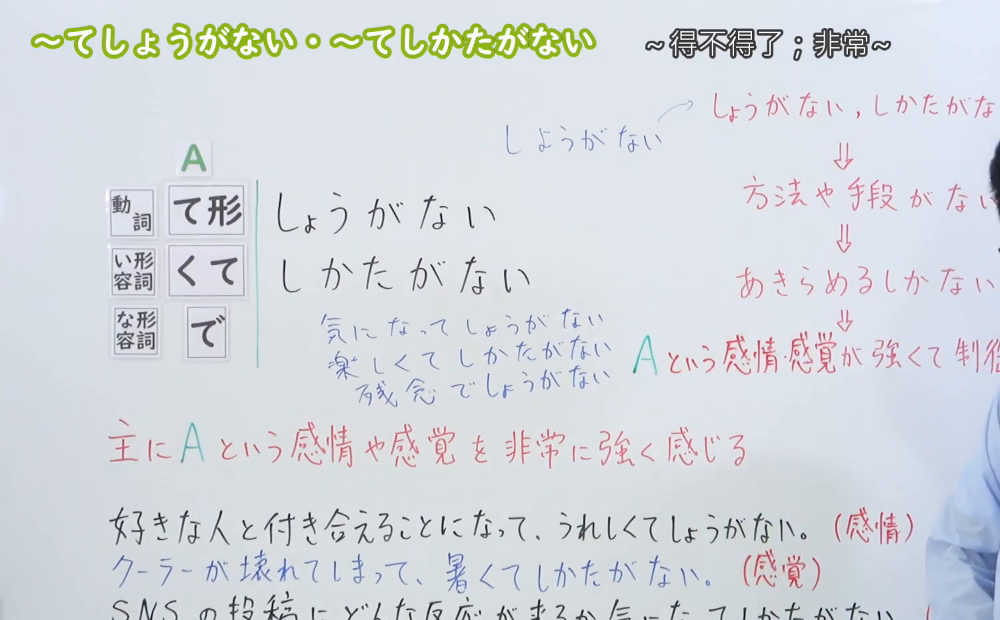
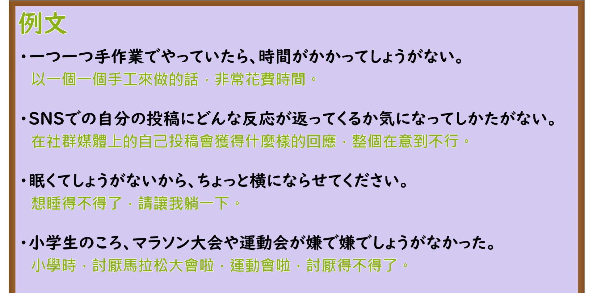

---
{
  "id": "N3-G-0036",
  "kind": "grammar",
  "level": "N3",
  "title": "〜てしょうがない／〜てしかたがない（……得不得了／非常……）",
  "card_revision": 1,
  "schema_version": 1,
  "source": {
    "lesson": "N3 第36个语法",
    "material": "出口日語原视频板书、日语自动字幕与Hagoromo文型检索正文",
    "video": "https://www.youtube.com/watch?v=cqkc0yJGQx4",
    "screenshot": "assets/grammar/n3/N3-G-0036-connection.png",
    "screenshot_seconds": 283,
    "screenshot_crop": {
      "x": 0,
      "y": 0,
      "width": 1500,
      "height": 930
    }
  },
  "tags": [
    "てしょうがない",
    "てしかたがない",
    "N3"
  ],
  "confusions": [
    "てたまらない",
    "てならない"
  ]
}
---

# N3 第36个语法：〜てしょうがない／〜てしかたがない

# 视频学习资料整理

本课讲解 N3 语法形式「〜てしょうがない／〜てしかたがない」。

## 接续图（板书与讲解）

- 视频链接：[出口日語 N3 第36个语法](https://www.youtube.com/watch?v=cqkc0yJGQx4)
- 真实时间：04:43（283.00秒）
- 原图尺寸：1920×1080
- 裁切说明：选用 04:43 画面，此时画面左上方语法标题与中文释义「〜てしょうがない・〜てしかたがない 〜得不得了；非常〜」清晰无渐隐，板书已完整书写接续规则「動詞て形／い形容詞くて／な形容詞で＋しょうがない／しかたがない」以及核心语义「主にAという感情や感覚を非常に強く感じる」；出口老师在板书中特别剖析「しょうがない／しかたがない＝方法や手段がない⇒あきらめるしかない⇒Aという感情・感覚が強くて制御できない」的语义演变脉络。固定左上角（0, 0），裁切区域为宽 1500、高 930，去除右侧人像与底部空白，完整保留全部板书与顶部标题。
- 图片：

## 例句图（视频例句）

- 视频链接：[出口日語 N3 第36个语法](https://www.youtube.com/watch?v=cqkc0yJGQx4)
- 真实时间：05:20（320.00秒）
- 原图尺寸：1920×1080
- 裁切说明：提取自视频 05:20 处的例句黑板页面。固定左上角（0, 0），裁切区域为宽 1920、高 950，裁去底部多余边框与杂物，完整保留四条例句及中文翻译。
- 图片：

# 核心

## 功能一：表示某种情绪、感觉或生理欲求极其强烈，自身无法克制或难以自拔（……得不得了／非常……）

**最上位意味カテゴリー：**

- **〜てしょうがない／〜てしかたがない：** 考え・感情（思想与情感）

**中位意味カテゴリー：**

- **〜てしょうがない／〜てしかたがない：** 避けられない心情・行動（无法克制的心情与行为）

**意味：**

- **〜てしょうがない／〜てしかたがない：** 心情（自然涌出且无法压抑的强烈感情与感觉）

**くわしい意味記述：**

- **〜てしょうがない／〜てしかたがない：** 話し手の感情・欲求などが非常に強いので，我慢できないというときに使う。（说话人的情感、感觉或欲求极其浓烈，达到了自身无法忍受或按捺不住的极高程度。）

### 例句

1. 志望していた大学に合格できて、嬉しくてしょうがない。

   （能考上梦寐以求的心仪大学，真是开心得不得了。）

2. 昨夜からクーラーが故障してしまい、部屋の中が暑くてしかたがない。

   （从昨晚起空调就坏了，屋子里热得让人受不了。）

3. 面接試験の結果がどうなるか、気になってしょうがない。

   （面试的结果究竟会怎样，心里实在挂念得放不下。）

4. 一日中立ち仕事をしていたので、足が痛くてしかたがありませんでした。

   （因为站着干了一整天活，双脚酸痛得难以忍受。）

# 来源

- [出口日語原视频](https://www.youtube.com/watch?v=cqkc0yJGQx4)
- [Hagoromo 文型検索「てしかた（が）ない」](https://hagoromo-text.work/lookup?vid=821)（查询日期：2026-09-25）
