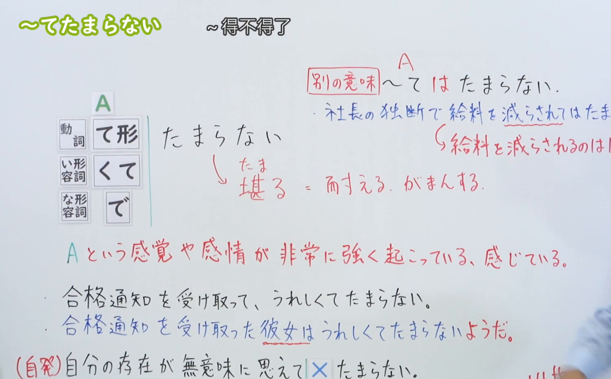
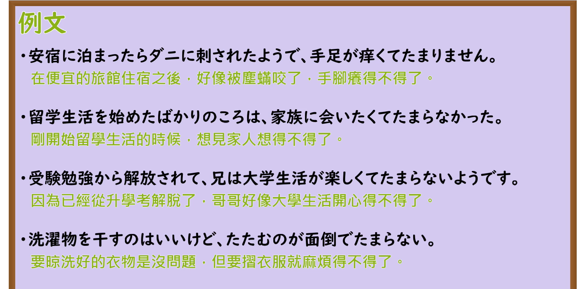

---
{
  "id": "N3-G-0037",
  "kind": "grammar",
  "level": "N3",
  "title": "〜てたまらない（……得受不了／非常……）",
  "card_revision": 1,
  "schema_version": 1,
  "source": {
    "lesson": "N3 第37个语法",
    "material": "出口日語原视频板书、日语自动字幕与Hagoromo文型检索正文",
    "video": "https://www.youtube.com/watch?v=IckBfBZ5KmM",
    "screenshot": "assets/grammar/n3/N3-G-0037-connection.png",
    "screenshot_seconds": 391,
    "screenshot_crop": {
      "x": 0,
      "y": 0,
      "width": 1500,
      "height": 930
    }
  },
  "tags": [
    "てたまらない",
    "たまらない",
    "N3"
  ],
  "confusions": [
    "てしょうがない",
    "てならない"
  ]
}
---

# N3 第37个语法：〜てたまらない

# 视频学习资料整理

本课讲解 N3 语法形式「〜てたまらない」。

## 接续图（板书与讲解）

- 视频链接：[出口日語 N3 第37个语法](https://www.youtube.com/watch?v=IckBfBZ5KmM)
- 真实时间：06:31（391.00秒）
- 原图尺寸：1920×1080
- 裁切说明：选用 06:31 画面，此时画面左上方语法标题与中文释义「〜てたまらない 〜得不得了」清晰无渐隐，板书已完整书写接续规则「動詞て形／い形容詞くて／な形容詞で＋たまらない」以及核心语义「Aという感覚や感情が非常に強く起こっている、感じている」；出口老师在板书中特别剖析「堪る＝耐える、がまんする」，并对主语为人称限制（第三人称须后加〜ようだ/〜らしい）、自发动词搭配限制以及易混句型「〜てはたまらない」做出专门辨析与例释。固定左上角（0, 0），裁切区域为宽 1500、高 930，去除右侧人像与底部空白，完整保留全部板书与顶部标题。
- 图片：

## 例句图（视频例句）

- 视频链接：[出口日語 N3 第37个语法](https://www.youtube.com/watch?v=IckBfBZ5KmM)
- 真实时间：07:15（435.00秒）
- 原图尺寸：1920×1080
- 裁切说明：提取自视频 07:15 处的例句黑板页面。固定左上角（0, 0），裁切区域为宽 1920、高 950，裁去底部多余边框与杂物，完整保留四条例句及中文翻译。
- 图片：

# 核心

## 功能一：表示某种生理感觉、心理愿望或情绪极其剧烈，难以忍耐（……得受不了／非常……）

**最上位意味カテゴリー：**

- **〜てたまらない：** 考え・感情（思想与情感）

**中位意味カテゴリー：**

- **〜てたまらない：** 避けられない心情・行動（无法克制的心情与行为）

**意味：**

- **〜てたまらない：** 心情（无法承受的高程度情感与生理感觉）

**くわしい意味記述：**

- **〜てたまらない：** 話し手の感情や感覚の程度が我慢できないくらい高いという意味を表す。（说话人的情感、感觉或欲求强烈到了难以忍耐、无法遏止的极致程度。）

### 例句

1. 一人暮らしを始めたばかりの頃は、家族に会いたくてたまらなかった。

   （刚开始一个人独立生活的时候，思念家人得受不了。）

2. 虫に刺されたところが赤く腫れて、かゆくてたまらない。

   （被虫子叮咬的地方红肿起来，痒得让人难以忍受。）

3. 長時間の試験が終わって、今は冷たいビールが飲みたくてたまりません。

   （漫长的考试终于结束了，现在真想马上喝上一杯冰啤酒想得不得了。）

4. 弟は新しいゲームを買ってもらって、自慢したくてたまらない様子だ。

   （弟弟新买到了游戏机，那一副迫不及待想要炫耀的样子溢于言表。）

# 来源

- [出口日語原视频](https://www.youtube.com/watch?v=IckBfBZ5KmM)
- [Hagoromo 文型検索「てたまらない」](https://hagoromo-text.work/lookup?vid=830)（查询日期：2026-09-25）
