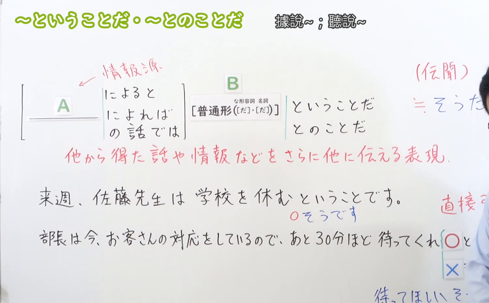
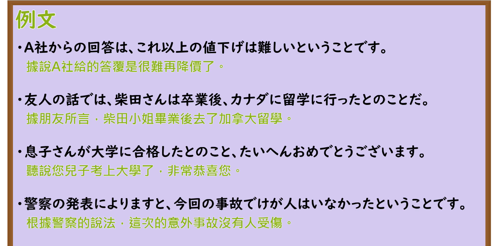

---
{
  "id": "N3-G-0038",
  "kind": "grammar",
  "level": "N3",
  "title": "〜ということだ／〜とのことだ（听说……／据传……）",
  "card_revision": 1,
  "schema_version": 1,
  "source": {
    "lesson": "N3 第38个语法",
    "material": "出口日語原视频板书、日语自动字幕与Hagoromo文型检索正文",
    "video": "https://www.youtube.com/watch?v=O7b7SlKA8YM",
    "screenshot": "assets/grammar/n3/N3-G-0038-connection.png",
    "screenshot_seconds": 299,
    "screenshot_crop": {
      "x": 0,
      "y": 0,
      "width": 1500,
      "height": 930
    }
  },
  "tags": [
    "ということだ",
    "とのことだ",
    "N3"
  ],
  "confusions": [
    "そうだ",
    "らしい"
  ]
}
---

# N3 第38个语法：〜ということだ／〜とのことだ

# 视频学习资料整理

本课讲解 N3 语法形式「〜ということだ／〜とのことだ」。

## 接续图（板书与讲解）

- 视频链接：[出口日語 N3 第38个语法](https://www.youtube.com/watch?v=O7b7SlKA8YM)
- 真实时间：04:59（299.00秒）
- 原图尺寸：1920×1080
- 裁切说明：选用 04:59 画面，此时画面左上方语法标题与中文释义「〜ということだ・〜とのことだ 據說〜；聽說〜」清晰无渐隐，板书已完整书写接续规则「情報源（によると／によれば／の話では）＋普通形（な形容詞・名詞［だ］・［だ］）＋ということだ／とのことだ」以及核心语义「他から得た話や情報などをさらに他人に伝える表現」；出口老师在板书中特别比较了与「〜そうだ」的区别，强调转述间接命令（待ってくれということだ）时不能替换为そうだ。固定左上角（0, 0），裁切区域为宽 1500、高 930，去除右侧人像与底部空白，完整保留全部板书与顶部标题。
- 图片：

## 例句图（视频例句）

- 视频链接：[出口日語 N3 第38个语法](https://www.youtube.com/watch?v=O7b7SlKA8YM)
- 真实时间：05:30（330.00秒）
- 原图尺寸：1920×1080
- 裁切说明：提取自视频 05:30 处的例句黑板页面。固定左上角（0, 0），裁切区域为宽 1920、高 950，裁去底部多余边框与杂物，完整保留四条例句及中文翻译。
- 图片：

# 核心

## 功能一：引述从他人、新闻报道或外界渠道获悉的信息并向他人传达（据传……／听说……）

**最上位意味カテゴリー：**

- **〜ということだ／〜とのことだ：** ものごとの関係（事物的关系）

**中位意味カテゴリー：**

- **〜ということだ／〜とのことだ：** 伝聞・引用（传闻与客观转述）

**意味：**

- **〜ということだ／〜とのことだ：** 伝聞（转达外部获取的消息）

**くわしい意味記述：**

- **〜ということだ／〜とのことだ：** 伝聞を表す。他の人から聞いたことを表す。（用于传达从第三方、书面记载、新闻报道等外部途径所获得的信息；比口语形式更具书面语色彩，常用「〜によると/によれば」明示信息来源。）

### 例句

1. ニュースによると、来月から電気料金が値上げされるということです。

   （据新闻报道，从下个月起电费将会上调。）

2. 天気予報によれば、明日は午後から大雨になるということです。

   （根据天气预报，明天从下午开始会下大雨。）

3. 部長からのメールによると、本日の会議は午後三時に変更されたとのことです。

   （据部长的邮件通知，今天的会议改至下午三点举行。）

4. 先輩からの伝言で、明日は少し早めに集合してほしいとのことでした。

   （学长传来口信，希望大家明天稍微提早一点集合。）

# 来源

- [出口日語原视频](https://www.youtube.com/watch?v=O7b7SlKA8YM)
- [Hagoromo 文型検索「ということだ（伝聞）」](https://hagoromo-text.work/lookup?vid=915)（查询日期：2026-09-25）
- [Hagoromo 文型検索「とのことだ」](https://hagoromo-text.work/lookup?vid=1052)（查询日期：2026-09-25）
