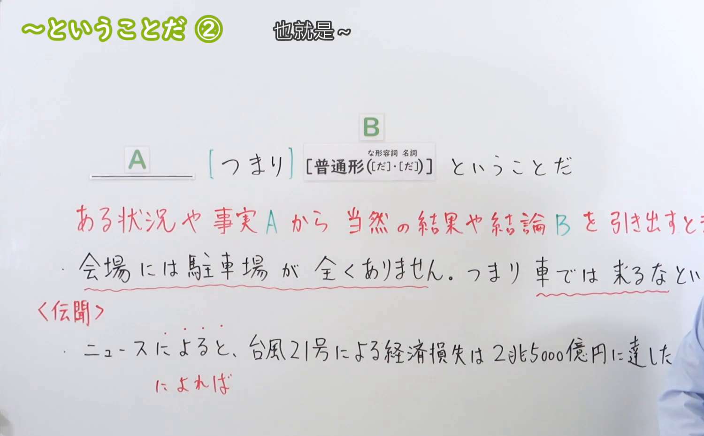
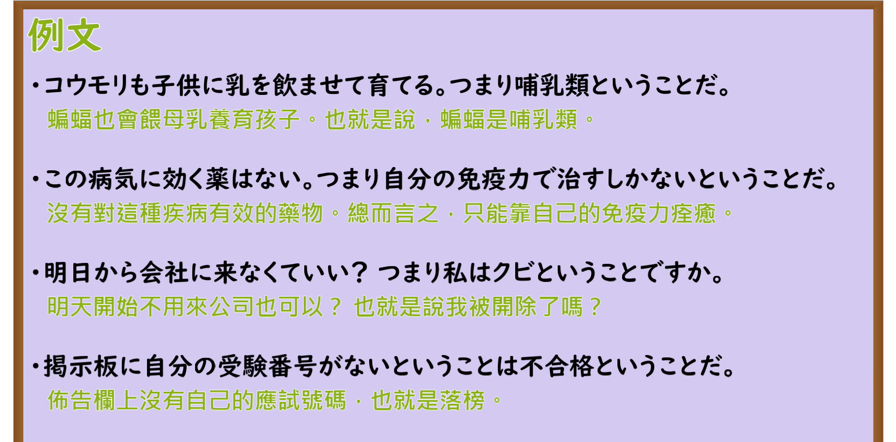

---
{
  "id": "N3-G-0039",
  "kind": "grammar",
  "level": "N3",
  "title": "〜ということだ（也就是说……／意味着……）",
  "card_revision": 1,
  "schema_version": 1,
  "source": {
    "lesson": "N3 第39个语法",
    "material": "出口日語原视频板书、日语自动字幕与Hagoromo文型检索正文",
    "video": "https://www.youtube.com/watch?v=bB_xNOl6c9U",
    "screenshot": "assets/grammar/n3/N3-G-0039-connection.png",
    "screenshot_seconds": 197,
    "screenshot_crop": {
      "x": 0,
      "y": 0,
      "width": 1500,
      "height": 930
    }
  },
  "tags": [
    "ということだ",
    "N3"
  ],
  "confusions": [
    "ということだ（伝聞）",
    "わけだ",
    "という意味だ"
  ]
}
---

# N3 第39个语法：〜ということだ

# 视频学习资料整理

本课讲解 N3 语法形式「〜ということだ」。

## 接续图（板书与讲解）

- 视频链接：[出口日語 N3 第39个语法](https://www.youtube.com/watch?v=bB_xNOl6c9U)
- 真实时间：03:17（197.00秒）
- 原图尺寸：1920×1080
- 裁切说明：选用 03:17 画面，此时画面左上方语法标题与中文释义「〜ということだ ② 也就是〜」清晰无渐隐，板书已完整书写接续规则「［つまり］＋普通形（な形容詞・名詞［だ］・［だ］）＋ということだ」以及核心语义「ある状況や事実Aから当然の結果や結論Bを引き出すとき」；出口老师在板书中特别提醒学习者本课侧重于逻辑推导与实质解释，常与「つまり／要するに」搭配呼应。固定左上角（0, 0），裁切区域为宽 1500、高 930，去除右侧人像与底部空白，完整保留全部板书与顶部标题。
- 图片：

## 例句图（视频例句）

- 视频链接：[出口日語 N3 第39个语法](https://www.youtube.com/watch?v=bB_xNOl6c9U)
- 真实时间：03:47（227.00秒）
- 原图尺寸：1920×1080
- 裁切说明：提取自视频 03:47 处的例句黑板页面。固定左上角（0, 0），裁切区域为宽 1920、高 950，裁去底部多余边框与杂物，完整保留四条例句及中文翻译。
- 图片：

# 核心

## 功能一：依据已知状况、事实或前提条件，自然推导出结论或做出实质归纳（也就是说……／这就意味着……）

**最上位意味カテゴリー：**

- **〜ということだ：** 考え・感情（思想与情感）

**中位意味カテゴリー：**

- **〜ということだ：** 主張・断定的評価（主张与逻辑断定）

**意味：**

- **〜ということだ：** 評価（事实导出之结论与实质评判）

**くわしい意味記述：**

- **〜ということだ：** ある事柄を受けて，そこから何らかの結論を導き出すことを表す。（承接前述事实、状况或客观数据，从中顺理成章地提炼出推论、解释或实质结论，常与副词「つまり/要するに」呼应使用。）

### 例句

1. 会場に駐車場がないということは、電車やバスで来てくださいということだ。

   （会场没有停车场，这也就意味着请大家乘坐电车或公交车前往。）

2. 返事がないということは、今回の提案を断られたということだろう。

   （没有得到回复，这就意味着对方大概是拒绝了这次的提议吧。）

3. 合格点が80点以上ということは、79点では不合格になるということですね。

   （合格分数线是80分以上，也就是说考79分也是算作不合格的对吧。）

4. 減給を受け入れられないなら、この会社を辞めるしかないということだ。

   （如果无法接受降薪，那就意味着除了离开这家公司别无他选。）

# 来源

- [出口日語原视频](https://www.youtube.com/watch?v=bB_xNOl6c9U)
- [Hagoromo 文型検索「ということだ（結論・評価）」](https://hagoromo-text.work/lookup?vid=916)（查询日期：2026-09-25）
