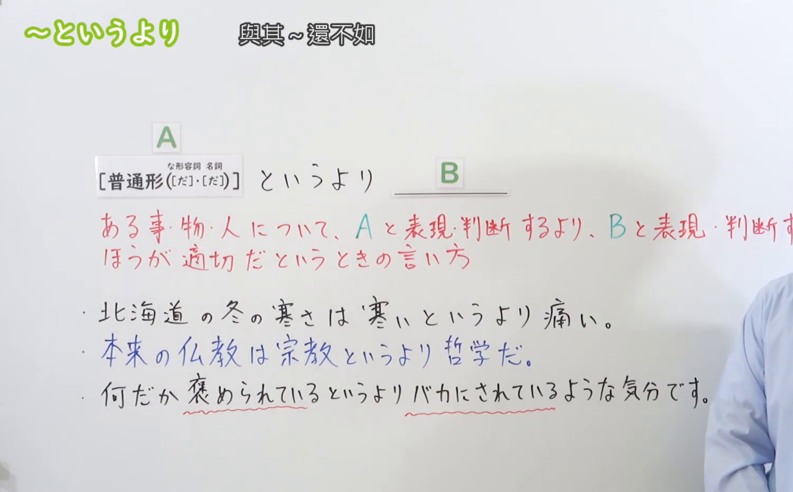
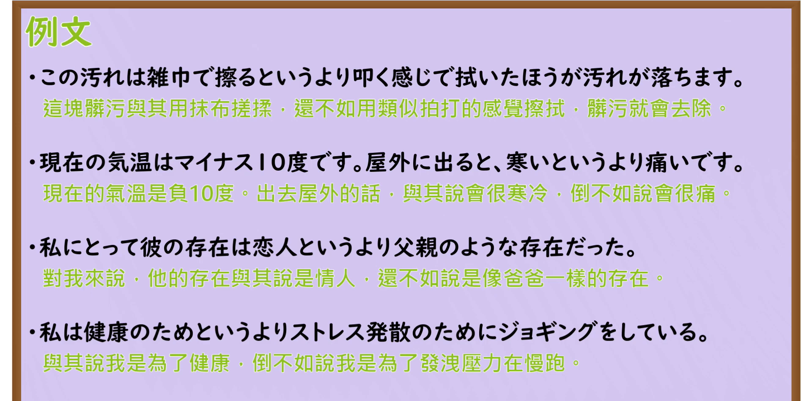

---
{
  "id": "N3-G-0040",
  "kind": "grammar",
  "level": "N3",
  "title": "〜というより（与其说……不如说……）",
  "card_revision": 1,
  "schema_version": 1,
  "source": {
    "lesson": "N3 第40个语法",
    "material": "出口日語原视频板书、日语自动字幕与Hagoromo文型检索正文",
    "video": "https://www.youtube.com/watch?v=pkq_IlcD5TA",
    "screenshot": "assets/grammar/n3/N3-G-0040-connection.png",
    "screenshot_seconds": 164,
    "screenshot_crop": {
      "x": 0,
      "y": 0,
      "width": 1500,
      "height": 930
    }
  },
  "tags": [
    "というより",
    "N3"
  ],
  "confusions": [
    "より",
    "むしろ"
  ]
}
---

# N3 第40个语法：〜というより

# 视频学习资料整理

本课讲解 N3 语法形式「〜というより」。

## 接续图（板书与讲解）

- 视频链接：[出口日語 N3 第40个语法](https://www.youtube.com/watch?v=pkq_IlcD5TA)
- 真实时间：02:44（164.00秒）
- 原图尺寸：1920×1080
- 裁切说明：选用 02:44 画面，此时画面左上方语法标题与中文释义「〜というより 與其〜還不如」清晰无渐隐，板书已完整书写接续规则「普通形（な形容詞・名詞［だ］・［だ］）＋というより ＿＿＿B」以及核心语义「ある事・物・人について、Aと表現・判断するより、Bと表現・判断するほうが適切だというときの言い方」；出口老师在板书中特别强调说话人并非完全否定A，而是认为B能更为精确、贴切地刻画当下的真实感受或事态特征。固定左上角（0, 0），裁切区域为宽 1500、高 930，去除右侧人像与底部空白，完整保留全部板书与顶部标题。
- 图片：

## 例句图（视频例句）

- 视频链接：[出口日語 N3 第40个语法](https://www.youtube.com/watch?v=pkq_IlcD5TA)
- 真实时间：03:15（195.00秒）
- 原图尺寸：1920×1080
- 裁切说明：提取自视频 03:15 处的例句黑板页面。固定左上角（0, 0），裁切区域为宽 1920、高 950，裁去底部多余边框与杂物，完整保留四条例句及中文翻译。
- 图片：

# 核心

## 功能一：对同一事物进行比照时，认为后项描述比前项更加贴切、准确（与其说……不如说……）

**最上位意味カテゴリー：**

- **〜というより：** ものごとの関係（事物的关系）

**中位意味カテゴリー：**

- **〜というより：** 対比（对比与更替判定）

**意味：**

- **〜というより：** 比較（贴切度与合适度的比较修正）

**くわしい意味記述：**

- **〜というより：** 「Xという言い方よりもむしろYと言った方がいい」という意味を表す。（表示针对某一状态、事实或性质，认为比起用X来表达，改用Y来描述更为确切、更符合实际情况。）

### 例句

1. 北海道の冬の寒さは、寒いというより痛いと感じるほどだ。

   （北海道冬天的严寒，与其说是冷，不如说甚至感到刺骨的疼痛。）

2. あの人の態度は、親切というよりおせっかいに思える。

   （那个人的态度，与其说是热情好客，不如说更让人觉得多管闲事。）

3. 私にとって彼の存在は、恋人というより頼れる兄のような存在だった。

   （对我来说他的存在，与其说是恋人，不如说是如可靠兄长一般的存在。）

4. この汚れは雑巾でこするというより、叩くようにして拭いたほうがよく落ちます。

   （这种污渍与其用抹布用力去擦，不如像拍打一样去擦拭更容易清除。）

# 来源

- [出口日語原视频](https://www.youtube.com/watch?v=pkq_IlcD5TA)
- [Hagoromo 文型検索「というより」](https://hagoromo-text.work/lookup?vid=930)（查询日期：2026-09-25）
