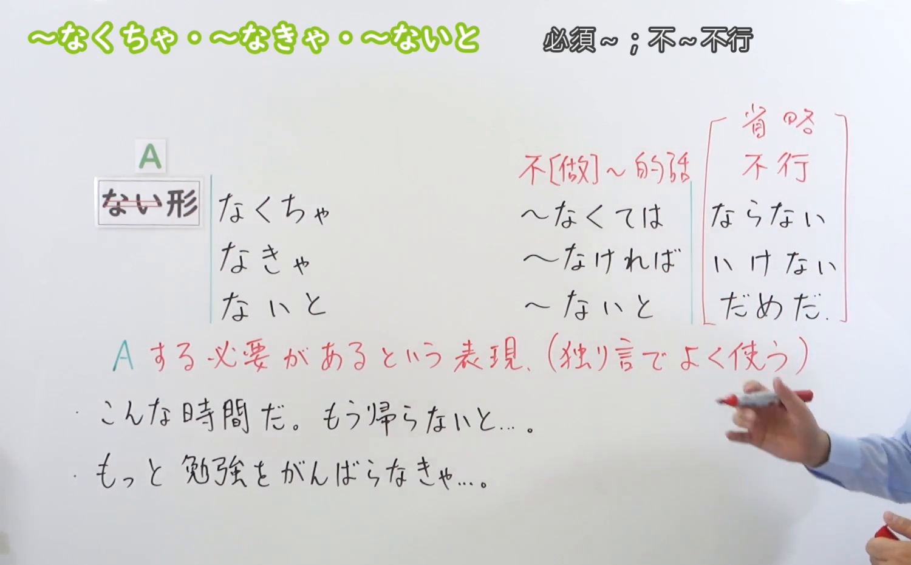
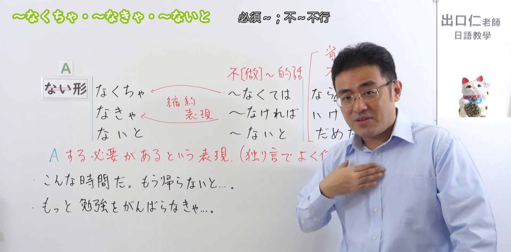

---
{
  "id": "N3-G-0041",
  "kind": "grammar",
  "level": "N3",
  "title": "〜なくちゃ／〜なきゃ／〜ないと（必须……／不……不行）",
  "card_revision": 1,
  "schema_version": 1,
  "source": {
    "lesson": "N3 第41个语法",
    "material": "出口日語原视频板书、日语自动字幕与Hagoromo文型检索正文",
    "video": "https://www.youtube.com/watch?v=aU8MLusen0g",
    "screenshot": "assets/grammar/n3/N3-G-0041-connection.png",
    "screenshot_seconds": 90,
    "screenshot_crop": {
      "x": 0,
      "y": 0,
      "width": 1500,
      "height": 930
    }
  },
  "tags": [
    "なくちゃ",
    "なきゃ",
    "ないと",
    "N3"
  ],
  "confusions": [
    "なければならない",
    "なくてはいけない"
  ]
}
---

# N3 第41个语法：〜なくちゃ／〜なきゃ／〜ないと

# 视频学习资料整理

本课讲解 N3 语法形式「〜なくちゃ／〜なきゃ／〜ないと」。

## 接续图（板书与讲解）

- 视频链接：[出口日語 N3 第41个语法](https://www.youtube.com/watch?v=aU8MLusen0g)
- 真实时间：01:30（90.00秒）
- 原图尺寸：1920×1080
- 裁切说明：选用 01:30 画面，此时画面左上方语法标题与中文释义「〜なくちゃ・〜なきゃ・〜ないと 必須〜；不〜不行」清晰无渐隐，板书已完整书写接续规则「動詞ない形（ないを取る）＋なくちゃ／なきゃ／ないと」以及核心语义「A する必要があるという表現（独り言でよく使う）」；出口老师在板书中特别剖析三者是由书面形「〜なくては／〜なければ／〜ないと」后项省略「ならない／いけない／だめだ」缩约而来的口语形式。固定左上角（0, 0），裁切区域为宽 1500、高 930，去除右侧人像与底部空白，完整保留全部板书与顶部标题。
- 图片：

## 例句图（视频例句）

- 视频链接：[出口日語 N3 第41个语法](https://www.youtube.com/watch?v=aU8MLusen0g)
- 真实时间：02:18（138.00秒）
- 原图尺寸：1920×1080
- 裁切说明：提取自视频 02:18 处的例句黑板页面。固定左上角（0, 0），裁切区域为宽 1920、高 950，裁去底部多余边框与杂物，完整保留四条例句及中文翻译。
- 图片：

# 核心

## 功能一：表示必须做某事、不得不做某事，多用于日常口语及自言自语（必须……／不……不行）

**最上位意味カテゴリー：**

- **〜なくちゃ／〜なきゃ／〜ないと：** 考え・感情（思想与情感）

**中位意味カテゴリー：**

- **〜なくちゃ／〜なきゃ／〜ないと：** 許可・禁止・義務・不必要（许可、禁止与义务）

**意味：**

- **〜なくちゃ／〜なきゃ／〜ないと：** 義務、勧告・忠告（日常义务与自省催促）

**くわしい意味記述：**

- **〜なくちゃ／〜なきゃ／〜ないと：** 相手や自分にある行動を促すために使う言葉で，「〜なければだめだ」「〜なければ困る」という意味を表す。「Xないと。」という形で，文末の述語が省略されることが多い。（日常会话中用于催促自己或对方采取某种必要行动，相当于“必须……/不……不行”；属于「なくては／なければ／ないと＋ならない／いけない／だめだ」省略后项的口语缩约表现，在自言自语或对关系亲密之人讲话时极高频使用。）

### 例句

1. もうこんな時間だ。明日も朝早いから、そろそろ帰らないと。

   （已经这个时间了。明天一早还得早起，差不多必须回去了。）

2. 来週は日本語能力試験の本番だから、もっと勉強をがんばらなきゃ。

   （下周就是日语能力考试的正式考试了，我必须得更加努力复习才行。）

3. レポートの提出締め切りは明日だから、今日中に仕上げなくちゃ。

   （报告提交截止日期就是明天，今天之内必须写完才行。）

4. 風邪がなかなか治らないので、早く病院へ行って薬をもらわなくちゃいけない。

   （感冒总是不见好，必须得早点去医院拿点药才行。）

# 来源

- [出口日語原视频](https://www.youtube.com/watch?v=aU8MLusen0g)
- [Hagoromo 文型検索「ないと」](https://hagoromo-text.work/lookup?vid=1105)（查询日期：2026-09-25）
- [Hagoromo 文型検索「なければならない」](https://hagoromo-text.work/lookup?vid=1136)（查询日期：2026-09-25）
