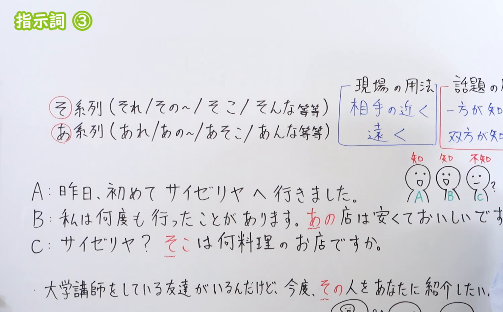
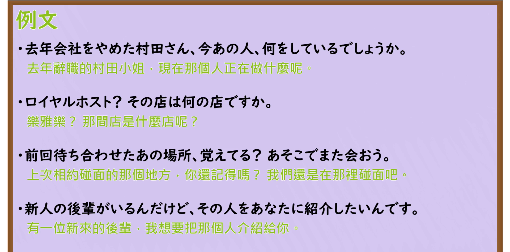

---
{
  "id": "N3-G-0042",
  "kind": "grammar",
  "level": "N3",
  "title": "指示詞 ③（文脉指示：これ・それ・あれ）",
  "card_revision": 1,
  "schema_version": 1,
  "source": {
    "lesson": "N3 第42个语法",
    "material": "出口日語原视频板书、日语自动字幕与Hagoromo文型检索正文",
    "video": "https://www.youtube.com/watch?v=ueBNkMb14Fc",
    "screenshot": "assets/grammar/n3/N3-G-0042-connection.png",
    "screenshot_seconds": 302,
    "screenshot_crop": {
      "x": 0,
      "y": 0,
      "width": 1500,
      "height": 930
    }
  },
  "tags": [
    "指示詞",
    "これ",
    "それ",
    "あれ",
    "N3"
  ],
  "confusions": [
    "現場指示",
    "文脈指示"
  ]
}
---

# N3 第42个语法：指示詞 ③

# 视频学习资料整理

本课讲解 N3 语法形式「指示詞 ③」。

## 接续图（板书与讲解）

- 视频链接：[出口日語 N3 第42个语法](https://www.youtube.com/watch?v=ueBNkMb14Fc)
- 真实时间：05:02（302.00秒）
- 原图尺寸：1920×1080
- 裁切说明：选用 05:02 画面，此时画面左上方语法标题「指示詞 ③」清晰无渐隐，板书已完整书写文脉指示的分类与核心判断原则「現場の用法（相手の近く／遠く）」与「話題の用法（そ系列：一方が知っている／あ系列：双方が知っている）」；出口老师在板书中特别以多段会话实例详述了双方已知时用「あ系列（あの店／あそこ）」、仅单方知悉时向对方说明用「そ系列（その人／そこ）」的规律。固定左上角（0, 0），裁切区域为宽 1500、高 930，去除右侧人像与底部空白，完整保留全部板书与顶部标题。
- 图片：

## 例句图（视频例句）

- 视频链接：[出口日語 N3 第42个语法](https://www.youtube.com/watch?v=ueBNkMb14Fc)
- 真实时间：05:25（325.00秒）
- 原图尺寸：1920×1080
- 裁切说明：提取自视频 05:25 处的例句黑板页面。固定左上角（0, 0），裁切区域为宽 1920、高 950，裁去底部多余边框与杂物，完整保留四条例句及中文翻译。
- 图片：

# 核心

## 功能一：在篇章与谈话上下文中指代前文出现的事物或概念（文脉指示）

**最上位意味カテゴリー：**

- **指示詞 ③：** もの・こと（事物与概念）

**中位意味カテゴリー：**

- **指示詞 ③：** 指示（指示与代词系统）

**意味：**

- **指示詞 ③：** 指示（文脉前后指代）

**くわしい意味記述：**

- **指示詞 ③：** 文脈の中で前に述べられた事柄や話題を指し示す用法。話し手と聞き手の双方が知っている事柄には「あ系列」、一方のみが知っている事柄には「そ系列」を用いる。（在语境与会话话题中用于指称上下文提及的事实与对象；当交际双方均了解该话题时用「あ系列（あの／あれ）」，仅一方了解而另一方不甚了解时用「そ系列（その／それ）」；谈及紧接在自己眼前的话题或主观拉近心理距离时可用「これ」。）

### 例句

1. 昨日、初めてサイゼリヤへ行きました。あの店は安くて本当においしいですね。

   （昨天我第一次去了萨莉亚。那家店真的很便宜又好吃呢。（双方皆知））

2. 大学で講師をしている友達がいるんだけど、今度その人をあなたに紹介したい。

   （我有一位在大学当讲师的朋友，下次想把那个人介绍给你认识。（单方知悉））

3. 先週見た映画、すごく面白かったよ。あれ、君ももう見たっけ？

   （上周看的那部电影太有意思了。那部片子，你也已经看过了来着？）

4. 最近新しいパソコンを買ったんですが、それがとても使いやすくて気に入っています。

   （最近买了一台新电脑，那个电脑用起来非常顺手，我很喜欢。）

# 来源

- [出口日語原视频](https://www.youtube.com/watch?v=ueBNkMb14Fc)
- [Hagoromo 文型検索「それ」](https://hagoromo-text.work/lookup?vid=648)（查询日期：2026-09-25）
- [Hagoromo 文型検索「あれ」](https://hagoromo-text.work/lookup?vid=243)（查询日期：2026-09-25）
