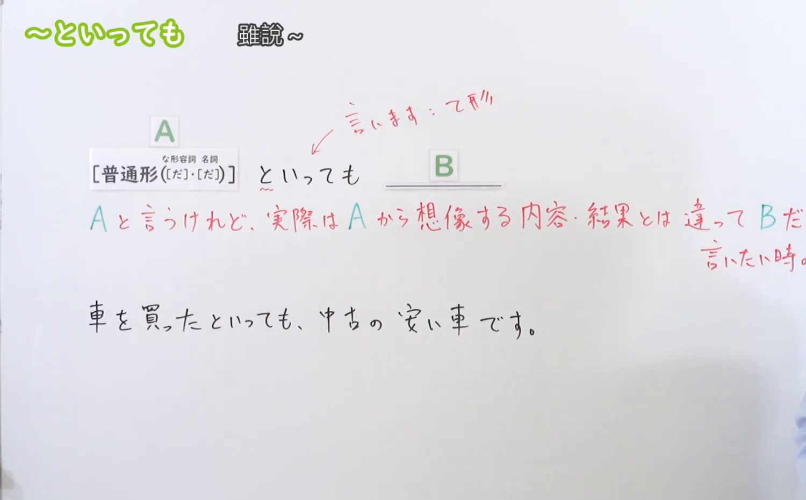
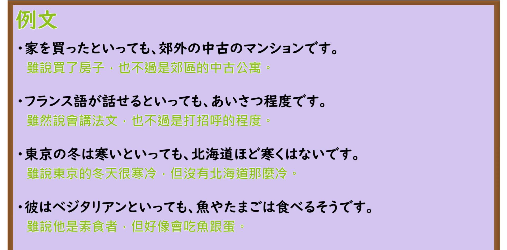

---
{
  "id": "N3-G-0043",
  "kind": "grammar",
  "level": "N3",
  "title": "〜といっても（虽说……但是……）",
  "card_revision": 1,
  "schema_version": 1,
  "source": {
    "lesson": "N3 第43个语法",
    "material": "出口日語原视频板书、日语自动字幕与Hagoromo文型检索正文",
    "video": "https://www.youtube.com/watch?v=sqeZl12X6cs",
    "screenshot": "assets/grammar/n3/N3-G-0043-connection.png",
    "screenshot_seconds": 130,
    "screenshot_crop": {
      "x": 0,
      "y": 0,
      "width": 1500,
      "height": 930
    }
  },
  "tags": [
    "といっても",
    "N3"
  ],
  "confusions": [
    "とはいっても",
    "とはいえ"
  ]
}
---

# N3 第43个语法：〜といっても

# 视频学习资料整理

本课讲解 N3 语法形式「〜といっても」。

## 接续图（板书与讲解）

- 视频链接：[出口日語 N3 第43个语法](https://www.youtube.com/watch?v=sqeZl12X6cs)
- 真实时间：02:10（130.00秒）
- 原图尺寸：1920×1080
- 裁切说明：选用 02:10 画面，此时画面左上方语法标题与中文释义「〜といっても 雖然說〜；但是〜」清晰无渐隐，板书已完整书写接续规则「普通形（な形容詞・名詞［だ］）＋といっても」以及核心语义「〜と言っても実際は違う／程度が低い（事実を認めつつ、そこから予想されるほどの水準ではないことを付け加える）」；出口老师在板书中特别提醒学习者当前项为名词或形容动词现在肯定形式时通常不加「だ」。固定左上角（0, 0），裁切区域为宽 1500、高 930，去除右侧人像与底部空白，完整保留全部板书与顶部标题。
- 图片：

## 例句图（视频例句）

- 视频链接：[出口日語 N3 第43个语法](https://www.youtube.com/watch?v=sqeZl12X6cs)
- 真实时间：02:35（155.00秒）
- 原图尺寸：1920×1080
- 裁切说明：提取自视频 02:35 处的例句黑板页面。固定左上角（0, 0），裁切区域为宽 1920、高 950，裁去底部多余边框与杂物，完整保留四条例句及中文翻译。
- 图片：

# 核心

## 功能一：先承认前项事实，随后指出实际情况与通常预想的程度有差距（虽说……但是……）

**最上位意味カテゴリー：**

- **〜といっても：** ものごとの関係（事物的关系）

**中位意味カテゴリー：**

- **〜といっても：** 逆接・譲歩（转折与让步）

**意味：**

- **〜といっても：** 話題提示・譲歩（话题限定与转折修正）

**くわしい意味記述：**

- **〜といっても：** 「〜と言いましたが，」の意味。すでに出た話題について，そこから一般に予想されることとは違う，ということを述べる時に使う。（表示虽然承认前项所说的名称、身份或事实，但后项紧接着说明其实际程度远没有通常人们预想的那么高，或者与一般印象存在差异。）

### 例句

1. 料理ができるといっても、簡単な卵焼きやスープが作れる程度です。

   （虽说会做饭，但也只是能做个简单的煎蛋和蛋汤的水平罢了。）

2. 日本に住んでいるといっても、まだ半年しか経っていないので日本語は下手です。

   （虽说住在日本，但因为才刚过了半年，日语还很蹩脚。）

3. 今週末は旅行に行くといっても、近場の温泉に一泊するだけですよ。

   （虽说这周末要去旅行，但也仅仅是去附近的温泉住上一晚而已。）

4. 新しい家を買ったといっても、とても狭くて古い中古マンションです。

   （虽说是买了新房子，但其实是一套非常狭小陈旧的二手公寓。）

# 来源

- [出口日語原视频](https://www.youtube.com/watch?v=sqeZl12X6cs)
- [Hagoromo 文型検索「といっても」](https://hagoromo-text.work/lookup?vid=950)（查询日期：2026-09-25）
