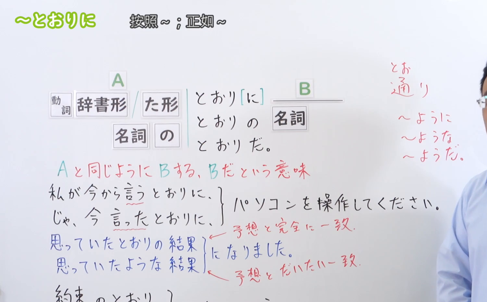
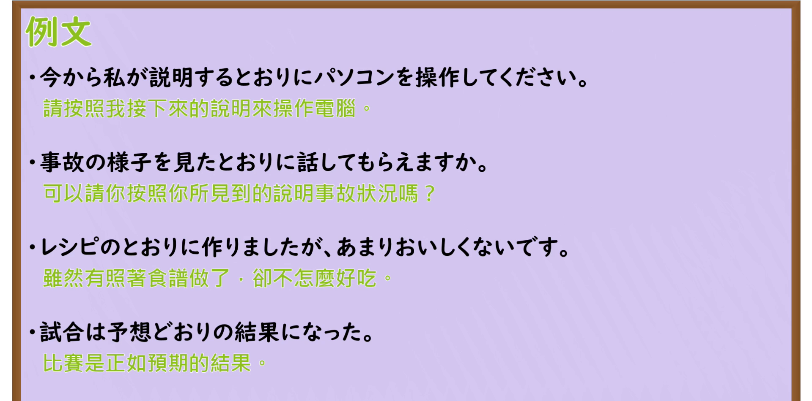

---
{
  "id": "N3-G-0044",
  "kind": "grammar",
  "level": "N3",
  "title": "〜とおりに／〜どおりに（照着……／按……那样）",
  "card_revision": 1,
  "schema_version": 1,
  "source": {
    "lesson": "N3 第44个语法",
    "material": "出口日語原视频板书、日语自动字幕与Hagoromo文型检索正文",
    "video": "https://www.youtube.com/watch?v=hDmL4cSlRiE",
    "screenshot": "assets/grammar/n3/N3-G-0044-connection.png",
    "screenshot_seconds": 316,
    "screenshot_crop": {
      "x": 0,
      "y": 0,
      "width": 1500,
      "height": 930
    }
  },
  "tags": [
    "とおりに",
    "どおりに",
    "N3"
  ],
  "confusions": [
    "とおり",
    "どおり",
    "まま"
  ]
}
---

# N3 第44个语法：〜とおりに／〜どおりに

# 视频学习资料整理

本课讲解 N3 语法形式「〜とおりに／〜どおりに」。

## 接续图（板书与讲解）

- 视频链接：[出口日語 N3 第44个语法](https://www.youtube.com/watch?v=hDmL4cSlRiE)
- 真实时间：05:16（316.00秒）
- 原图尺寸：1920×1080
- 裁切说明：选用 05:16 画面，此时画面左上方语法标题与中文释义「〜とおりに 按照〜」清晰无渐隐，板书已完整书写接续规则「動詞辞書形／動詞た形＋とおりに」「名詞＋のとおりに／名詞＋どおりに」以及核心语义「Aと同じようにBをする」；出口老师在板书中特别强调若名次直接紧接「とおり」时会发生连浊变为「〜どおり（予定どおり、思いどおり）」，而加上助词「の」时则保持清音「のとおりに」。固定左上角（0, 0），裁切区域为宽 1500、高 930，去除右侧人像与底部空白，完整保留全部板书与顶部标题。
- 图片：

## 例句图（视频例句）

- 视频链接：[出口日語 N3 第44个语法](https://www.youtube.com/watch?v=hDmL4cSlRiE)
- 真实时间：05:38（338.00秒）
- 原图尺寸：1920×1080
- 裁切说明：提取自视频 05:38 处的例句黑板页面。固定左上角（0, 0），裁切区域为宽 1920、高 950，裁去底部多余边框与杂物，完整保留四条例句及中文翻译。
- 图片：

# 核心

## 功能一：完全按照前述的示范、指示、计划或想法去进行后续行为（照着……／按……那样）

**最上位意味カテゴリー：**

- **〜とおりに／〜どおりに：** ものごとの関係（事物的关系）

**中位意味カテゴリー：**

- **〜とおりに／〜どおりに：** 基準（依据与基准）

**意味：**

- **〜とおりに／〜どおりに：** 同様（完全依照前项原样进行）

**くわしい意味記述：**

- **〜とおりに／〜どおりに：** 「〜と同じように」という意味を表す。動詞の辞書形では「思うとおり」「言うとおり」が多く，これらに関連する「おっしゃる，示す」や，「ている」を使う場合もある。（表示后续的行为、结果或状态与前项的指示、模范、计划或预期丝毫不差地完全一致；名词直接后续时常连浊读作「どおり」。）

### 例句

1. 私が今からやるのを見て、そのとおりにやってみてください。

   （看着我现在的动作示范，请照着那个样子试着做一遍。）

2. 先生が指示したとおりに実験を進めたら、無事に成功しました。

   （完全按照老师指示的那样推进实验，顺利取得了成功。）

3. 説明書の図の通りに組み立てれば、誰でも簡単に作ることができます。

   （只要按照说明书示意图那样去组装，无论是谁都能轻松做好。）

4. 工事は予定どおりに進んでおり、来月末には完成する見込みです。

   （工程正按计划顺利推进，预计下月底即可完工。）

# 来源

- [出口日語原视频](https://www.youtube.com/watch?v=hDmL4cSlRiE)
- [Hagoromo 文型検索「とおり（に）」](https://hagoromo-text.work/lookup?vid=974)（查询日期：2026-09-25）
