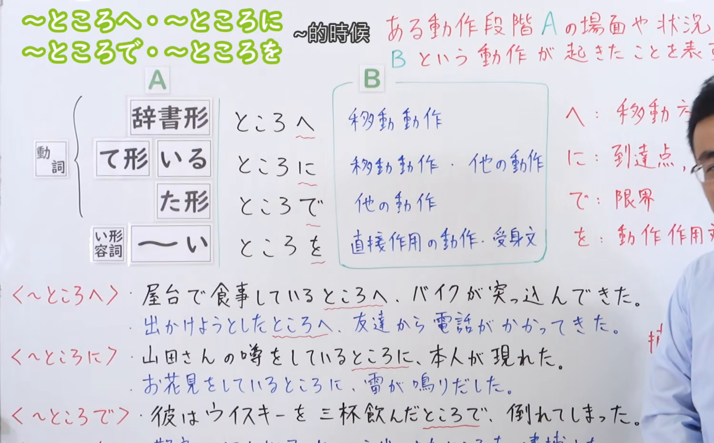
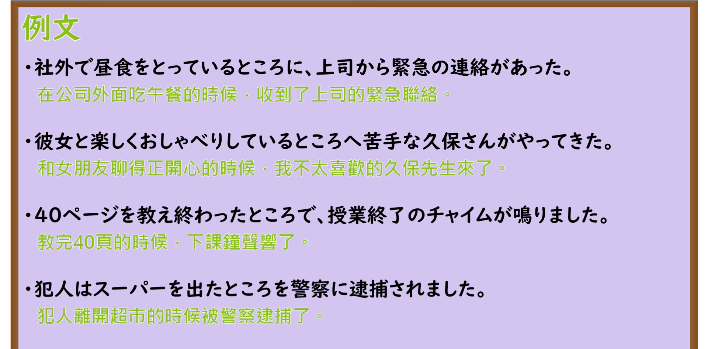

---
{
  "id": "N3-G-0045",
  "kind": "grammar",
  "level": "N3",
  "title": "〜ところへ／〜ところに／〜ところで／〜ところを（正当……的时候）",
  "card_revision": 1,
  "schema_version": 1,
  "source": {
    "lesson": "N3 第45个语法",
    "material": "出口日語原视频板书、日语自动字幕与Hagoromo文型检索正文",
    "video": "https://www.youtube.com/watch?v=DfbwUOXyNAc",
    "screenshot": "assets/grammar/n3/N3-G-0045-connection.png",
    "screenshot_seconds": 463,
    "screenshot_crop": {
      "x": 0,
      "y": 0,
      "width": 1500,
      "height": 930
    }
  },
  "tags": [
    "ところへ",
    "ところに",
    "ところで",
    "ところを",
    "N3"
  ],
  "confusions": [
    "ところだ",
    "最中"
  ]
}
---

# N3 第45个语法：〜ところへ／〜ところに／〜ところで／〜ところを

# 视频学习资料整理

本课讲解 N3 语法形式「〜ところへ／〜ところに／〜ところで／〜ところを」。

## 接续图（板书与讲解）

- 视频链接：[出口日語 N3 第45个语法](https://www.youtube.com/watch?v=DfbwUOXyNAc)
- 真实时间：07:43（463.00秒）
- 原图尺寸：1920×1080
- 裁切说明：选用 07:43 画面，此时画面左上方语法标题与中文释义「〜ところへ・〜ところに・〜ところで・〜ところを 〜的時候」清晰无渐隐，板书已完整书写接续规则「動詞辞書形／ている／た形／い形容詞＋ところ＋助詞（へ・に・で・を）」以及四助词搭配的核心区别：へ（移動動作）、に（移動・他の動作）、で（他の動作・限界・展開）、を（直接作用の動作・受身文）；板书包含了丰富的例句对照。固定左上角（0, 0），裁切区域为宽 1500、高 930，去除右侧人像与底部空白，完整保留全部板书与顶部标题。
- 图片：

## 例句图（视频例句）

- 视频链接：[出口日語 N3 第45个语法](https://www.youtube.com/watch?v=DfbwUOXyNAc)
- 真实时间：08:05（485.00秒）
- 原图尺寸：1920×1080
- 裁切说明：提取自视频 08:05 处的例句黑板页面。固定左上角（0, 0），裁切区域为宽 1920、高 950，裁去底部多余边框与杂物，完整保留四条例句及中文翻译。
- 图片：

# 核心

## 功能一：表示正处于前项动作或事态的特定阶段局面时，突然发生后项外部事态介入（正当……的时候）

**最上位意味カテゴリー：**

- **〜ところへ／〜ところに／〜ところで／〜ところを：** 場所・時間（场所与时间）

**中位意味カテゴリー：**

- **〜ところへ／〜ところに／〜ところで／〜ところを：** 時点・場面（时间节点与情境局面）

**意味：**

- **〜ところへ／〜ところに／〜ところで／〜ところを：** 時点・状況（处于特定时点情境中受到外界介入）

**くわしい意味記述：**

- **〜ところへ／〜ところに／〜ところで／〜ところを：** ある行為が時間的な流れのどの時点で行われるかを表す表現。「ある動作段階Aの場面や状況に、Bという動作が起きたこと」を表す。（表示在前项事态正要开始、正在进行或刚结束的特定场面节点上，后项新事态适逢其会地介入；依后项性质分别呼应助词：移动动作用「ところへ/ところに」、转折或展开用「ところで」、被动直接作用动作则必用「ところを」。）

### 例句

1. 社外で昼食をとっているところに、上司から緊急の電話がかかってきた。

   （正巧在公司外面吃午饭的时候，上司打来了紧急电话。）

2. 出かけようとしたところへ、ちょうど宅配便が荷物を届けてくれた。

   （正准备要出门的时候，刚好快递员把包裹送上门了。）

3. いいところで邪魔が入ってしまい、話の続きが聞けなくなってしまった。

   （正讲到关键时刻却被人打岔搅局，以至于没能听到后续的内容。）

4. 授業中に居眠りをしているところを、運悪く先生に見つかってしまった。

   （上课正打瞌睡的时候，不偏不倚被老师当场抓了个正着。）

# 来源

- [出口日語原视频](https://www.youtube.com/watch?v=DfbwUOXyNAc)
- [Hagoromo 文型検索「ところ（時点・状況）」](https://hagoromo-text.work/lookup?vid=1001)（查询日期：2026-09-25）
- [Hagoromo 文型検索「ところを」](https://hagoromo-text.work/lookup?vid=1006)（查询日期：2026-09-25）
