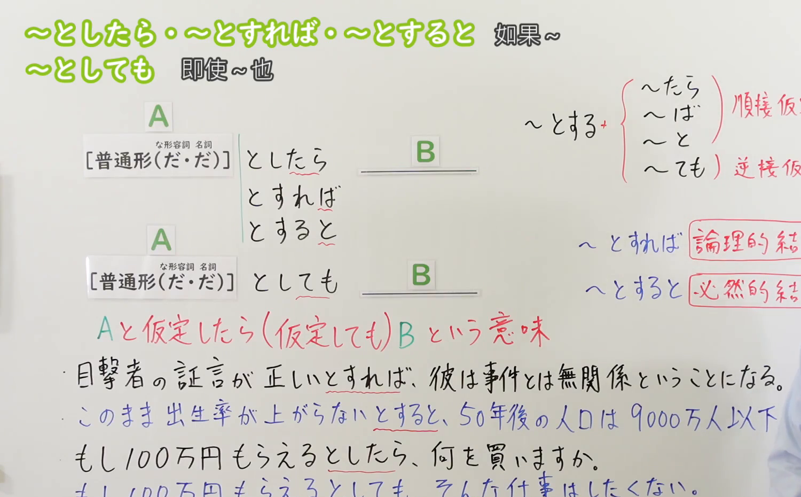

---
{
  "id": "N3-G-0046",
  "kind": "grammar",
  "level": "N3",
  "title": "〜としたら／〜とすれば／〜とすると／〜としても（假设……／即使……）",
  "card_revision": 1,
  "schema_version": 1,
  "source": {
    "lesson": "N3 第46个语法",
    "material": "出口日語原视频板书、日语自动字幕与Hagoromo文型检索正文",
    "video": "https://www.youtube.com/watch?v=3CvjuUYsW98",
    "screenshot": "assets/grammar/n3/N3-G-0046-connection.png",
    "screenshot_seconds": 329,
    "screenshot_crop": {
      "x": 0,
      "y": 0,
      "width": 1500,
      "height": 930
    }
  },
  "tags": [
    "としたら",
    "とすれば",
    "とすると",
    "としても",
    "N3"
  ],
  "confusions": [
    "たら",
    "ば",
    "と",
    "ても"
  ]
}
---

# N3 第46个语法：〜としたら／〜とすれば／〜とすると／〜としても

# 视频学习资料整理

本课讲解 N3 语法形式「〜としたら／〜とすれば／〜とすると／〜としても」。

## 接续图（板书与讲解）

- 视频链接：[出口日語 N3 第46个语法](https://www.youtube.com/watch?v=3CvjuUYsW98)
- 真实时间：05:29（329.00秒）
- 原图尺寸：1920×1080
- 裁切说明：选用 05:29 画面，此时画面左上方语法标题与中文释义「〜としたら・〜とすれば・〜とすると・〜としても 如果〜的話；即使〜也」清晰无渐隐，板书已完整书写接续规则「普通形（な形容詞・名詞［だ］）＋としたら／とすれば／とすると／としても」以及核心语义「仮定のニュアンスが強い表現（真偽不明・非現実的な仮定）」；出口老师在板书中特别辨析了としたら（说话人主观假定）、とすれば／とすると（逻辑推导条件）与としても（逆接让步假定）的异同。固定左上角（0, 0），裁切区域为宽 1500、高 930，去除右侧人像与底部空白，完整保留全部板书与顶部标题。
- 图片：

## 例句图（视频例句）

- 视频链接：[出口日語 N3 第46个语法](https://www.youtube.com/watch?v=3CvjuUYsW98)
- 真实时间：05:50（350.00秒）
- 原图尺寸：1920×1080
- 裁切说明：提取自视频 05:50 处的例句黑板页面。固定左上角（0, 0），裁切区域为宽 1920、高 950，裁去底部多余边框与杂物，完整保留四条例句及中文翻译。
- 图片：

# 核心

## 功能一：提出某种未定事实或假设情况，并以此为前提推导后项判断或行动（假设……／如果……的话）

**最上位意味カテゴリー：**

- **〜としたら／〜とすれば／〜とすると／〜としても：** ものごとの関係（事物的关系）

**中位意味カテゴリー：**

- **〜としたら／〜とすれば／〜とすると／〜としても：** 条件（条件表达）

**意味：**

- **〜としたら／〜とすれば／〜とすると／〜としても：** 条件：仮定条件（纯粹假设与设定条件）

**くわしい意味記述：**

- **〜としたら／〜とすれば／〜とすると／〜としても：** 「もし〜と仮定したら，〜」という意味。純粋な仮定のニュアンスが強い表現。（将实际上尚未发生或尚未确证的事态设想为前提，进而展开推理、提问或表明主观态度；比起单一的「たら/ば」，其“纯粹假设、如果真有其事的话”的虚拟语气更加鲜明。）

### 例句

1. もし宝くじで一億円が当たったとしたら、何に使いますか。

   （如果假定彩票中了1亿日元大奖，你会用来做什么？）

2. 彼の話が本当だとすれば、私たちはすぐに避難しなければならない。

   （如果他的话确实属实的话，那我们就必须立刻前去避难了。）

3. 明日飛行機が飛ばないとすると、会議に間に合わなくなる恐れがある。

   （若是假定明天的航班飞不了的话，恐怕会赶不上会议。）

## 功能二：即使承认存在某种假定情况，后项事态或决心也依然不受其动摇（即使……也……）

**最上位意味カテゴリー：**

- **〜としたら／〜とすれば／〜とすると／〜としても：** ものごとの関係（事物的关系）

**中位意味カテゴリー：**

- **〜としたら／〜とすれば／〜とすると／〜としても：** 逆接・譲歩（转折与让步）

**意味：**

- **〜としたら／〜とすれば／〜とすると／〜としても：** 条件：仮定条件（逆接让步假设）

**くわしい意味記述：**

- **〜としたら／〜とすれば／〜とすると／〜としても：** 「仮に〜ということが起こっても，それとは関係なく，」の意味。（假定即便出现前项的不利事态或极端局面，后项的结论、决心或客观评价也绝不因此发生改变。）

### 例句

1. たとえ失敗したとしても、全力を尽くしたのだから後悔はしない。

   （就算真的失败了，既然已经拼尽全力，我也绝不后悔。）

2. いくら給料が高いとしても、あんな危険な仕事は引き受けたくない。

   （哪怕给的薪水再怎么丰厚，我也不愿意接下那么危险的工作。）

3. 仮に親に反対されたとしても、私は自分の夢をあきらめるつもりはありません。

   （纵使遭到父母的坚决反对，我也完全不打算放弃自己的梦想。）

# 来源

- [出口日語原视频](https://www.youtube.com/watch?v=3CvjuUYsW98)
- [Hagoromo 文型検索「とすれば」](https://hagoromo-text.work/lookup?vid=1024)（查询日期：2026-09-25）
- [Hagoromo 文型検索「としても」](https://hagoromo-text.work/lookup?vid=1017)（查询日期：2026-09-25）
