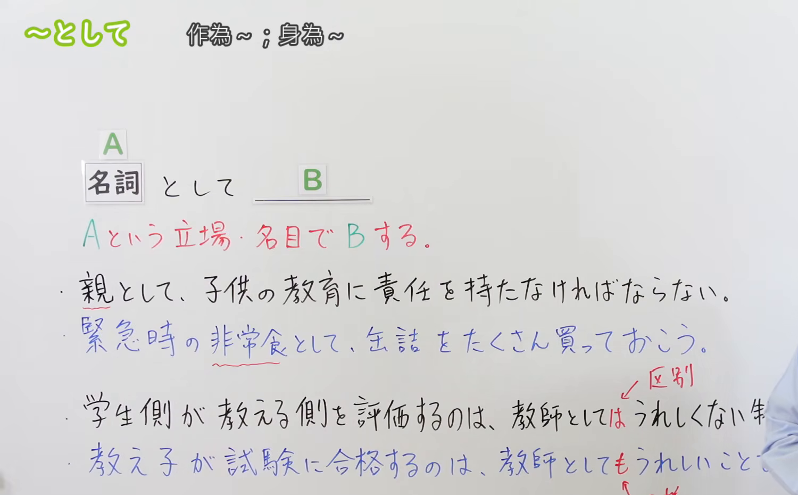
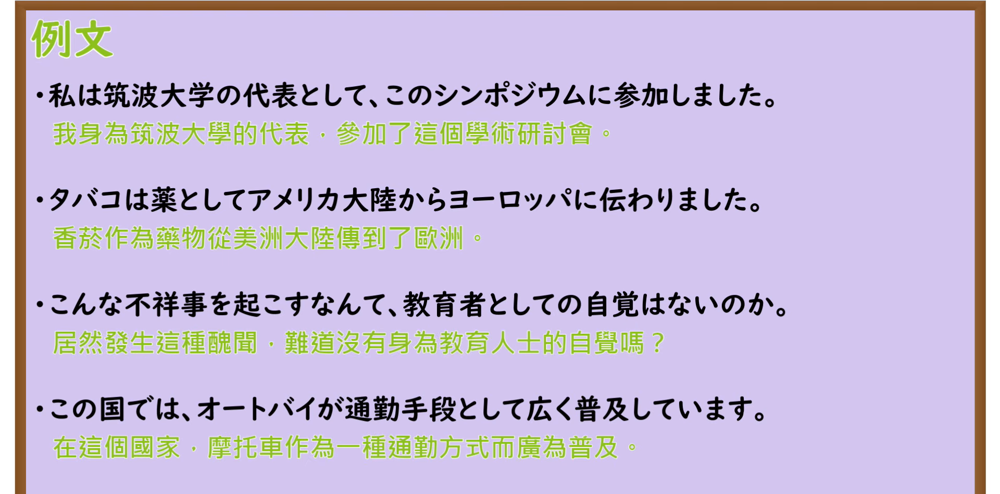

---
{
  "id": "N3-G-0047",
  "kind": "grammar",
  "level": "N3",
  "title": "〜として（作为……／以……身份・名义）",
  "card_revision": 1,
  "schema_version": 1,
  "source": {
    "lesson": "N3 第47个语法",
    "material": "出口日語原视频板书、日语自动字幕与Hagoromo文型检索正文",
    "video": "https://www.youtube.com/watch?v=cD6f8YKnUnQ",
    "screenshot": "assets/grammar/n3/N3-G-0047-connection.png",
    "screenshot_seconds": 210,
    "screenshot_crop": {
      "x": 0,
      "y": 0,
      "width": 1500,
      "height": 930
    }
  },
  "tags": [
    "として",
    "N3"
  ],
  "confusions": [
    "としては",
    "としても",
    "としての"
  ]
}
---

# N3 第47个语法：〜として

# 视频学习资料整理

本课讲解 N3 语法形式「〜として」。

## 接续图（板书与讲解）

- 视频链接：[出口日語 N3 第47个语法](https://www.youtube.com/watch?v=cD6f8YKnUnQ)
- 真实时间：03:30（210.00秒）
- 原图尺寸：1920×1080
- 裁切说明：选用 03:30 画面，此时画面左上方语法标题与中文释义「〜として 作為〜」清晰无渐隐，板书已完整书写接续规则「名詞 A＋として＋B」以及核心语义「Aという立場・資格・名目・種類でBをする」；出口老师在板书中特别提示后接名词修饰时的形态「〜としての名詞（留学生としての生活、親としての責任）」。固定左上角（0, 0），裁切区域为宽 1500、高 930，去除右侧人像与底部空白，完整保留全部板书与顶部标题。
- 图片：

## 例句图（视频例句）

- 视频链接：[出口日語 N3 第47个语法](https://www.youtube.com/watch?v=cD6f8YKnUnQ)
- 真实时间：03:55（235.00秒）
- 原图尺寸：1920×1080
- 裁切说明：提取自视频 03:55 处的例句黑板页面。固定左上角（0, 0），裁切区域为宽 1920、高 950，裁去底部多余边框与杂物，完整保留四条例句及中文翻译。
- 图片：

# 核心

## 功能一：表明说话人或动作主体所处的立场、资格、名义或功能分类（作为……／以……身份）

**最上位意味カテゴリー：**

- **〜として：** ものごとの関係（事物的关系）

**中位意味カテゴリー：**

- **〜として：** 判断の立場（判断基准与立场资格）

**意味：**

- **〜として：** 立場（身份、名义与客观资质）

**くわしい意味記述：**

- **〜として：** 「〜の立場・名目で」という意味を表す。Nには，ある人の立場や資格を表す名詞が入る。（接于表示人物身份、社会资格、代表名义或功能属性的名词之后，表示以此种立场身份行事或做出判断；后续修饰名词时用「としての」。）

### 例句

1. 彼は留学生の代表として、スピーチ大会で立派な発表をした。

   （他作为留学生的代表，在演讲比赛上做出了精彩出色的发言。）

2. 趣味として始めた生け花ですが、今では教室を開くほど夢中になっています。

   （虽然最初只是作为业余爱好开始练习插花，但如今已沉迷到开班授课的程度。）

3. 富士山は日本を代表する名山として、世界中から多くの観光客が訪れている。

   （富士山作为代表日本的名山，吸引着来自世界各地的无数游客前来观光。）

4. 一人の親として、子どもの将来を真剣に考えるのは当然のことだ。

   （作为一名为人父母者，认真为孩子的将来做考量是理所当然的事情。）

# 来源

- [出口日語原视频](https://www.youtube.com/watch?v=cD6f8YKnUnQ)
- [Hagoromo 文型検索「として」](https://hagoromo-text.work/lookup?vid=1012)（查询日期：2026-09-25）
