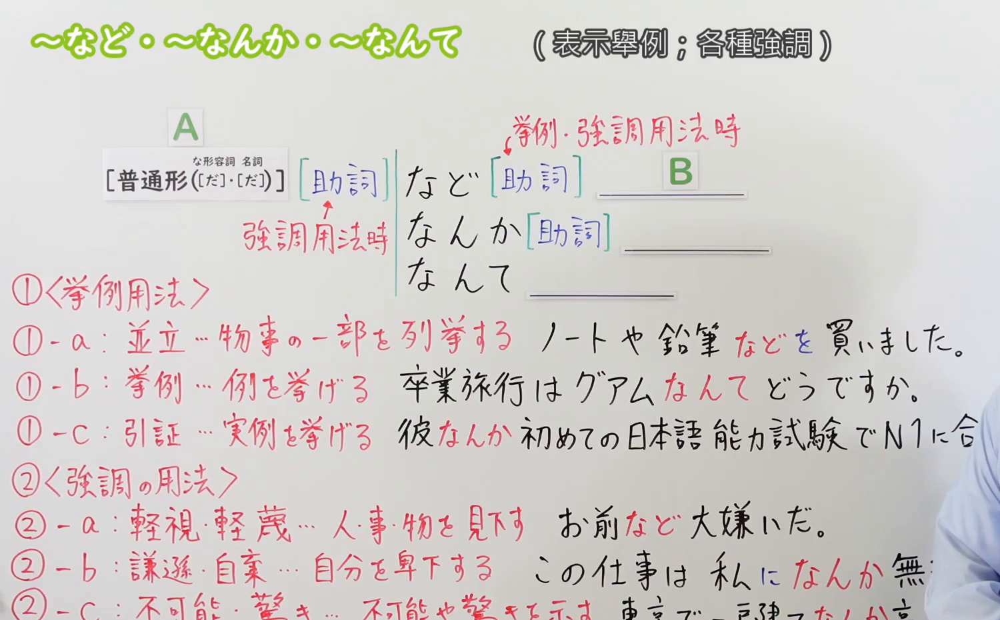
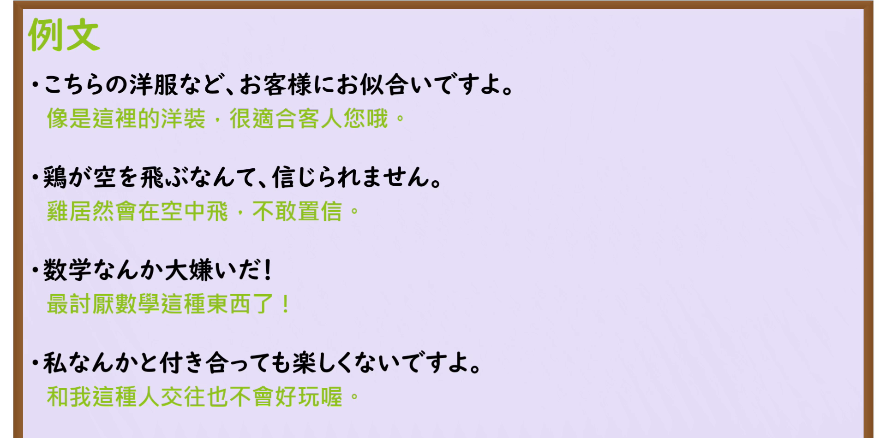

---
{
  "id": "N3-G-0048",
  "kind": "grammar",
  "level": "N3",
  "title": "〜など／〜なんか／〜なんて（……之类／等等／轻视与强调）",
  "card_revision": 1,
  "schema_version": 1,
  "source": {
    "lesson": "N3 第48个语法",
    "material": "出口日語原视频板书、日语自动字幕与Hagoromo文型检索正文",
    "video": "https://www.youtube.com/watch?v=bq38A3YlCJg",
    "screenshot": "assets/grammar/n3/N3-G-0048-connection.png",
    "screenshot_seconds": 524,
    "screenshot_crop": {
      "x": 0,
      "y": 0,
      "width": 1500,
      "height": 930
    }
  },
  "tags": [
    "など",
    "なんか",
    "なんて",
    "N3"
  ],
  "confusions": [
    "くらい",
    "ほど"
  ]
}
---

# N3 第48个语法：〜など／〜なんか／〜なんて

# 视频学习资料整理

本课讲解 N3 语法形式「〜など／〜なんか／〜なんて」。

## 接续图（板书与讲解）

- 视频链接：[出口日語 N3 第48个语法](https://www.youtube.com/watch?v=bq38A3YlCJg)
- 真实时间：08:44（524.00秒）
- 原图尺寸：1920×1080
- 裁切说明：选用 08:44 画面，此时画面左上方语法标题与中文释义「〜など・〜なんか・〜なんて （表示舉例；各種強調）」清晰无渐隐，板书已完整书写接续规则「普通形（な形容詞・名詞［だ・だ］）＋助詞＋など／なんか／なんて」以及两大用法分支「①挙例用法（並立・挙例・引証）」「②強調用法（軽視・謙遜・不可能驚き）」；出口老师在板书中特别梳理了など（书面正式）、なんか（口语常用）、なんて（口语且更具感彩）的语体差异与助词替换规则。固定左上角（0, 0），裁切区域为宽 1500、高 930，去除右侧人像与底部空白，完整保留全部板书与顶部标题。
- 图片：

## 例句图（视频例句）

- 视频链接：[出口日語 N3 第48个语法](https://www.youtube.com/watch?v=bq38A3YlCJg)
- 真实时间：09:08（548.00秒）
- 原图尺寸：1920×1080
- 裁切说明：提取自视频 09:08 处的例句黑板页面。固定左上角（0, 0），裁切区域为宽 1920、高 950，裁去底部多余边框与杂物，完整保留四条例句及中文翻译。
- 图片：

# 核心

## 功能一：举出事物、行为的一个或多个代表性例子，暗示还有其他同类事物（……之类的／等等）

**最上位意味カテゴリー：**

- **〜など／〜なんか／〜なんて：** ものごとの関係（事物的关系）

**中位意味カテゴリー：**

- **〜など／〜なんか／〜なんて：** 例示（举例与并列列举）

**意味：**

- **〜など／〜なんか／〜なんて：** 例示（典型例示与同类暗示）

**くわしい意味記述：**

- **〜など／〜なんか／〜なんて：** 類似のものが他にあることを示す。（用于举出一个或数个具体例子，以暗示还存在其他同类类似事物；「など」用于书面语或郑重口语，「なんか／なんて」则多用于亲近随意的日常口语。）

### 例句

1. 休日は読書や映画鑑賞などを楽しんでいます。

   （休息日我喜欢享受读书和欣赏电影之类的乐趣。）

2. 卒業旅行はグアムなんかどうですか。海がとてもきれいですよ。

   （毕业旅行去关岛之类的怎么样？大海非常美丽哦。）

3. お休みの日は、家でゲームをしたりなんかしてのんびり過ごしています。

   （休息天里，就在家里打打游戏之类的悠闲度日。）

## 功能二：将某事物作为低价值对象提出，表达轻视、自谦或出乎意料的强烈情感（轻蔑／自嘲自谦／意外感慨）

**最上位意味カテゴリー：**

- **〜など／〜なんか／〜なんて：** 考え・感情（思想与情感）

**中位意味カテゴリー：**

- **〜など／〜なんか／〜なんて：** 軽重の強調（轻重评判与感情强调）

**意味：**

- **〜など／〜なんか／〜なんて：** 程度の強調（轻蔑、谦逊或意外震惊的感情强化）

**くわしい意味記述：**

- **〜など／〜なんか／〜なんて：** 前のものは「程度が低い」または「想定外、ありえない」ものだという意味を表し、否定的な気持ちや強い感情を表す。（将某一事物或自身作为微不足道、不值一提的对象提出，用于表达轻视、自我贬低自谦；亦可用于表达意想不到、令人难以置信的意外与惊叹。）

### 例句

1. お前なんかの言うことなど、誰が信じるものか。

   （像你这种家伙说出来的鬼话，谁会相信啊。（轻视））

2. 私なんかにそんな大きな役目が務まるかどうか、とても不安です。

   （像我这种水平的人究竟能不能胜任如此重任，心里实在非常不安。（自谦））

3. 彼が日本語能力試験のN1に一発で合格したなんて、本当に信じられない。

   （他居然一次性就通过了JLPT N1考试，真是太不可思议了！（意外感慨））

# 来源

- [出口日語原视频](https://www.youtube.com/watch?v=bq38A3YlCJg)
- [Hagoromo 文型検索「など」](https://hagoromo-text.work/lookup?vid=1145)（查询日期：2026-09-25）
- [Hagoromo 文型検索「なんか」](https://hagoromo-text.work/lookup?vid=1182)（查询日期：2026-09-25）
