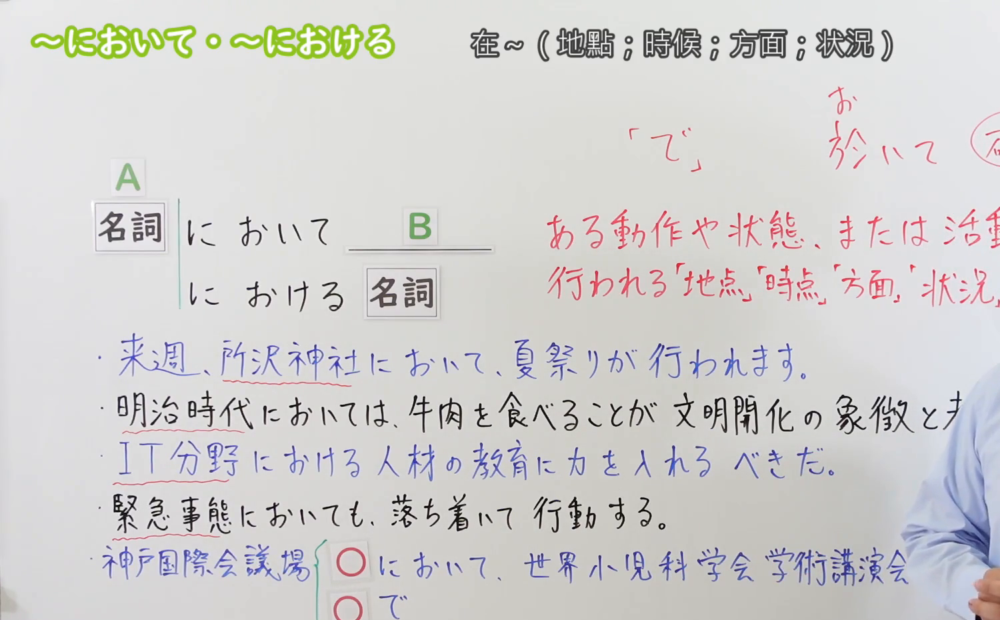

---
{
  "id": "N3-G-0049",
  "kind": "grammar",
  "level": "N3",
  "title": "〜において／〜における（在……／在……处于）",
  "card_revision": 1,
  "schema_version": 1,
  "source": {
    "lesson": "N3 第49个语法",
    "material": "出口日語原视频板书、日语自动字幕与Hagoromo文型检索正文",
    "video": "https://www.youtube.com/watch?v=H8yE5PpHEA8",
    "screenshot": "assets/grammar/n3/N3-G-0049-connection.png",
    "screenshot_seconds": 242,
    "screenshot_crop": {
      "x": 0,
      "y": 0,
      "width": 1500,
      "height": 930
    }
  },
  "tags": [
    "において",
    "における",
    "N3"
  ],
  "confusions": [
    "で",
    "にて"
  ]
}
---

# N3 第49个语法：〜において／〜における

# 视频学习资料整理

本课讲解 N3 语法形式「〜において／〜における」。

## 接续图（板书与讲解）

- 视频链接：[出口日語 N3 第49个语法](https://www.youtube.com/watch?v=H8yE5PpHEA8)
- 真实时间：04:02（242.00秒）
- 原图尺寸：1920×1080
- 裁切说明：选用 04:02 画面，此时画面左上方语法标题与中文释义「〜において・〜における 在〜；於〜」清晰无渐隐，板书已完整书写接续规则「名詞＋において」「名詞＋における＋名詞」以及核心语义「地点・場面・状況・方面で」；出口老师在板书中特别强调这是格助词「で」的高度正式书面语表现（改まった表現），广泛用于新闻报道、学术论文、正式公告及演讲之中。固定左上角（0, 0），裁切区域为宽 1500、高 930，去除右侧人像与底部空白，完整保留全部板书与顶部标题。
- 图片：

## 例句图（视频例句）

- 视频链接：[出口日語 N3 第49个语法](https://www.youtube.com/watch?v=H8yE5PpHEA8)
- 真实时间：04:25（265.00秒）
- 原图尺寸：1920×1080
- 裁切说明：提取自视频 04:25 处的例句黑板页面。固定左上角（0, 0），裁切区域为宽 1920、高 950，裁去底部多余边框与杂物，完整保留四条例句及中文翻译。
- 图片：

# 核心

## 功能一：正式书面指出某动作或事态发生的场所、时间节点、时代背景、领域或情境（在……／于……）

**最上位意味カテゴリー：**

- **〜において／〜における：** 場所・時間（场所与时间）

**中位意味カテゴリー：**

- **〜において／〜における：** 時点・場面（时间节点与情境局面）

**意味：**

- **〜において／〜における：** 場所・状況（正式书面情境中的地点、领域与时局）

**くわしい意味記述：**

- **〜において／〜における：** 物事が行われる場所，場面，状況を表す。「XにおけるY」の形で，Yの出来事や状態が起こる場所や時間などを言う時に使う。（相当于格助词「で」的书面语郑重表达；用于正式表明事件开展的地点、举办场所、历史时代背景或专门技术领域；修饰后项名词时使用「における」。）

### 例句

1. 明日の全体会議は、本社第2ビル8階の大会議室において開かれる予定です。

   （明天的全体会议预定在本部第2大厦8楼的大会议室举行。）

2. 現代社会におけるスマートフォンの普及は、人々の生活様式を大きく変えた。

   （智能手机在现代社会的普及，极大改变了人们的生活方式。）

3. 経済のグローバル化が進む今日において、国際的な視野を持つことは不可欠だ。

   （在经济全球化不断深入的今天，具备国际化视野是不可或缺的。）

4. 我が社は環境保護の分野においても、業界をリードする存在を目指しています。

   （我公司在环境保护领域方面，也立志成为引领整个行业的标杆存在。）

# 来源

- [出口日語原视频](https://www.youtube.com/watch?v=H8yE5PpHEA8)
- [Hagoromo 文型検索「において」](https://hagoromo-text.work/lookup?vid=1220)（查询日期：2026-09-25）
- [Hagoromo 文型検索「における」](https://hagoromo-text.work/lookup?vid=1228)（查询日期：2026-09-25）
