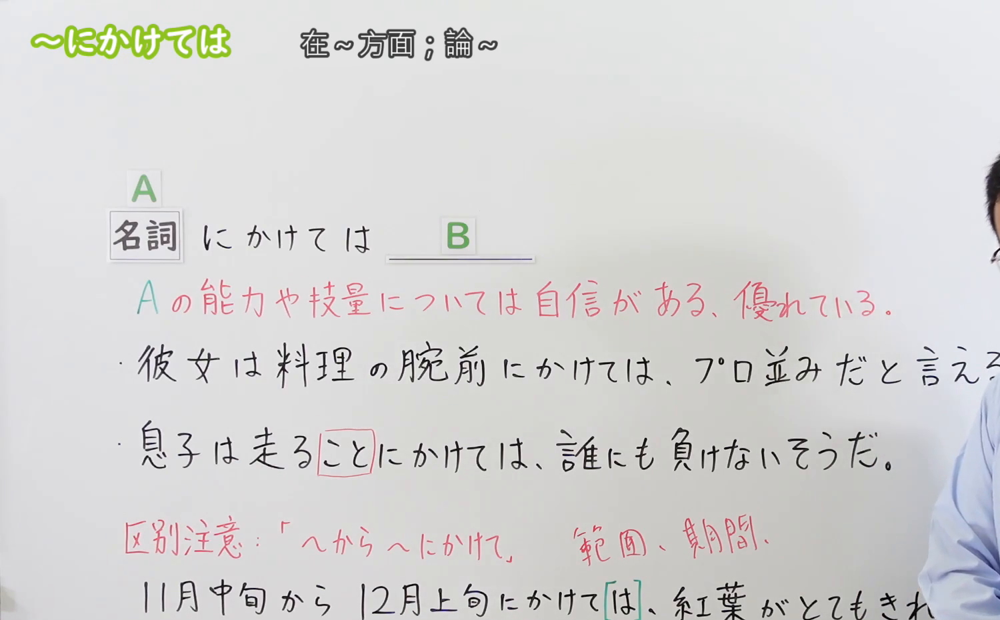
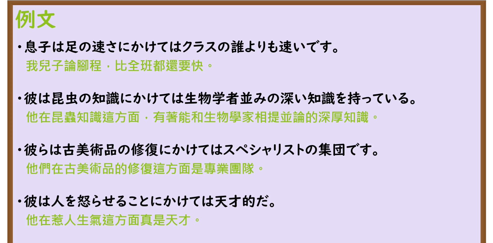

---
{
  "id": "N3-G-0050",
  "kind": "grammar",
  "level": "N3",
  "title": "〜にかけては（在……方面／论及……）",
  "card_revision": 1,
  "schema_version": 1,
  "source": {
    "lesson": "N3 第50个语法",
    "material": "出口日語原视频板书、日语自动字幕与Hagoromo文型检索正文",
    "video": "https://www.youtube.com/watch?v=hWZGJGLbwEE",
    "screenshot": "assets/grammar/n3/N3-G-0050-connection.png",
    "screenshot_seconds": 197,
    "screenshot_crop": {
      "x": 0,
      "y": 0,
      "width": 1500,
      "height": 930
    }
  },
  "tags": [
    "にかけては",
    "N3"
  ],
  "confusions": [
    "〜から〜にかけて",
    "について"
  ]
}
---

# N3 第50个语法：〜にかけては

# 视频学习资料整理

本课讲解 N3 语法形式「〜にかけては」。

## 接续图（板书与讲解）

- 视频链接：[出口日語 N3 第50个语法](https://www.youtube.com/watch?v=hWZGJGLbwEE)
- 真实时间：03:17（197.00秒）
- 原图尺寸：1920×1080
- 裁切说明：选用 03:17 画面，此时画面左上方语法标题与中文释义「〜にかけては 在〜方面；論〜」清晰无渐隐，板书已完整书写接续规则「名詞＋にかけては」以及核心语义「Aの能力や技量については自信がある、優れている」；出口老师在板书中特别强调后项必定是表示自信充沛或褒奖赞叹的积极正面评价（不用于负面缺陷），并专门板书辨析了易混时空跨度语法「〜から〜にかけて」。固定左上角（0, 0），裁切区域为宽 1500、高 930，去除右侧人像与底部空白，完整保留全部板书与顶部标题。
- 图片：

## 例句图（视频例句）

- 视频链接：[出口日語 N3 第50个语法](https://www.youtube.com/watch?v=hWZGJGLbwEE)
- 真实时间：03:40（220.00秒）
- 原图尺寸：1920×1080
- 裁切说明：提取自视频 03:40 处的例句黑板页面。固定左上角（0, 0），裁切区域为宽 1920、高 950，裁去底部多余边框与杂物，完整保留四条例句及中文翻译。
- 图片：

# 核心

## 功能一：提出某一技能、知识或专门领域，强调在该特定方面具备过人本领或无人能及（在……方面／论及……）

**最上位意味カテゴリー：**

- **〜にかけては：** 考え・感情（思想与情感）

**中位意味カテゴリー：**

- **〜にかけては：** 主張・断定的評価（主张与评价断定）

**意味：**

- **〜にかけては：** 評価（特定专业领域之卓越评价与才能赞赏）

**くわしい意味記述：**

- **〜にかけては：** 素質や能力に自信がある，他より優れている，と思うことをあげて，それについて説明する時に使う。（用于提出某项具体专业能力、技术或擅长领域，并在后项给出该方面水平极高、不输给任何人的褒奖肯定或自豪断定；后项绝不接消极劣势评价。）

### 例句

1. 彼女は料理の腕前にかけては、プロの料理人並みだと言える。

   （论及烹饪的手艺，可以说她完全不逊色于专业大厨。）

2. 息子は足の速さにかけては、クラスの誰にも負けない自信があるようだ。

   （论起跑步的速度，我儿子似乎很有自信不输给班上的任何同学。）

3. パソコンのトラブル解決にかけては、社内で彼の右に出る者はいない。

   （在解决电脑故障方面，全公司上下没有人能出其右。）

4. 日本の伝統文化の知識にかけては、留学生の田中さんの方が日本人より詳しいくらいだ。

   （论及对日本传统文化的了解，留学生田中甚至比一般日本人还要更加精通。）

# 来源

- [出口日語原视频](https://www.youtube.com/watch?v=hWZGJGLbwEE)
- [Hagoromo 文型検索「にかけては」](https://hagoromo-text.work/lookup?vid=1238)（查询日期：2026-09-25）
