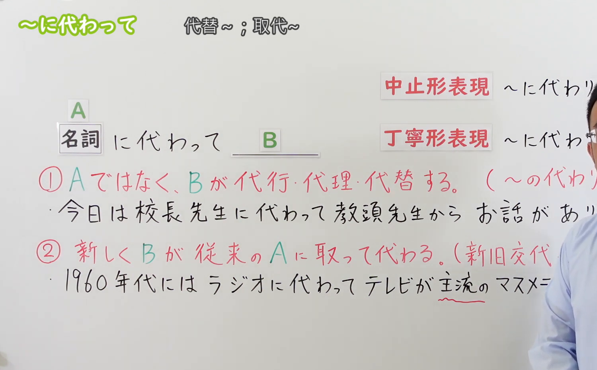
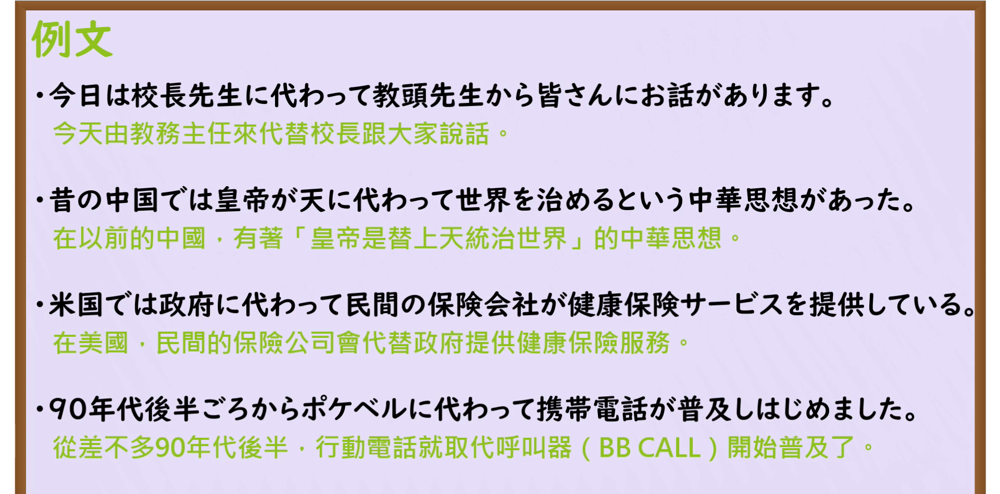

---
{
  "id": "N3-G-0051",
  "kind": "grammar",
  "level": "N3",
  "title": "〜に代わって／〜に代わり（代替／代表／取代）",
  "card_revision": 1,
  "schema_version": 1,
  "source": {
    "lesson": "N3 第51个语法",
    "material": "出口日語原视频板书、日语自动字幕与Hagoromo文型检索正文",
    "video": "https://www.youtube.com/watch?v=hMubvUMGjv8",
    "screenshot": "assets/grammar/n3/N3-G-0051-connection.png",
    "screenshot_seconds": 264,
    "screenshot_crop": {
      "x": 0,
      "y": 0,
      "width": 1500,
      "height": 930
    }
  },
  "tags": [
    "に代わって",
    "に代わり",
    "N3"
  ],
  "confusions": [
    "〜を代わりに",
    "〜のかわりに"
  ]
}
---

# N3 第51个语法：〜に代わって／〜に代わり

# 视频学习资料整理

本课讲解 N3 语法形式「〜に代わって／〜に代わり」。

## 接续图（板书与讲解）

- 视频链接：[出口日語 N3 第51个语法](https://www.youtube.com/watch?v=hMubvUMGjv8)
- 真实时间：04:24（264.00秒）
- 原图尺寸：1920×1080
- 裁切说明：选用 04:24 画面，此时画面左上方语法标题与中文释义「〜に代わって 代替；取代」清晰无渐隐，板书已完整书写接续规则「名詞＋に代わって」以及出口老师在视频中明确划分的两大核心用法：1番「人の代理（平时由A做，本次由B临时或代表处理）」与 2番「新旧交代（新事物B不可逆地彻底取缔或更换传统事物A的地位）」；同时整理了硬语中顿「〜に代わり」、郑重体「〜に代わりまして」以及修饰体「〜に代わる＋名詞」。固定左上角（0, 0），裁切区域为宽 1500、高 930，去除右侧人像与底部空白，完整保留全部板书与顶部标题。
- 图片：

## 例句图（视频例句）

- 视频链接：[出口日語 N3 第51个语法](https://www.youtube.com/watch?v=hMubvUMGjv8)
- 真实时间：04:47（287.00秒）
- 原图尺寸：1920×1080
- 裁切说明：提取自视频 04:47 处的例句黑板页面。固定左上角（0, 0），裁切区域为宽 1920、高 950，裁去底部多余边框与杂物，完整保留四条例句及中文翻译。
- 图片：

# 核心

## 功能一：人的代理与职责代行（代替某人履行职责、扮演角色或代表团体发声）

**最上位意味カテゴリー：**

- **に代わって：** ものごとの関係（事物之间的关系）

**中位意味カテゴリー：**

- **に代わって：** 対比（对比与代理对应）

**意味：**

- **に代わって：** 代替（代理职务或角色代行）

**くわしい意味記述：**

- **に代わって：** 〜の代理として。改まった言い方。（平时本应由A负责，但本次出于特别或临时原因，由B代表A行使职能、发表讲话或处理事务；可与「〜の代わりに」互换，属于较为正式庄重的表达。书面中止形常作「〜に代わり」，面向尊长或公众演讲的郑重礼貌体为「〜に代わりまして」）。

### 例句

1. 今日は校長先生に代わって、教頭先生から皆さんにお話があります。

   （今天由副校长代替校长向大家讲话。）

2. 昔の中国では、皇帝が天に代わって世界を治めるという中華思想があった。

   （在古代中国，有着皇帝代替上天统治天下的中华思想。）

3. 米国では政府に代わって、民間の保険会社が健康保険サービスを提供している。

   （在美国，由民间商业保险公司代替政府向公众提供医疗保险服务。）

4. 入院中の田中部長に代わりまして、本日は代理の山田がご挨拶申し上げます。

   （田中部长目前正在住院，今天由我代理人山田代表他向各位致以问候。）

## 功能二：事物的更替与时代取代（新事物取代旧事物，发生不可逆的新旧更迭）

**最上位意味カテゴリー：**

- **に代わって：** ものごとの関係（事物之间的关系）

**中位意味カテゴリー：**

- **に代わって：** 対比（新旧更迭对比）

**意味：**

- **に代わって：** 代替（新旧交代・取而代之）

**くわしい意味記述：**

- **に代わって：** 新しくBが従来のAに取って代わることを表す。（原有事物或旧式技术逐渐退场，新事物或先进手段全面取代其主流地位，具有不可逆转的新旧更替特征。连体修饰后续名词时常用「〜に代わる＋名詞」）。

### 例句

1. 90年代後半ごろから、ポケベルに代わって携帯電話が普及し始めました。

   （从90年代后半期开始，移动电话取代了寻呼机并迅速普及开来。）

2. 1960年代には、ラジオに代わってテレビが家庭の主流メディアとなりました。

   （在20世纪60年代，电视取代收音机成为了家庭的主流大众媒介。）

3. 近年では、紙の書類に代わって電子データでの管理が主流になってきている。

   （近年来，电子数据管理正取代传统的纸质文件成为各行业的主流。）

4. 蒸気機関車に代わって、電車やディーゼル機関車が鉄道輸送の主役となった。

   （取代原有的蒸汽机车，电力列车与内燃机车成为了铁路运输的主力。）

# 来源

- [出口日語原视频](https://www.youtube.com/watch?v=hMubvUMGjv8)
- [Hagoromo 文型検索「にかわって」](https://hagoromo-text.work/lookup?vid=1241)（查询日期：2026-09-25）
