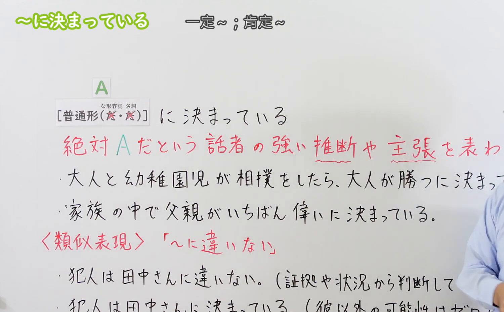
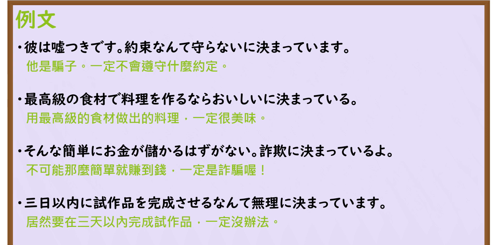

---
{
  "id": "N3-G-0052",
  "kind": "grammar",
  "level": "N3",
  "title": "〜に決まっている（肯定……／一定是……）",
  "card_revision": 1,
  "schema_version": 1,
  "source": {
    "lesson": "N3 第52个语法",
    "material": "出口日語原视频板书、日语自动字幕与Hagoromo文型检索正文",
    "video": "https://www.youtube.com/watch?v=wLP_fREK1IU",
    "screenshot": "assets/grammar/n3/N3-G-0052-connection.png",
    "screenshot_seconds": 204,
    "screenshot_crop": {
      "x": 0,
      "y": 0,
      "width": 1500,
      "height": 930
    }
  },
  "tags": [
    "に決まっている",
    "に決まっています",
    "N3"
  ],
  "confusions": [
    "〜に違いない",
    "〜はずだ"
  ]
}
---

# N3 第52个语法：〜に決まっている

# 视频学习资料整理

本课讲解 N3 语法形式「〜に決まっている」。

## 接续图（板书与讲解）

- 视频链接：[出口日語 N3 第52个语法](https://www.youtube.com/watch?v=wLP_fREK1IU)
- 真实时间：03:24（204.00秒）
- 原图尺寸：1920×1080
- 裁切说明：选用 03:24 画面，此时画面左上方语法标题与中文释义「〜に決まっている 一定〜；肯定是〜」清晰无渐隐，板书已完整书写接续规则「普通形＋に決まっている（な形語幹・名詞は「だ」なし直接接続）」；出口老师在板书中特别强调该句型多用于口语会话，表达说话人毫无疑问的主观绝对确信。固定左上角（0, 0），裁切区域为宽 1500、高 930，去除右侧人像与底部空白，完整保留全部板书与顶部标题。
- 图片：

## 例句图（视频例句）

- 视频链接：[出口日語 N3 第52个语法](https://www.youtube.com/watch?v=wLP_fREK1IU)
- 真实时间：03:43（223.00秒）
- 原图尺寸：1920×1080
- 裁切说明：提取自视频 03:43 处的例句黑板页面。固定左上角（0, 0），裁切区域为宽 1920、高 950，裁去底部多余边框与杂物，完整保留四条例句及中文翻译。
- 图片：

# 核心

## 功能一：基于说话人的强烈直觉、主观判断或常理推断，断定某事必定如此（肯定……／一定是……）

**最上位意味カテゴリー：**

- **に決まっている：** 考え・感情（思想与情感）

**中位意味カテゴリー：**

- **に決まっている：** 主張・断定的評価（主张与断定性评价）

**意味：**

- **に決まっている：** 主張（坚决主张与确信断定）

**くわしい意味記述：**

- **に決まっている：** 何らかの根拠にもとづいて，話し手が強く確信していることを表す。「にちがいない」と同じ意味だが，話しことばでよく使う。（基于说话人的常识或主观确信，强烈认定某件事“必定如此、绝无例外”；多用于口语对话，带有说话人坚信不疑的主观语气。礼貌体为「〜に決まっています」；接续时名词与な形容词直接接「に決まっている」，不加「だ」）。

### 例句

1. 彼は嘘つきです。約束なんて守らないに決まっています。

   （他是个骗子。肯定不会遵守什么约定的。）

2. 最高級の食材で料理を作るなら、美味しいに決まっている。

   （如果用最高级的食材来做料理，那肯定是美味无比的。）

3. そんな簡単にお金が儲かるはずがない。詐欺に決まっているよ。

   （不可能那么轻易就赚到大钱。肯定是诈骗陷阱。）

4. 3日以内に試作品を完成させるなんて、無理に決まっています。

   （要在三天之内完成样品试制，肯定是办不到的。）

# 来源

- [出口日語原视频](https://www.youtube.com/watch?v=wLP_fREK1IU)
- [Hagoromo 文型検索「にきまっている」](https://hagoromo-text.work/lookup?vid=1248)（查询日期：2026-09-25）
