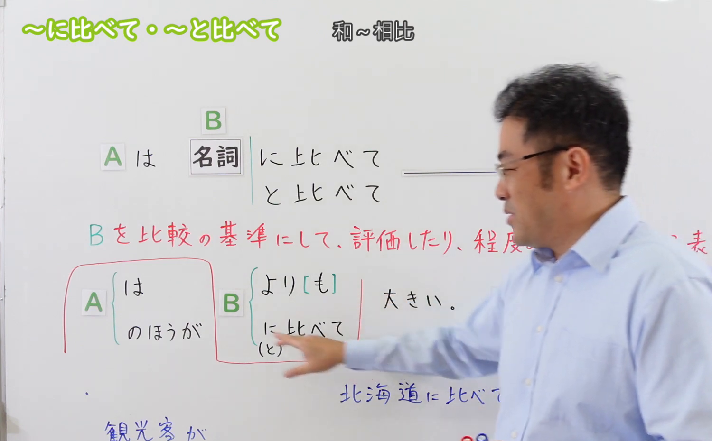
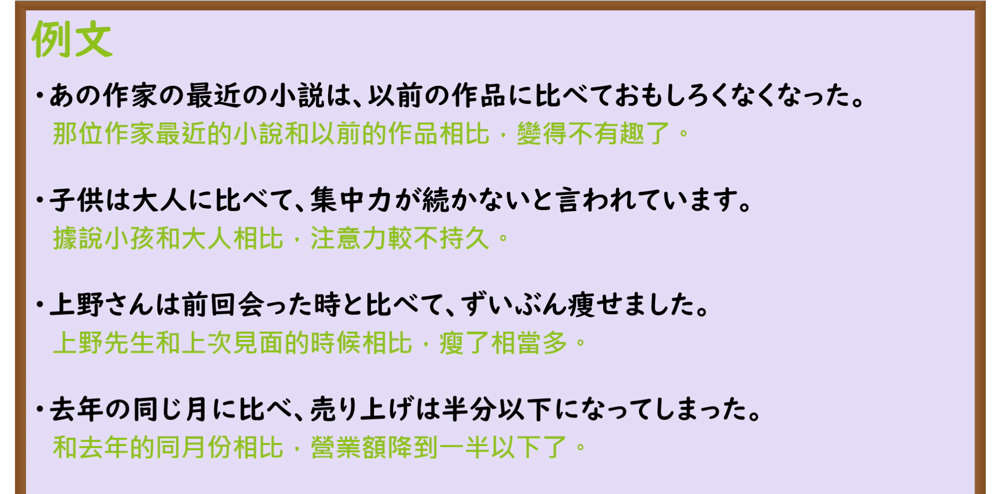

---
{
  "id": "N3-G-0053",
  "kind": "grammar",
  "level": "N3",
  "title": "〜に比べて／〜と比べて（与……相比）",
  "card_revision": 1,
  "schema_version": 1,
  "source": {
    "lesson": "N3 第53个语法",
    "material": "出口日語原视频板书、日语自动字幕与Hagoromo文型检索正文",
    "video": "https://www.youtube.com/watch?v=AaC1txUsHkw",
    "screenshot": "assets/grammar/n3/N3-G-0053-connection.png",
    "screenshot_seconds": 316,
    "screenshot_crop": {
      "x": 0,
      "y": 0,
      "width": 1500,
      "height": 930
    }
  },
  "tags": [
    "に比べて",
    "と比べて",
    "N3"
  ],
  "confusions": [
    "〜に対して",
    "〜より"
  ]
}
---

# N3 第53个语法：〜に比べて／〜と比べて

# 视频学习资料整理

本课讲解 N3 语法形式「〜に比べて／〜と比べて」。

## 接续图（板书与讲解）

- 视频链接：[出口日語 N3 第53个语法](https://www.youtube.com/watch?v=AaC1txUsHkw)
- 真实时间：05:16（316.00秒）
- 原图尺寸：1920×1080
- 裁切说明：选用 05:16 画面，此时画面左上方语法标题与中文释义「〜に比べて／〜と比べて 和〜相比」清晰无渐隐，板书已完整书写接续规则「名詞＋に比べて／と比べて」以及中止形「〜に比べ／〜と比べ」、「〜に比べると／〜と比べると」；出口老师在板书中详细辨析了助词「に」与「と」均可互换，并说明其与「〜より」在语气上的对照特点。固定左上角（0, 0），裁切区域为宽 1500、高 930，去除右侧人像与底部空白，完整保留全部板书与顶部标题。
- 图片：

## 例句图（视频例句）

- 视频链接：[出口日語 N3 第53个语法](https://www.youtube.com/watch?v=AaC1txUsHkw)
- 真实时间：05:40（340.00秒）
- 原图尺寸：1920×1080
- 裁切说明：提取自视频 05:40 处的例句黑板页面。固定左上角（0, 0），裁切区域为宽 1920、高 950，裁去底部多余边框与杂物，完整保留四条例句及中文翻译。
- 图片：

# 核心

## 功能一：以某事物作为基准进行对照比较，指出两者在程度、状态或性质上的差异（与……相比）

**最上位意味カテゴリー：**

- **に比べて：** ものごとの関係（事物之间的关系）

**中位意味カテゴリー：**

- **に比べて：** 対比（对比与参照）

**意味：**

- **に比べて：** 比較（基准比对与差异权衡）

**くわしい意味記述：**

- **に比べて：** 「〜より」という意味を表す。「XにくらべてYは」という表現で，「XよりもYの方が」と同じ意味になる。（以提出的名词作为比较参照基准，指明两者在性质、数量或状态上的差异。助词可用「に」亦可用「と」，书面中止形常作「〜に比べ／〜と比べ」，条件形亦可作「〜に比べると／〜と比べると」）。

### 例句

1. あの作家の最近の小説は、以前の作品に比べて面白くなくなった。

   （那位作家最近出版的小说和以前的作品相比，变得没那么有趣了。）

2. 子どもは大人に比べて、集中力が続かないと言われています。

   （据说小孩子和大人们相比，专注力更不容易持久。）

3. 上野さんは前回会った時と比べて、ずいぶん痩せましたね。

   （上野先生和上次见面的时候相比，清瘦了许多呢。）

4. 去年の同じ月に比べ、売り上げは半分以下になってしまった。

   （与去年同期月份相比，销售额已经缩减到了一半以下。）

# 来源

- [出口日語原视频](https://www.youtube.com/watch?v=AaC1txUsHkw)
- [Hagoromo 文型検索「にくらべて」](https://hagoromo-text.work/lookup?vid=1250)（查询日期：2026-09-25）
