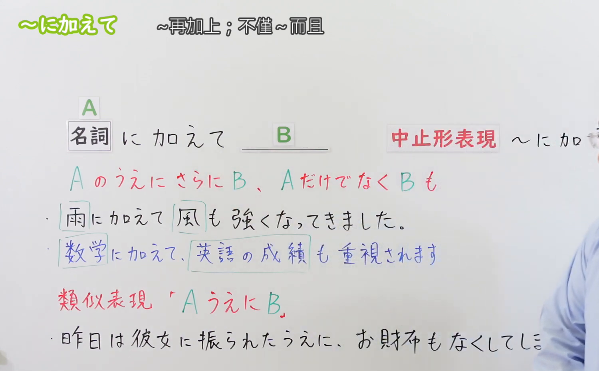
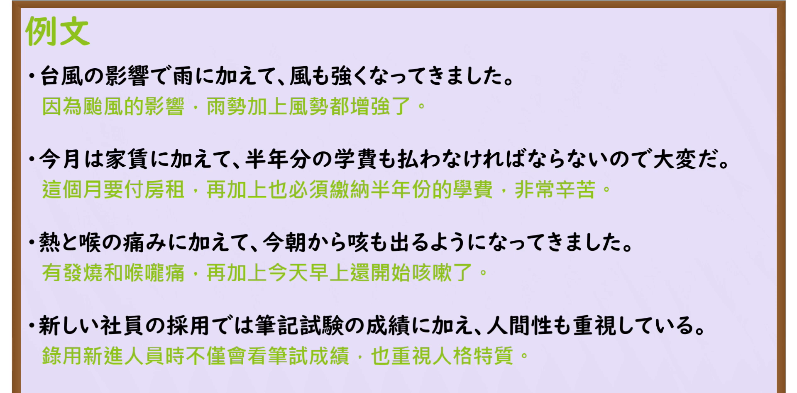

---
{
  "id": "N3-G-0054",
  "kind": "grammar",
  "level": "N3",
  "title": "〜に加えて（不仅……而且……／加上……）",
  "card_revision": 1,
  "schema_version": 1,
  "source": {
    "lesson": "N3 第54个语法",
    "material": "出口日語原视频板书、日语自动字幕与Hagoromo文型检索正文",
    "video": "https://www.youtube.com/watch?v=XZ96IeUZkTI",
    "screenshot": "assets/grammar/n3/N3-G-0054-connection.png",
    "screenshot_seconds": 196,
    "screenshot_crop": {
      "x": 0,
      "y": 0,
      "width": 1500,
      "height": 930
    }
  },
  "tags": [
    "に加えて",
    "に加え",
    "N3"
  ],
  "confusions": [
    "〜だけでなく",
    "〜ばかりでなく",
    "〜とともに"
  ]
}
---

# N3 第54个语法：〜に加えて

# 视频学习资料整理

本课讲解 N3 语法形式「〜に加えて」。

## 接续图（板书与讲解）

- 视频链接：[出口日語 N3 第54个语法](https://www.youtube.com/watch?v=XZ96IeUZkTI)
- 真实时间：03:16（196.00秒）
- 原图尺寸：1920×1080
- 裁切说明：选用 03:16 画面，此时画面左上方语法标题与中文释义「〜に加えて 再加上〜；而且〜」清晰无渐隐，板书已完整书写接续规则「名詞＋に加えて」以及硬语中顿「〜に加え」与修饰体「〜に加えた＋名詞」；出口老师在板书中特别强调该句型表示在已有前项的前提下再叠加上同方向的累加事物。固定左上角（0, 0），裁切区域为宽 1500、高 930，去除右侧人像与底部空白，完整保留全部板书与顶部标题。
- 图片：

## 例句图（视频例句）

- 视频链接：[出口日語 N3 第54个语法](https://www.youtube.com/watch?v=XZ96IeUZkTI)
- 真实时间：03:40（220.00秒）
- 原图尺寸：1920×1080
- 裁切说明：提取自视频 03:40 处的例句黑板页面。固定左上角（0, 0），裁切区域为宽 1920、高 950，裁去底部多余边框与杂物，完整保留四条例句及中文翻译。
- 图片：

# 核心

## 功能一：在已有某事物或状况的基础上，进一步叠加累加其他同类或性质相符的事物（不仅……而且……／加上……）

**最上位意味カテゴリー：**

- **に加えて：** ものごとの関係（事物之间的关系）

**中位意味カテゴリー：**

- **に加えて：** 付加（追加与递进）

**意味：**

- **に加えて：** 付加（累加与叠加）

**くわしい意味記述：**

- **に加えて：** 今までにあったNに，類似した別のものが加わったことを表す。（表示在原有的事物、条件或状况之上，又额外添加了其他同类或同一方向的事态；多用于叙述天灾人祸的连带发生、负担的叠加或优秀条件的叠加。书面中止形可作「〜に加え」；修饰后项名词时可用「〜に加えた」）。

### 例句

1. 台風の影響で、雨に加えて風も強くなってきました。

   （受台风影响，不仅暴雨如注，风势也越发猛烈了。）

2. 今月は家賃に加えて半年分の学費も払わなければならないので大変だ。

   （这个月除了房租，还必须缴纳半年的学费，实在吃不消。）

3. 熱と喉の痛みに加えて、今朝から激しい咳も出るようになってきました。

   （除了发烧和喉咙发痛，今天早上起也开始剧烈咳嗽了。）

4. 新しい社員の採用では、筆記試験の成績に加え人間性も重視している。

   （在录用新员工时，除了笔试成绩以外，也非常看重其人品道德。）

# 来源

- [出口日語原视频](https://www.youtube.com/watch?v=XZ96IeUZkTI)
- [Hagoromo 文型検索「にくわえて」](https://hagoromo-text.work/lookup?vid=1252)（查询日期：2026-09-25）
