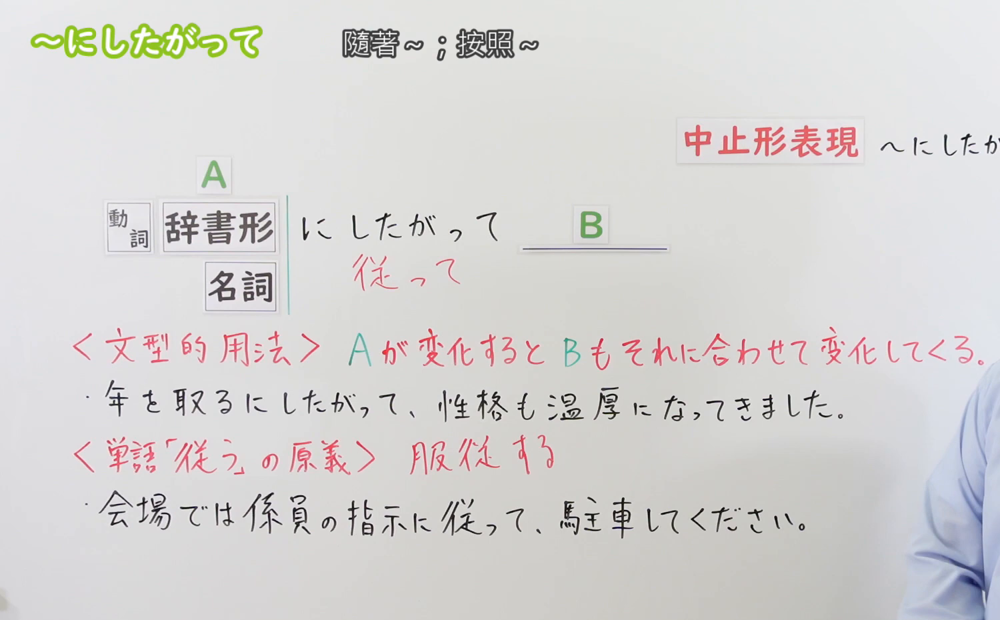
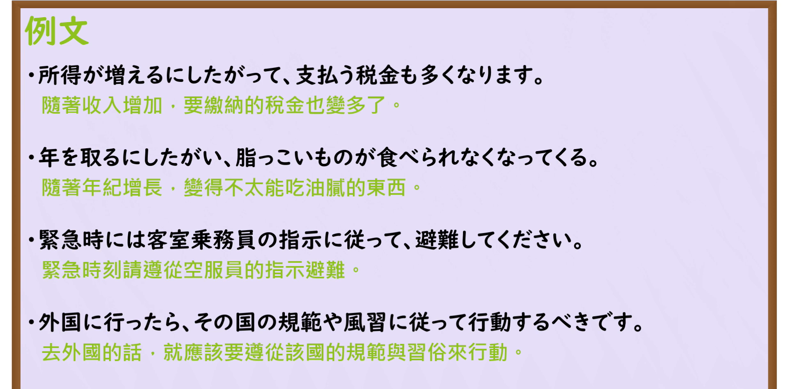

---
{
  "id": "N3-G-0055",
  "kind": "grammar",
  "level": "N3",
  "title": "〜に従って／〜に従い（随着……／遵照……）",
  "card_revision": 1,
  "schema_version": 1,
  "source": {
    "lesson": "N3 第55个语法",
    "material": "出口日語原视频板书、日语自动字幕与Hagoromo文型检索正文",
    "video": "https://www.youtube.com/watch?v=HhOaWKpx1U8",
    "screenshot": "assets/grammar/n3/N3-G-0055-connection.png",
    "screenshot_seconds": 176,
    "screenshot_crop": {
      "x": 0,
      "y": 0,
      "width": 1500,
      "height": 930
    }
  },
  "tags": [
    "にしたがって",
    "にしたがい",
    "N3"
  ],
  "confusions": [
    "〜につれて",
    "〜に伴って",
    "〜とおりに"
  ]
}
---

# N3 第55个语法：〜に従って／〜に従い

# 视频学习资料整理

本课讲解 N3 语法形式「〜に従って／〜に従い」。

## 接续图（板书与讲解）

- 视频链接：[出口日語 N3 第55个语法](https://www.youtube.com/watch?v=HhOaWKpx1U8)
- 真实时间：02:56（176.00秒）
- 原图尺寸：1920×1080
- 裁切说明：选用 02:56 画面，此时画面左上方语法标题与中文释义「〜にしたがって 隨著〜；按照〜」清晰无渐隐，板书已完整书写两大接续与语义支柱：一是「動詞辞書形・名詞＋に従って」表示自然比例变化（随着），二是「名詞＋に従って」表示遵从指示或规则（依照）；出口老师特别总结了书面中止形「〜に従い」。固定左上角（0, 0），裁切区域为宽 1500、高 930，去除右侧人像与底部空白，完整保留全部板书与顶部标题。
- 图片：

## 例句图（视频例句）

- 视频链接：[出口日語 N3 第55个语法](https://www.youtube.com/watch?v=HhOaWKpx1U8)
- 真实时间：03:18（198.00秒）
- 原图尺寸：1920×1080
- 裁切说明：提取自视频 03:18 处的例句黑板页面。固定左上角（0, 0），裁切区域为宽 1920、高 950，裁去底部多余边框与杂物，完整保留四条例句及中文翻译。
- 图片：

# 核心

## 功能一：表示伴随前项事态的推移变化，后项事态按比例产生联动变化（随着……）

**最上位意味カテゴリー：**

- **にしたがって：** ものごとの関係（事物之间的关系）

**中位意味カテゴリー：**

- **にしたがって：** 関連・対応（关联与呼应）

**意味：**

- **にしたがって：** 変化の相関（比例伴随推移）

**くわしい意味記述：**

- **にしたがって：** 「〜が変化すると，〜も変化する」という意味を表す。（前项通常接表示自然推移或程度变化的动词辞书形或变化性名词，表示一方发生渐进变化，另一方也与之保持比例联动改变；书面语常用中止形「〜に従い」）。

### 例句

1. 所得が増えるにしたがって、支払う税金も多くなります。

   （随着个人所得增加，需要缴纳的税款也会相应增多。）

2. 年を取るに従い、脂っこい料理がだんだん食べられなくなってくる。

   （随着年龄渐长，油腻的食物渐渐变得难以下咽了。）

3. 知っている単語が増えるにしたがって、聞き取り能力も上がっていきます。

   （随着掌握的词汇量日益增多，听力理解能力也会随之稳步提升。）

## 功能二：表示服从、遵从前项的规则、指示、法律或引导采取行动（遵照……／依照……）

**最上位意味カテゴリー：**

- **にしたがって：** ものごとの関係（事物之间的关系）

**中位意味カテゴリー：**

- **にしたがって：** 関連・対応（关联与规范）

**意味：**

- **にしたがって：** 対応（服从准则与行动依据）

**くわしい意味記述：**

- **にしたがって：** 規則・指示・方針・予定などにそのまま合わせることを表す。（严格按照规章、法纪、长辈或专业人士的指示、规范行事，不做违背）。

### 例句

1. 緊急時には、客室乗務員の指示に従って冷静に避難してください。

   （发生紧急情况时，请听从机舱乘务人员的指示冷静撤离避难。）

2. 外国に行ったら、その国の法律や社会規範に従って行動するべきです。

   （如果前往外国，就应当遵守并依照该国的法律与社会规范行事。）

3. 先生のアドバイスに従って練習を続けた結果、見事に試験に合格した。

   （按照老师的建议持续练习，最终顺利通过了考试。）

# 来源

- [出口日語原视频](https://www.youtube.com/watch?v=HhOaWKpx1U8)
- [Hagoromo 文型検索「にしたがって」](https://hagoromo-text.work/lookup?vid=1264)（查询日期：2026-09-25）
