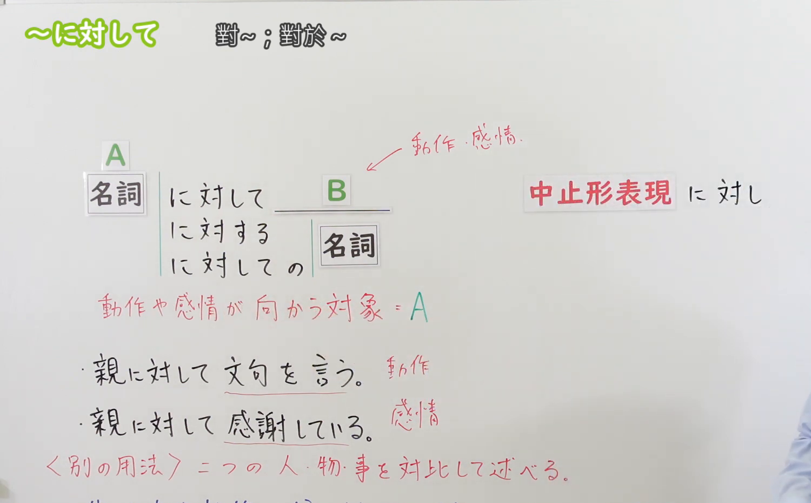
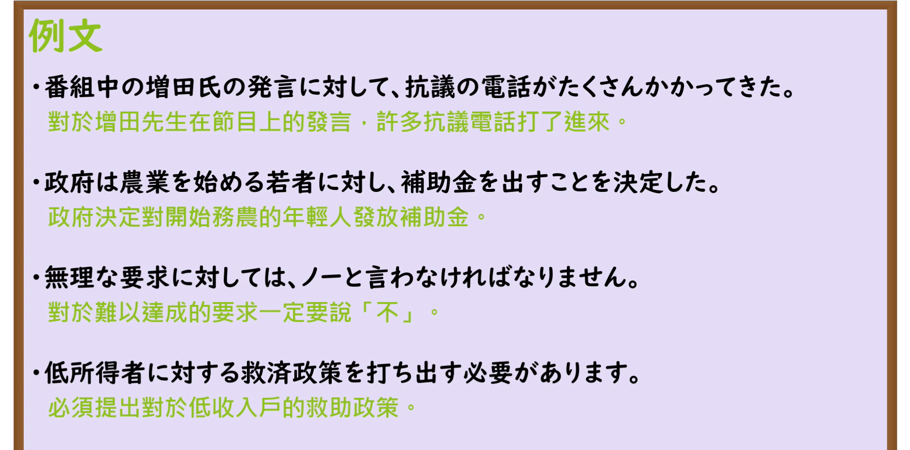

---
{
  "id": "N3-G-0056",
  "kind": "grammar",
  "level": "N3",
  "title": "〜に対して／〜に対する（对……／针对……；与……相对）",
  "card_revision": 1,
  "schema_version": 1,
  "source": {
    "lesson": "N3 第56个语法",
    "material": "出口日語原视频板书、日语自动字幕与Hagoromo文型检索正文",
    "video": "https://www.youtube.com/watch?v=0IWbG_0KSjs",
    "screenshot": "assets/grammar/n3/N3-G-0056-connection.png",
    "screenshot_seconds": 194,
    "screenshot_crop": {
      "x": 0,
      "y": 0,
      "width": 1500,
      "height": 930
    }
  },
  "tags": [
    "に対して",
    "に対する",
    "N3"
  ],
  "confusions": [
    "〜について",
    "〜にとって",
    "〜に比べて"
  ]
}
---

# N3 第56个语法：〜に対して／〜に対する

# 视频学习资料整理

本课讲解 N3 语法形式「〜に対して／〜に対する」。

## 接续图（板书与讲解）

- 视频链接：[出口日語 N3 第56个语法](https://www.youtube.com/watch?v=0IWbG_0KSjs)
- 真实时间：03:14（194.00秒）
- 原图尺寸：1920×1080
- 裁切说明：选用 03:14 画面，此时画面左上方语法标题与中文释义「〜に対して 對〜；向〜；相對於〜」清晰无渐隐，板书已完整书写接续形式「名詞＋に対して／に対する＋名詞」以及书面体「〜に対し」与郑重体「〜に対しまして」；出口老师在板书中清晰划分了行为动作指向对象（对……）与性质对比（与……相对）两大核心功能。固定左上角（0, 0），裁切区域为宽 1500、高 930，去除右侧人像与底部空白，完整保留全部板书与顶部标题。
- 图片：

## 例句图（视频例句）

- 视频链接：[出口日語 N3 第56个语法](https://www.youtube.com/watch?v=0IWbG_0KSjs)
- 真实时间：03:38（218.00秒）
- 原图尺寸：1920×1080
- 裁切说明：提取自视频 03:38 处的例句黑板页面。固定左上角（0, 0），裁切区域为宽 1920、高 950，裁去底部多余边框与杂物，完整保留四条例句及中文翻译。
- 图片：

# 核心

## 功能一：引出言语、动作、情感或政策所指向的直接对象或目标（对……／针对……）

**最上位意味カテゴリー：**

- **に対して：** ものごとの関係（事物之间的关系）

**中位意味カテゴリー：**

- **に対して：** 関連・対応（关联与对象指向）

**意味：**

- **に対して：** 対応（动作与态度之承受目标）

**くわしい意味記述：**

- **に対して：** 言葉や感情が働きかける対象を表す。（表示向某对象提出言语、态度、情感倾注或实施具体行为政策；修饰后项名词时用「〜に対する＋名詞」，书面体可作「〜に対し」，郑重体可作「〜に対しまして」）。

### 例句

1. 番組中の増田氏の発言に対して、視聴者から抗議の電話がたくさんかかってきた。

   （针对节目中增田先生的发言，很多观众打来了抗议电话。）

2. 政府は農業を始める若者に対し、補助金を支給することを決定した。

   （政府决定针对投身农业的青年群体发放扶持补助金。）

3. 相手の無理な要求に対しては、曖昧にせず「NO」と言わなければなりません。

   （面对对方不合理的要求，绝不能含糊其辞，必须明确拒绝。）

4. 社会的弱者や低所得者に対する実効性のある救済政策を打ち出す必要がある。

   （有必要针对社会弱势群体与低收入者出台切实有效的救助政策。）

## 功能二：将两个事物或两方特征进行对照，表示鲜明的正反对比（与……相对／相反）

**最上位意味カテゴリー：**

- **に対して：** ものごとの関係（事物之间的关系）

**中位意味カテゴリー：**

- **に対して：** 対比（对比与映衬）

**意味：**

- **に対して：** 対比（截然相反特征之鲜明对照）

**くわしい意味記述：**

- **に対して：** XとYの２つの事物について，その性質を対照的に示す時に使う。（将前后两种事物、性格、状况截然相反的特点形成鲜明比照；亦可接动词简体小句「〜のに対して」）。

### 例句

1. 兄が社交的で友人が多いのに対して、弟は物静かで家で読書をするのが好きだ。

   （哥哥性格开朗外向朋友众多，相比之下弟弟则文静内向喜欢在家看书。）

2. 昨日は大雨だったのに対して、今日は朝から爽やかに晴れ渡っている。

   （昨天还是暴雨如注，与之相对今天一早便是晴空万里。）

3. 都心部で若年層の人口が増えているのに対して、地方では過疎化が一層進んでいる。

   （大都市中心区域年轻人数量在增长，与此相对地方各县的空心化却愈发严峻。）

# 来源

- [出口日語原视频](https://www.youtube.com/watch?v=0IWbG_0KSjs)
- [Hagoromo 文型検索「にたいして」](https://hagoromo-text.work/lookup?vid=1292)（查询日期：2026-09-25）
