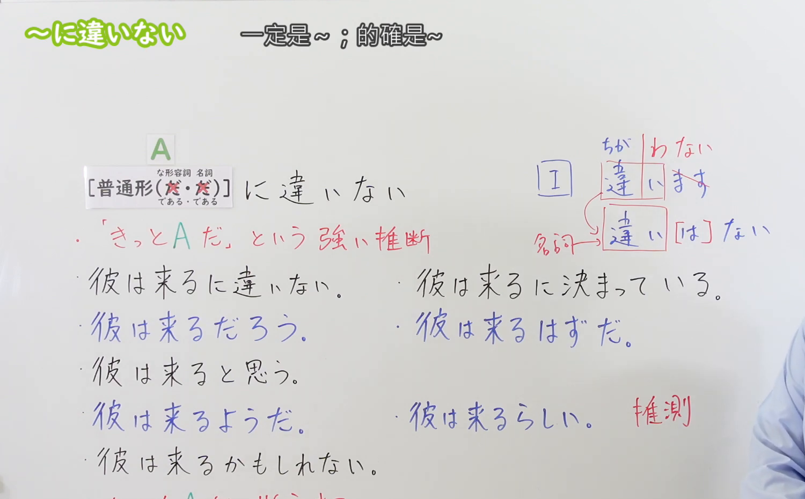
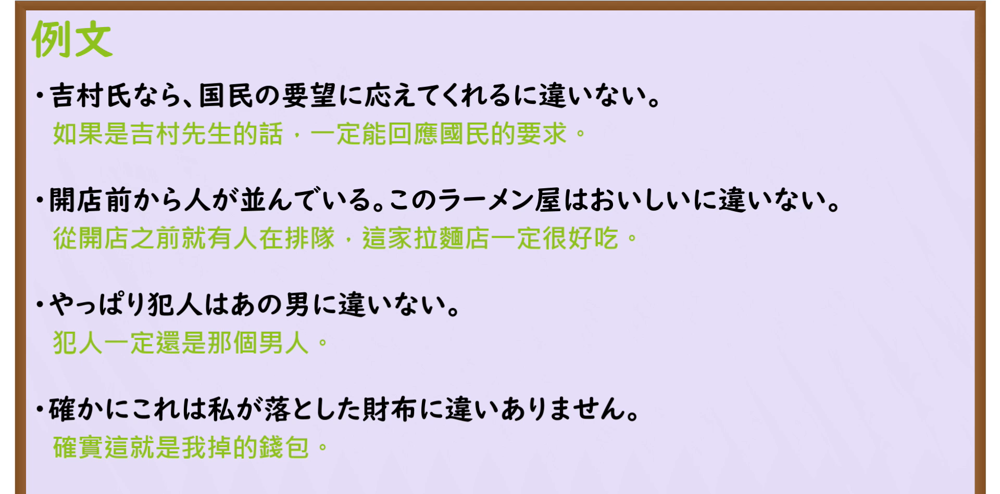

---
{
  "id": "N3-G-0057",
  "kind": "grammar",
  "level": "N3",
  "title": "〜に違いない（肯定……／一定是……）",
  "card_revision": 1,
  "schema_version": 1,
  "source": {
    "lesson": "N3 第57个语法",
    "material": "出口日語原视频板书、日语自动字幕与Hagoromo文型检索正文",
    "video": "https://www.youtube.com/watch?v=d3L-xJCuRVc",
    "screenshot": "assets/grammar/n3/N3-G-0057-connection.png",
    "screenshot_seconds": 363,
    "screenshot_crop": {
      "x": 0,
      "y": 0,
      "width": 1500,
      "height": 930
    }
  },
  "tags": [
    "に違いない",
    "に違いありません",
    "N3"
  ],
  "confusions": [
    "〜に決まっている",
    "〜はずだ",
    "〜かもしれない"
  ]
}
---

# N3 第57个语法：〜に違いない

# 视频学习资料整理

本课讲解 N3 语法形式「〜に違いない」。

## 接续图（板书与讲解）

- 视频链接：[出口日語 N3 第57个语法](https://www.youtube.com/watch?v=d3L-xJCuRVc)
- 真实时间：06:03（363.00秒）
- 原图尺寸：1920×1080
- 裁切说明：选用 06:03 画面，此时画面左上方语法标题与中文释义「〜に違いない 一定是〜；肯定〜」清晰无渐隐，板书已完整书写接续规则「普通形＋に違いない（な形語幹・名詞は「だ」なし直接接続）」与郑重体「〜に違いありません」；出口老师在板书中特别辨析了该句型依据明确线索展开推理的严谨客观语气。固定左上角（0, 0），裁切区域为宽 1500、高 930，去除右侧人像与底部空白，完整保留全部板书与顶部标题。
- 图片：

## 例句图（视频例句）

- 视频链接：[出口日語 N3 第57个语法](https://www.youtube.com/watch?v=d3L-xJCuRVc)
- 真实时间：06:26（386.00秒）
- 原图尺寸：1920×1080
- 裁切说明：提取自视频 06:26 处的例句黑板页面。固定左上角（0, 0），裁切区域为宽 1920、高 950，裁去底部多余边框与杂物，完整保留四条例句及中文翻译。
- 图片：

# 核心

## 功能一：依据确凿依据或客观事实，作出极高确信度的严谨推断与断定（肯定……／一定是……）

**最上位意味カテゴリー：**

- **に違いない：** 考え・感情（思想与情感）

**中位意味カテゴリー：**

- **に違いない：** 推量（推理与推断）

**意味：**

- **に違いない：** 推量：強い確信（依据线索的高度确信）

**くわしい意味記述：**

- **に違いない：** 何らかの根拠にもとづいて，話し手が強く確信していることを表す。かたい表現。（说话人基于眼前的线索、常识或推理，以极其确定的心态断定某事“必定如此，绝无差错”；语气比「〜に決まっている」更加严谨、书面，可用于郑重场合。郑重礼貌体为「〜に違いありません」；名词与な形容词直接接续，不加「だ」）。

### 例句

1. 吉村氏なら、国民の切実な要望に応えてくれるに違いない。

   （如果是吉村先生的话，必定能够切实回应广大国民的殷切期盼。）

2. 開店前から大勢の人が並んでいる。このラーメン屋は美味しいに違いない。

   （还没开门就有大批顾客在排队。这家拉面店的味道肯定错不了。）

3. 防犯カメラの映像を見れば、犯人はあの怪しい男に違いない。

   （看了监控录像的画面，凶手必定是那个可疑男子无疑。）

4. 確かにこれは私が駅のベンチに置き忘れてしまった財布に違いありません。

   （这确实千真万确就是我不慎遗落在车站长椅上的钱包。）

# 来源

- [出口日語原视频](https://www.youtube.com/watch?v=d3L-xJCuRVc)
- [Hagoromo 文型検索「にちがいない」](https://hagoromo-text.work/lookup?vid=1302)（查询日期：2026-09-25）
