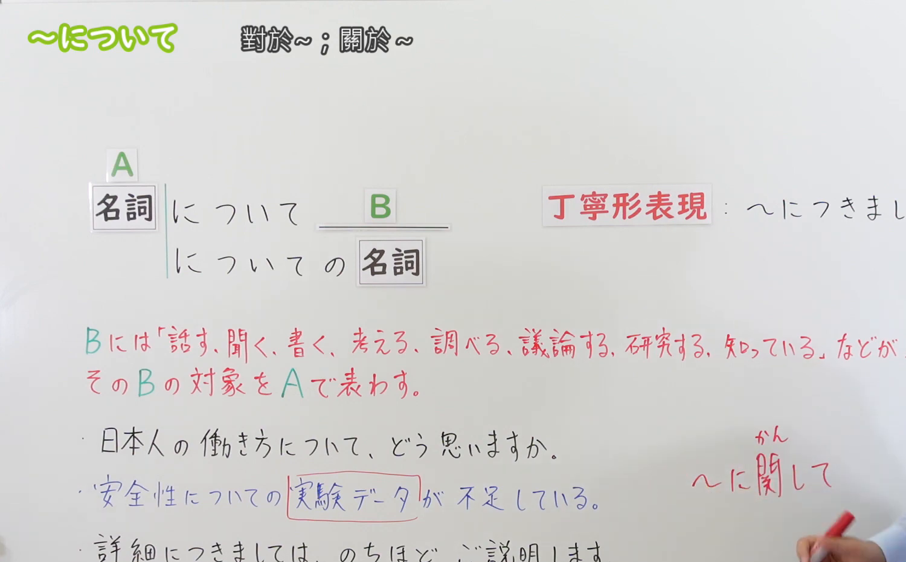
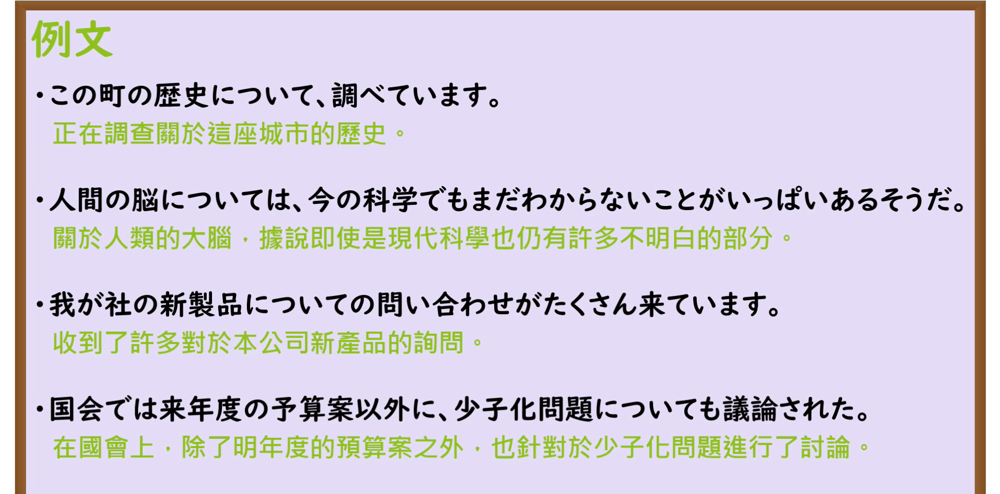

---
{
  "id": "N3-G-0058",
  "kind": "grammar",
  "level": "N3",
  "title": "〜について（关于……／就……）",
  "card_revision": 1,
  "schema_version": 1,
  "source": {
    "lesson": "N3 第58个语法",
    "material": "出口日語原视频板书、日语自动字幕与Hagoromo文型检索正文",
    "video": "https://www.youtube.com/watch?v=_pvv-aU--5Y",
    "screenshot": "assets/grammar/n3/N3-G-0058-connection.png",
    "screenshot_seconds": 166,
    "screenshot_crop": {
      "x": 0,
      "y": 0,
      "width": 1500,
      "height": 930
    }
  },
  "tags": [
    "について",
    "につき",
    "N3"
  ],
  "confusions": [
    "〜に関して",
    "〜に対して",
    "〜をめぐって"
  ]
}
---

# N3 第58个语法：〜について

# 视频学习资料整理

本课讲解 N3 语法形式「〜について」。

## 接续图（板书与讲解）

- 视频链接：[出口日語 N3 第58个语法](https://www.youtube.com/watch?v=_pvv-aU--5Y)
- 真实时间：02:46（166.00秒）
- 原图尺寸：1920×1080
- 裁切说明：选用 02:46 画面，此时画面左上方语法标题与中文释义「〜について 關於〜；就〜」清晰无渐隐，板书已完整书写接续规则「名詞＋について」以及修饰体「〜についての＋名詞」与硬语形式「〜につき／〜につきまして」；出口老师在板书中详细说明该句型广泛用于引出调查、发言、思考与讨论的核心主题。固定左上角（0, 0），裁切区域为宽 1500、高 930，去除右侧人像与底部空白，完整保留全部板书与顶部标题。
- 图片：

## 例句图（视频例句）

- 视频链接：[出口日語 N3 第58个语法](https://www.youtube.com/watch?v=_pvv-aU--5Y)
- 真实时间：03:12（192.00秒）
- 原图尺寸：1920×1080
- 裁切说明：提取自视频 03:12 处的例句黑板页面。固定左上角（0, 0），裁切区域为宽 1920、高 950，裁去底部多余边框与杂物，完整保留四条例句及中文翻译。
- 图片：

# 核心

## 功能一：引出思考、言语陈述、调查研究或咨询讨论所围绕的主题内容（关于……／就……）

**最上位意味カテゴリー：**

- **について：** ものごとの関係（事物之间的关系）

**中位意味カテゴリー：**

- **について：** 関連・対応（关联与对应）

**意味：**

- **について：** 対応（动作与思维所指向之主题）

**くわしい意味記述：**

- **について：** 発言・思考・調査などの対象を表す。（引出动作（如调查、叙述、思考、讨论、询问等）所涉及的中心议题、事物或领域；修饰后项名词时用「〜についての＋名詞」，郑重场合可作「〜につき／〜につきまして」）。

### 例句

1. 私は今、大学のゼミでこの町の歴史について詳しく調べています。

   （我目前正在大学的讨论课上，就这座城镇的历史展开深入调研。）

2. 人間の脳の働きについては、現代の先端科学でもまだ未解明な点が多いそうだ。

   （关于人类大脑的运作机制，据说即使用现代尖端科学也仍有诸多未解之谜。）

3. 発表直後から、我が社の新製品についての問い合わせがたくさん寄せられている。

   （从发布会刚刚结束起，关于我们公司新产品的咨询电话便接踵而至。）

4. 今日の国会審議では、来年度の予算案以外に少子化問題についても議論された。

   （在今天的国会审议中，除了下一财年的预算案外，还围绕少子化对策展开了讨论。）

# 来源

- [出口日語原视频](https://www.youtube.com/watch?v=_pvv-aU--5Y)
- [Hagoromo 文型検索「について」](https://hagoromo-text.work/lookup?vid=1303)（查询日期：2026-09-25）
