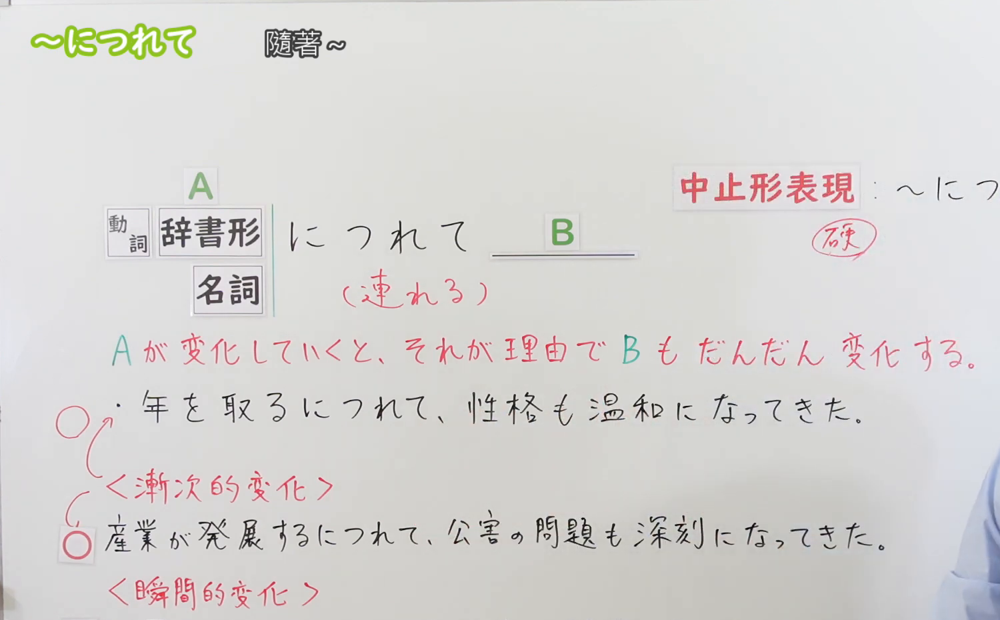
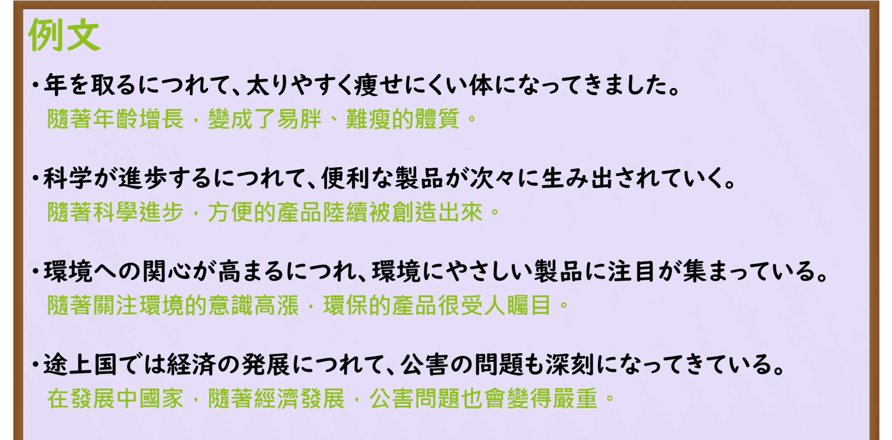

---
{
  "id": "N3-G-0059",
  "kind": "grammar",
  "level": "N3",
  "title": "〜につれて／〜につれ（随着……／伴随着……）",
  "card_revision": 1,
  "schema_version": 1,
  "source": {
    "lesson": "N3 第59个语法",
    "material": "出口日語原视频板书、日语自动字幕与Hagoromo文型检索正文",
    "video": "https://www.youtube.com/watch?v=NWBRG-5umrc",
    "screenshot": "assets/grammar/n3/N3-G-0059-connection.png",
    "screenshot_seconds": 232,
    "screenshot_crop": {
      "x": 0,
      "y": 0,
      "width": 1500,
      "height": 930
    }
  },
  "tags": [
    "につれて",
    "につれ",
    "N3"
  ],
  "confusions": [
    "〜にしたがって",
    "〜に伴って",
    "〜とともに"
  ]
}
---

# N3 第59个语法：〜につれて／〜につれ

# 视频学习资料整理

本课讲解 N3 语法形式「〜につれて／〜につれ」。

## 接续图（板书与讲解）

- 视频链接：[出口日語 N3 第59个语法](https://www.youtube.com/watch?v=NWBRG-5umrc)
- 真实时间：03:52（232.00秒）
- 原图尺寸：1920×1080
- 裁切说明：选用 03:52 画面，此时画面左上方语法标题与中文释义「〜につれて 隨著〜；伴隨著〜」清晰无渐隐，板书已完整书写接续规则「動詞辞書形・名詞＋につれて」与书面中止形「〜につれ」；出口老师在板书中清晰辨析了其与「〜にしたがって」的区别，强调「〜につれて」专用于自然、单向且伴随发生的客观渐变推移，后项不能包含说话人的主观意志命令。固定左上角（0, 0），裁切区域为宽 1500、高 930，去除右侧人像与底部空白，完整保留全部板书与顶部标题。
- 图片：

## 例句图（视频例句）

- 视频链接：[出口日語 N3 第59个语法](https://www.youtube.com/watch?v=NWBRG-5umrc)
- 真实时间：04:20（260.00秒）
- 原图尺寸：1920×1080
- 裁切说明：提取自视频 04:20 处的例句黑板页面。固定左上角（0, 0），裁切区域为宽 1920、高 950，裁去底部多余边框与杂物，完整保留四条例句及中文翻译。
- 图片：

# 核心

## 功能一：表示伴随前项程度或事态的自然推移演进，后项自然而然产生联动变化（随着……）

**最上位意味カテゴリー：**

- **につれて：** ものごとの関係（事物之间的关系）

**中位意味カテゴリー：**

- **につれて：** 関連・対応（关联与对应）

**意味：**

- **につれて：** 変化の相関（自然伴随联动推移）

**くわしい意味記述：**

- **につれて：** 「〜の程度が変化すると，それが理由となって〜の程度も変化する」という意味を表す。（前项多接表示时间推移、程度增减的动词辞书形或动作名词，表示前项渐进发生，后项自然伴随变化；后项必须是自发的变化状态，不能包含主观意志、命令或要求。书面语可作中止形「〜につれ」）。

### 例句

1. 年を取るにつれて、太りやすく痩せにくい体質になってきました。

   （随着年龄渐长，体质逐渐变成了容易发胖却极难瘦下去的状态。）

2. 科学技術が進歩するにつれて、日々の暮らしを豊かにする製品が生み出されていく。

   （随着科学技术的不断进步，使日常生活更加丰富便利的各类产品被接连创造出来。）

3. 環境問題への関心が高まるにつれ、エコ製品への注目が世界中で集まっている。

   （随着人们对环境问题关注度的日益升温，环保产品正受到全世界的瞩目。）

4. 開発途上国では経済の急速な発展につれて、大気汚染などの公害問題も深刻化している。

   （在发展中国家，伴随着经济的飞速发展，大气污染等公害问题也日益严峻。）

# 来源

- [出口日語原视频](https://www.youtube.com/watch?v=NWBRG-5umrc)
- [Hagoromo 文型検索「につれて」](https://hagoromo-text.work/lookup?vid=1318)（查询日期：2026-09-25）
