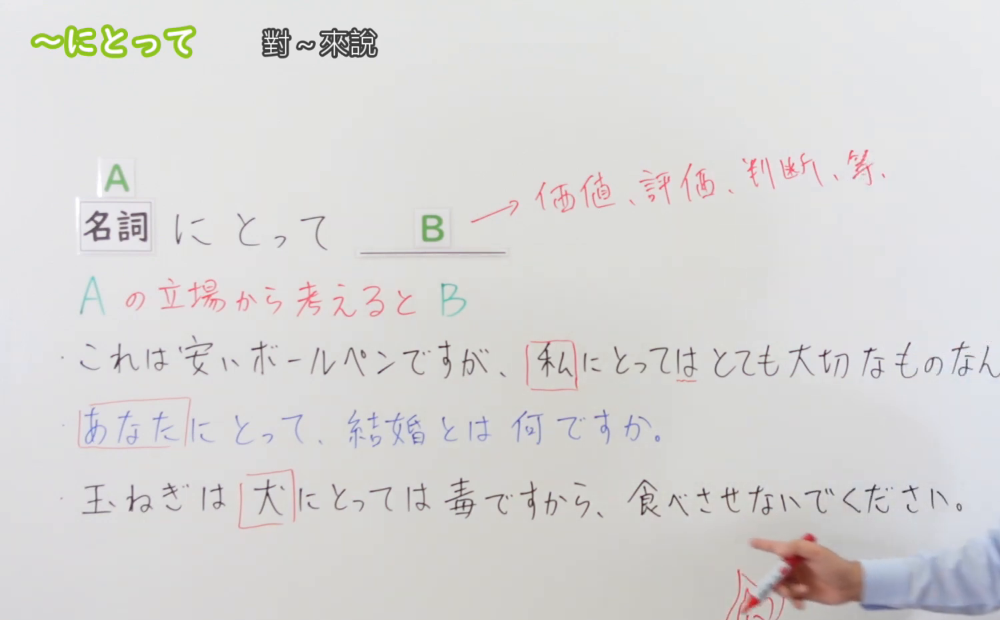
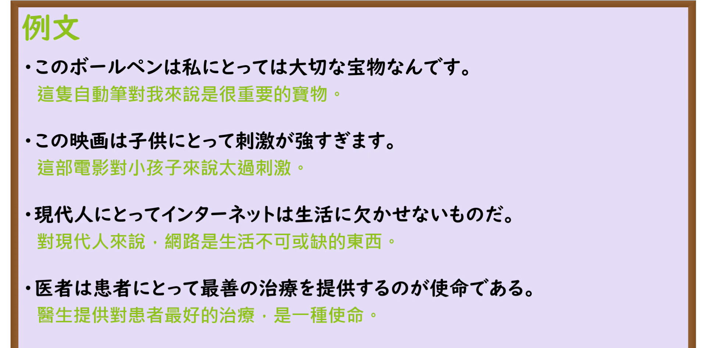

---
{
  "id": "N3-G-0060",
  "kind": "grammar",
  "level": "N3",
  "title": "〜にとって（对……来说／从……的立场来看）",
  "card_revision": 1,
  "schema_version": 1,
  "source": {
    "lesson": "N3 第60个语法",
    "material": "出口日語原视频板书、日语自动字幕与Hagoromo文型检索正文",
    "video": "https://www.youtube.com/watch?v=0xYBhBw8Xzc",
    "screenshot": "assets/grammar/n3/N3-G-0060-connection.png",
    "screenshot_seconds": 180,
    "screenshot_crop": {
      "x": 0,
      "y": 0,
      "width": 1500,
      "height": 930
    }
  },
  "tags": [
    "にとって",
    "にとっては",
    "N3"
  ],
  "confusions": [
    "〜に対して",
    "〜について",
    "〜として"
  ]
}
---

# N3 第60个语法：〜にとって

# 视频学习资料整理

本课讲解 N3 语法形式「〜にとって」。

## 接续图（板书与讲解）

- 视频链接：[出口日語 N3 第60个语法](https://www.youtube.com/watch?v=0xYBhBw8Xzc)
- 真实时间：03:00（180.00秒）
- 原图尺寸：1920×1080
- 裁切说明：选用 03:00 画面，此时画面左上方语法标题与中文释义「〜にとって 對〜來說；從〜的立場來看」清晰无渐隐，板书已完整书写接续规则「名詞（人物・組織）＋にとって／にとっては」以及修饰体「〜にとっての＋名詞」；出口老师在板书中特别强调该句型专用于表明立足于某特定立场所作出的价值评判、主观感受或评价，后项不接行动动作动词。固定左上角（0, 0），裁切区域为宽 1500、高 930，去除右侧人像与底部空白，完整保留全部板书与顶部标题。
- 图片：

## 例句图（视频例句）

- 视频链接：[出口日語 N3 第60个语法](https://www.youtube.com/watch?v=0xYBhBw8Xzc)
- 真实时间：03:32（212.00秒）
- 原图尺寸：1920×1080
- 裁切说明：提取自视频 03:32 处的例句黑板页面。固定左上角（0, 0），裁切区域为宽 1920、高 950，裁去底部多余边框与杂物，完整保留四条例句及中文翻译。
- 图片：

# 核心

## 功能一：提出评价或考量的基准立场，从该人物或团体的角度给出价值判断（对……来说）

**最上位意味カテゴリー：**

- **にとって：** ものごとの関係（事物之间的关系）

**中位意味カテゴリー：**

- **にとって：** 判断の立場（判断之立场视角）

**意味：**

- **にとって：** 評価の基準（主观评价与衡量基准）

**くわしい意味記述：**

- **にとって：** 「ある人や組織の立場から考えると」という意味。（接在表示人、组织、生物等名词后，表示以该主体的立场出发进行思考、权衡，并在后项给出评价、判断、感觉或主观感受；后项通常不用行为动作动词，多为形容词或表示必要、重要性等的评价。修饰名词时用「〜にとっての＋名詞」）。

### 例句

1. この古いボールペンは、私にとってはかけがえのない大切な宝物なんです。

   （这支老旧的圆珠笔，对我本人而言是无法替代的珍贵宝物。）

2. このホラー映画は、小学生の子供にとっては刺激が强すぎるかもしれません。

   （这部恐怖电影，对于小学生年纪的孩子来说刺激或许有些过于强烈了。）

3. 現代人にとって、スマートフォンとインターネットは生活に欠かせないものだ。

   （对现代人来说，智能手机与互联网早已是日常生活中不可或缺的存在。）

4. 医師という職業は、患者にとって最善の医療ケアを提供することが第一の使命である。

   （对于医生这一职业而言，为患者提供最为适宜的医疗救治乃是第一天职。）

# 来源

- [出口日語原视频](https://www.youtube.com/watch?v=0xYBhBw8Xzc)
- [Hagoromo 文型検索「にとって」](https://hagoromo-text.work/lookup?vid=1320)（查询日期：2026-09-25）
