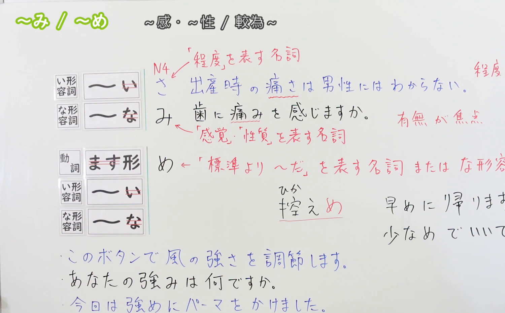
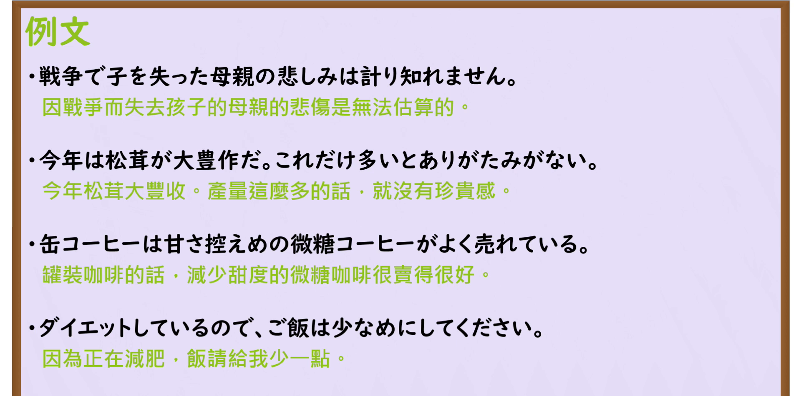

---
{
  "id": "N3-G-0061",
  "kind": "grammar",
  "level": "N3",
  "title": "〜み・〜め（感觉属性名词化／微调倾向接尾辞）",
  "card_revision": 1,
  "schema_version": 1,
  "source": {
    "lesson": "N3 第61个语法",
    "material": "出口日語原视频板书、日语自动字幕与Hagoromo文型检索正文",
    "video": "https://www.youtube.com/watch?v=8MQuEXzHwSc",
    "screenshot": "assets/grammar/n3/N3-G-0061-connection.png",
    "screenshot_seconds": 256,
    "screenshot_crop": {
      "x": 0,
      "y": 0,
      "width": 1500,
      "height": 930
    }
  },
  "tags": [
    "み",
    "め",
    "N3"
  ],
  "confusions": [
    "〜さ",
    "〜げ",
    "〜っぽい"
  ]
}
---

# N3 第61个语法：〜み・〜め

# 视频学习资料整理

本课讲解 N3 语法形式「〜み・〜め」。

## 接续图（板书与讲解）

- 视频链接：[出口日語 N3 第61个语法](https://www.youtube.com/watch?v=8MQuEXzHwSc)
- 真实时间：04:16（256.00秒）
- 原图尺寸：1920×1080
- 裁切说明：选用 04:16 画面，此时画面左上方语法标题与中文释义「〜み・〜め」清晰无渐隐，板书已完整书写接尾辞三大系统横向对比：度量衡客观数值的「〜さ」、主观感觉与属性本质的「〜み（深み・重み・温かみ・強み）」以及带有程度微偏倾向的「〜め（控えめ・濃いめ・少なめ）」；出口老师在板书中特别针对形容词「濃い」的特例「濃いめ（保留い以避免与「米」同音）」进行了重点板书。固定左上角（0, 0），裁切区域为宽 1500、高 930，去除右侧人像与底部空白，完整保留全部板书与顶部标题。
- 图片：

## 例句图（视频例句）

- 视频链接：[出口日語 N3 第61个语法](https://www.youtube.com/watch?v=8MQuEXzHwSc)
- 真实时间：08:45（525.00秒）
- 原图尺寸：1920×1080
- 裁切说明：提取自视频 08:45 处的例句黑板页面。固定左上角（0, 0），裁切区域为宽 1920、高 950，裁去底部多余边框与杂物，完整保留四条例句及中文翻译。
- 图片：

# 核心

## 功能一：将形容词转化为表示主观感受、情感或深层特质的名词（感觉属性名词化）

**最上位意味カテゴリー：**

- **み：** もの・こと（事物与概念）

**中位意味カテゴリー：**

- **み：** 文法のことば（语法性词缀）

**意味：**

- **み：** 接尾語（名词化接尾辞）

**くわしい意味記述：**

- **み：** イAをNとして用いる時に使う。精神に関わる感情を表す。（接在部分イ形容词词干后，将其转化为抽象名词；不同于客观度量衡「〜さ」，「〜み」专用于表现人内心的主观感受、深层情味、感情或固有属性，如悲しみ、温かみ、甘み、苦み、深み、強み等）。

### 例句

1. 戦争で子を失った母親の深い悲しみは、到底計り知れません。

   （战争中失去孩子的母亲内心的深切悲痛，外人根本无法衡量。）

2. 今年は松茸が大豊作だが、これだけ数が多いとありがたみが薄れてしまう。

   （今年松茸大丰收，但数量一多，那种难得可贵的珍惜感就淡薄了。）

3. 面接試験では、自分の強みを的確にアピールすることが大切です。

   （在面试中，准确展示自身的长处与优势至关重要。）

4. この小説には人間の心理の深みが見事に描かれており、読者に強い印象を与える。

   （这部小说生动地刻画了人性的深沉之处，给读者留下了深刻印象。）

## 功能二：表示程度或倾向略微偏向某一方，带有斟酌微调语气（微调倾向接尾辞）

**最上位意味カテゴリー：**

- **み：** ものごとの様子（事物的情态）

**中位意味カテゴリー：**

- **み：** 様子・状態（状态与偏向）

**意味：**

- **み：** 傾向（程度轻微倾向）

**くわしい意味記述：**

- **み：** 標準や平均よりも少しその傾向があることを表す。（接在形容词词干或动词连用形后，表示程度稍许偏大、偏小或有所节制，如多め、少なめ、長め、短め、早め、控えめ、濃いめ、硬め等；常作副词或ナ形容词修饰后续动作或事物）。

### 例句

1. 缶コーヒーは、健康を気遣って甘さ控えめの微糖タイプがよく売れている。

   （罐装咖啡中，出于对健康的考虑，甜度偏淡的微糖型销量很好。）

2. 現在ダイエット中なので、ご飯の量は少なめに盛り付けてください。

   （我目前正在减肥，米饭请盛得稍微少一点。）

3. ラーメン屋の注文で、スープは濃いめ、麺は硬めでお願いした。

   （在拉面店点餐时，我要求汤头稍微浓一点、面条稍微硬一点。）

4. 明日の朝は道路が混雑するおそれがあるため、いつもより早めに出発しよう。

   （明早道路可能会拥堵，我们比平时稍微提前一点出发吧。）

# 来源

- [出口日語原视频](https://www.youtube.com/watch?v=8MQuEXzHwSc)
- [Hagoromo 文型検索「み」](https://hagoromo-text.work/lookup?vid=2014)（查询日期：2026-09-25）
